# Core logic · Service flow & ERD

ตรวจจาก working tree วันที่ 11 ตุลาคม 2026; ไม่ยืนยัน production. Flow คือการส่งต่อระหว่าง service; ERD แสดง FK จริง เฉพาะฟิลด์ที่เกี่ยวกับ core logic ไม่รวม CRUD ทั่วไป

## 01 · End-to-end

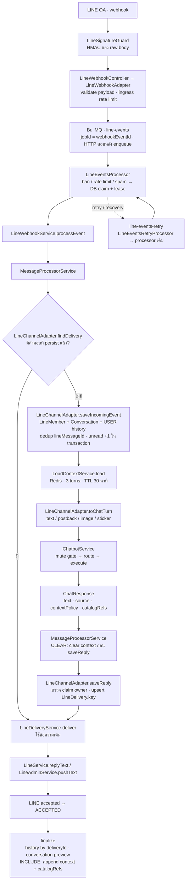

- Queue main concurrency 10; retry concurrency 3. Retryable provider errors ที่หลุดออกจาก main ไป retry queue; webhook recovery scan ทุก 15 วินาที
- การเรียงต่อ user ใช้ userProcessingTails ใน process; ไม่ใช่ distributed lock แม้ event claim เป็น DB lease
- Adapter รับ follow/unfollow แต่ saveIncomingEvent คืน null สำหรับ lifecycle event เหล่านี้ จึงไม่มี chatbot turn; event/message type ที่ไม่รองรับถูก acknowledge โดยไม่ enqueue
- Image จาก LINE ดาวน์โหลดใน adapter ก่อน chatbot mute gate; external image คืน SYSTEM response แบบ EXCLUDE
- Loading indicator เป็น best effort และไม่บล็อก turn. Automatic outbound history ใน finalize ใช้ sender SYSTEM แม้ ChatResponse.source เป็น AI/KNOWLEDGE
- Sources: src/modules/line/line-webhook.adapter.ts, line-signature.guard.ts, line-events.processor.ts, line-webhook.service.ts, line-channel.adapter.ts, line-delivery.service.ts; src/modules/events/message/message-processor.service.ts

## 02 · Chatbot routing

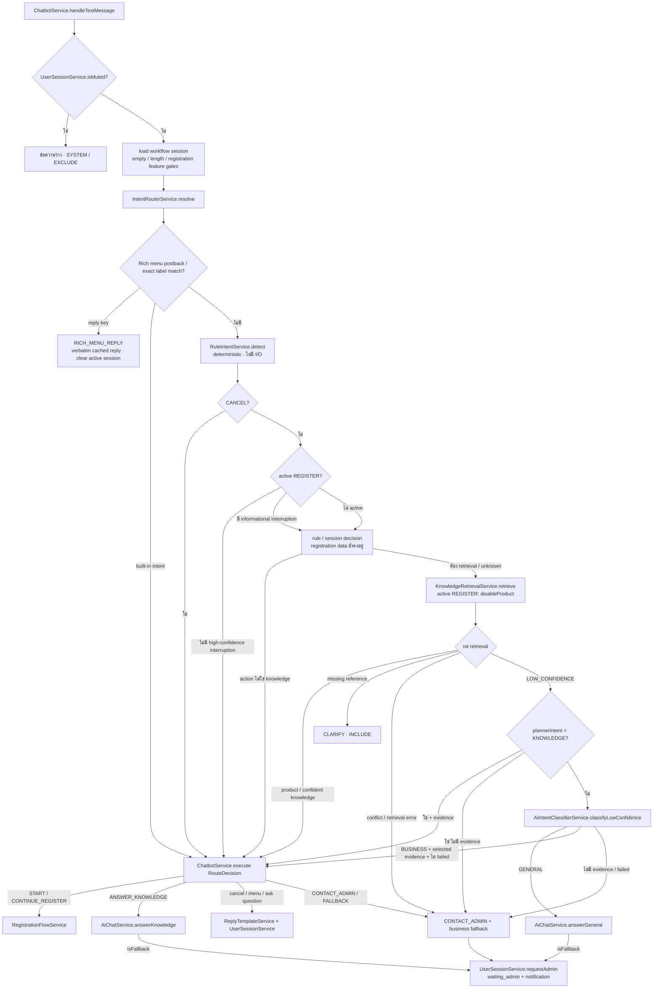

- ลำดับจริง: rich menu มาก่อน rule CANCEL; ไม่ควรอ้างว่า cancel เป็นอันดับแรกของ router เสมอ
- Whole-message inquiry opener ไป CONTINUE_AI_CHAT ก่อน retrieval. START_AI_CHAT ตั้ง GENERAL_QUESTION session เมื่อไม่ได้อยู่ใน active registration
- StickerIntentService: greeting/thanks/unknown ตอบ template แบบ EXCLUDE; TEXT กลับเข้า handleTextMessage. Image ผ่าน AiChatService.answerImage + image safety policy; unsafe/transaction/business-unverified ใช้ fallback + handoff
- Sources: src/modules/chatbot/chatbot.service.ts, intent-router.service.ts, rule-intent.service.ts, sticker-intent.service.ts, ai-intent-classifier.service.ts, image-analysis.policy.ts

## 03 · Knowledge RAG

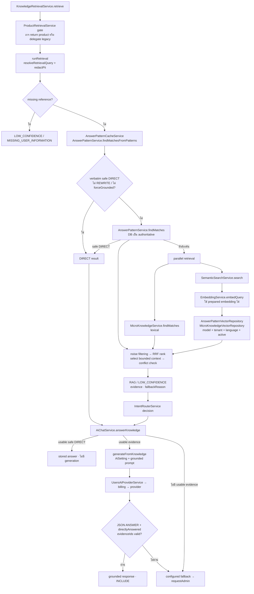

- Retrieval reuse ใน router ส่งต่อให้ AiChatService; ไม่ค้นซ้ำใน path ปกติ. Product gate ที่ตรวจ legacy ใช้ promise เดียวเมื่อ query เดิม
- REWRITE / follow-up / BOTH ที่ forceGrounded ไม่เข้า safe DIRECT. Read failure ที่จำเป็นหรือ conflict ห้าม generate จาก pool ที่ไม่ครบ
- RRF เป็น ranking score; confidence gate ใช้ exact match หรือ cosine similarity ไม่เอา RRF เทียบ threshold ของ cosine
- Sources: src/modules/chatbot/knowledge/knowledge-retrieval.service.ts, semantic-search.service.ts, retrieval-query-planner.service.ts, knowledge-scope.ts; src/modules/chatbot/aichat.service.ts

## 04 · Product RAG

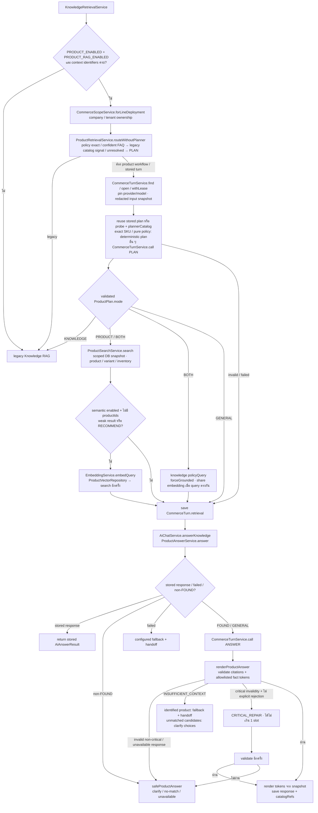

- Durable uniqueness: companyId + connectionKey + externalEventId. CommerceLlmCall unique turnId+slot และ turnId+ordinal; ไม่เกิน 3 calls: PLAN, ANSWER, CRITICAL_REPAIR (บาง turn ไม่ต้องใช้ทุก slot)
- ราคา/stock เป็น DB snapshot ของ turn; vector ช่วยหา candidate ไม่ใช่แหล่งราคา/stock. Product mode ไม่มี checkout/order/payment mutation
- BOTH เมื่อไม่มี policy evidence ตอบ product half พร้อมข้อความว่ policy ยังยืนยันไม่ได้; ไม่แต่ง policy
- Product GENERAL ใช้ general rules ภายใต้ workflow นี้. KNOWLEDGE ส่ง plannerIntent กลับ router เพื่อไม่ classify BUSINESS/GENERAL ซ้ำ
- Feature defaults เป็น false; PRODUCT_SEMANTIC_ENABLED ขึ้นกับสอง flags ก่อนหน้า ไม่ได้อ่าน .env เพื่อสรุป deployment
- Sources: src/modules/chatbot/knowledge/product-retrieval.service.ts, product-answer.service.ts, product-answer.policy.ts; src/modules/commerce/commerce-turn.service.ts, commerce-scope.service.ts, commerce-feature.service.ts; src/modules/products/search/product-search.service.ts

## 05 · Provider & credit lifecycle

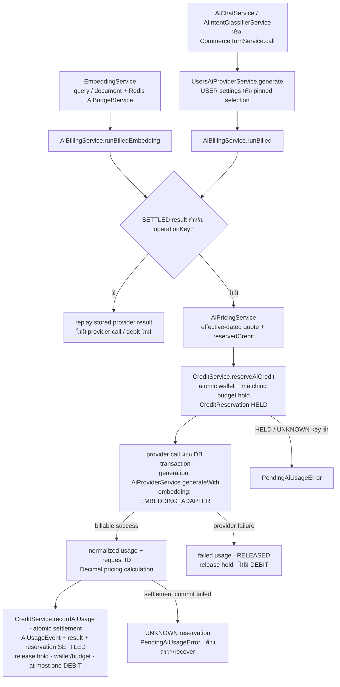

- Generation และ embedding มี billing abstraction ร่วม แต่ embedding ใช้ EMBEDDING_ADAPTER ไม่ได้วิ่งผ่าน UsersAiProviderService/AiProviderService
- AiBudgetService เป็น Redis call limit; CreditBudget เป็น Decimal credit hold/used ใน DB เป็นคนละ gate. Call sites ของ generation ตรวจ AiBudgetService และ pinned product ใช้ beforeCall
- scopeKey แยก document indexing กับ query embedding; ledger amount ของ DEBIT เป็นลบ. Provider result ที่ bill แล้วแต่ถูก answer validator ปฏิเสธ ยังมี usage/charge ตาม provider outcome
- Reservation expiry ไม่มี automatic refund: listUnresolvedReservations เปลี่ยน expired HELD เป็น UNKNOWN; releaseUnknownReservation เป็นการแก้โดยผู้มีสิทธิ์
- Sources: src/modules/ai/users-ai-provider.service.ts, ai-provider.service.ts, embeding/embedding.service.ts; src/modules/usage/billing/ai-billing.service.ts, ai-pricing.service.ts; src/modules/usage/credit-point/credit.service.ts

## 06 · Delivery & recovery

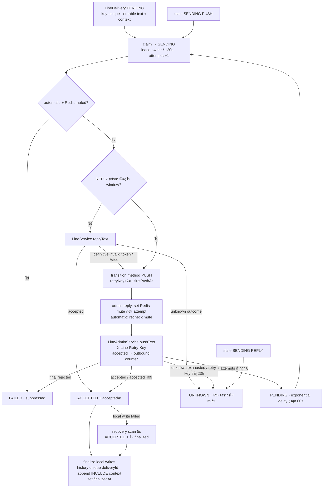

- ReplyUntil = event.timestamp + 50 วินาที; event เก่าไม่ได้ drop เพราะอายุ แต่เลือก PUSH ใน delivery
- Accepted กับ finalizedAt แยกกัน; repair หลัง acceptance ไม่ resend LINE และไม่ generate AI ใหม่
- LineAdminService.pushText ปัจจุบันส่ง HTTP แล้วบันทึก outbound counter; path นี้ไม่มี CreditService debit หรือ quota pre-check จึงไม่วาดว่า LINE_PUSH_MESSAGE ถูก bill อัตโนมัติ
- Sources: src/modules/line/line-delivery.service.ts, line-channel.adapter.ts, line-reply.service.ts, admin/line-admin.service.ts

## 07 · Registration & handoff

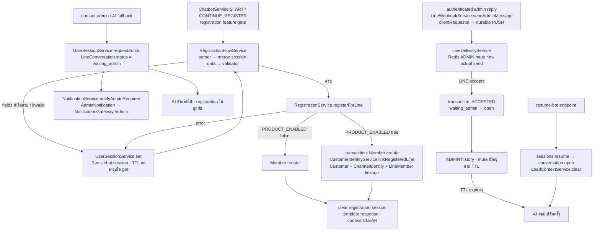

- waiting_admin คือ durable request queue ไม่ใช่ mute. Admin send ที่ไม่ accepted ยังไม่เปิด conversation
- Registration gate และ Product flags เป็นคนละเงื่อนไข; registration PII ไม่ใช้เป็น AI context
- Notification metadata.conversationId เป็น JSON linkage ไม่ใช่ foreign key. Notification failure ถูก catch และไม่มี durable notification outbox ใน path นี้
- Sources: src/modules/registration/registration-flow.service.ts, registration.service.ts; src/modules/users/customers/customer-identity.service.ts; src/modules/chatbot/user-session.service.ts; src/modules/line/line-webhook.service.ts; src/modules/admin/notification/notification.service.ts

## 08 · Product indexing event

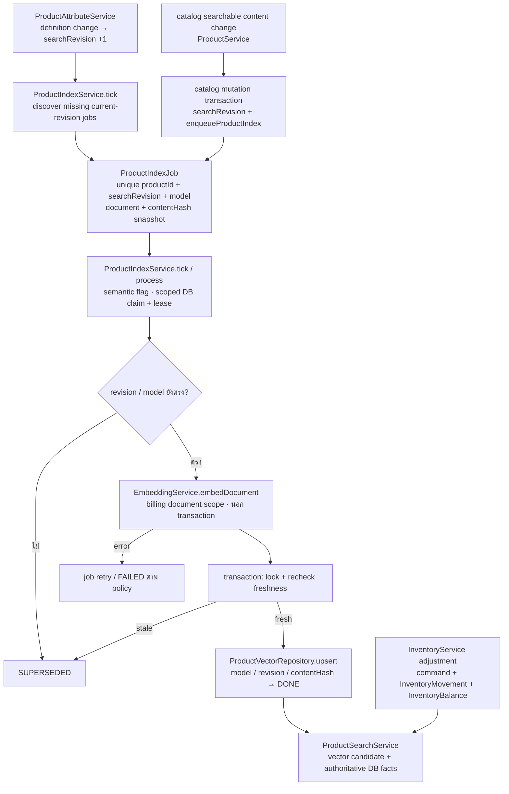

- Indexing เป็น derived-data workflow จึงรวมไว้แม้ไม่แสดง CRUD endpoint. Price/stock ไม่ใช้ vector เป็นแหล่งข้อเท็จจริง; document builder คุม content สำหรับ semantic identity
- ProductCatalogCommand และ InventoryMovement เก็บ originating command/idempotency ของ stock adjustment. แผนภาพนี้ไม่ได้สื่อว่ามี customer checkout/reservation
- Sources: src/modules/products/search/product-index-outbox.ts, product-index.service.ts, product-vector.repository.ts, product-document.ts; src/modules/products/product.service.ts, inventory.service.ts, attributes/product-attribute.service.ts

## 09 · Admin AI turn

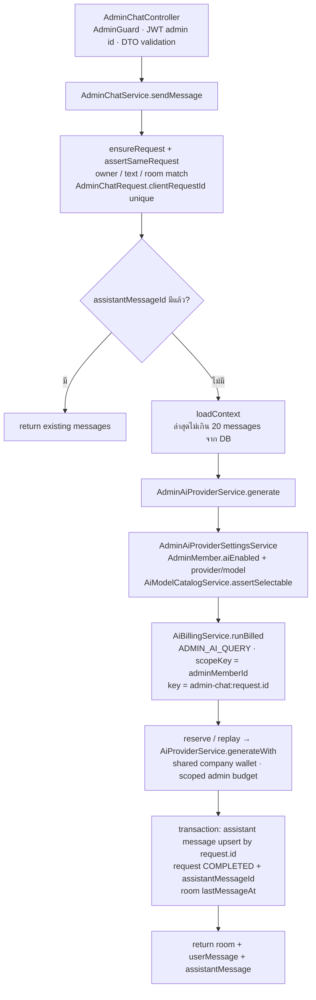

- Admin role ต้องมี budget limit ตาม requireBudgetLimit; owner/dev ใช้เงื่อนไข setting.role ตามโค้ด. Admin AI query ไม่ส่ง LINE และไม่ได้เข้าลูกค้า IntentRouterService
- clientRequestId ที่ไม่ส่งมาจะสร้าง UUID ใหม่; client ต้อง reuse ID เดิมเพื่อ retry เป็น turn เดิม. Provider success ที่ billing settle แล้วแต่ local persist ล้มสามารถ replay ด้วย request เดิม
- Sources: src/modules/admin/ai-chat/admin-chat.controller.ts, admin-chat.service.ts; src/modules/ai/admin-ai-provider.service.ts, ai-setting/admin-ai-provider-settings.service.ts

## 10 · Credit top-up event

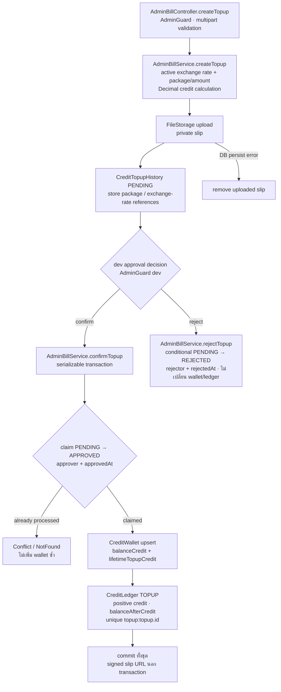

- Top-up เป็น internal credit workflow แยกจาก product/order payment; approval ต้อง dev ตาม controller ปัจจุบัน ไม่ใช่ OCR หรือ AI ตรวจสลิป
- Approval failure rollback ทั้ง status/wallet/ledger; repeated APPROVED request คืน Conflict ตาม implementation ไม่ใช่ success replay
- Sources: src/modules/admin/bill/admin-bill.controller.ts, admin-bill.service.ts; prisma/models/admin/wallet.schema.prisma

## 11 · ERD — Conversation & identity

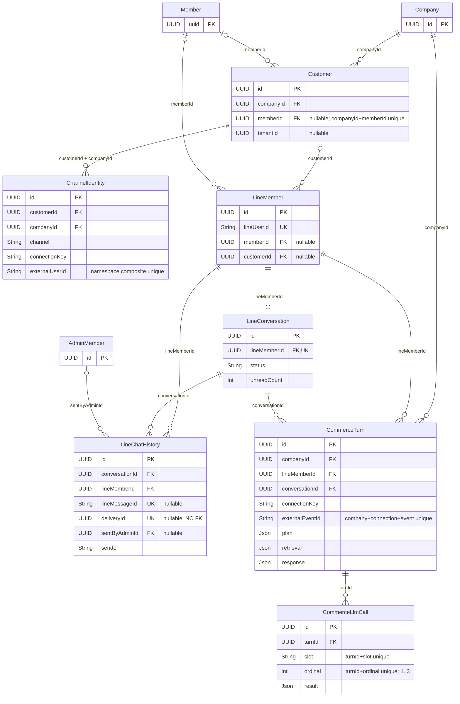

- Company→LineConversation และ Company→LineMember ไม่มี direct FK; LINE deployment เป็น single Company/OA. Customer/CommerceTurn เพิ่ม company scope ตาม schema จริง
- Sources: prisma/schema.prisma, prisma/member.prisma, prisma/models/customers/customer.prisma, prisma/models/customers/commerce-turn.prisma

## 12 · ERD — Knowledge & delivery records

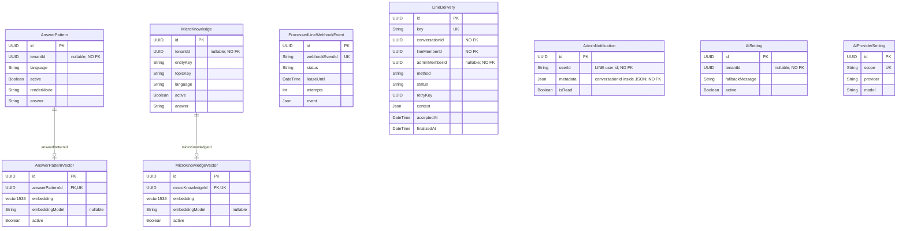

- กล่องที่ไม่เชื่อมกันตั้งใจสะท้อนว่าไม่มี FK. เชื่อมเชิง logic: event.webhookEventId = LineDelivery.key; LineChatHistory.deliveryId = LineDelivery.id; notification.metadata.conversationId = conversation.id
- Redis chat:session, chat:control, chat:context และ cache ไม่ใช่ PostgreSQL entities
- Sources: prisma/schema.prisma; migrations ของ webhook/delivery ใน prisma/migrations/20260907000000_fix_mvp_release_blockers/migration.sql

## 13 · ERD — Product & derived index

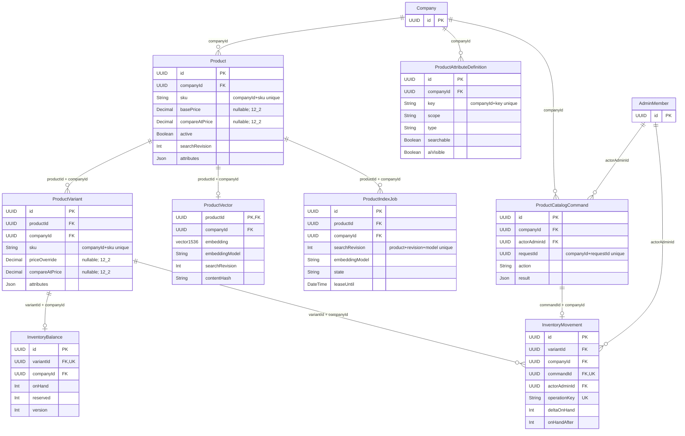

- ProductAttributeDefinition.key ใช้เป็น key ใน attributes JSON; ไม่มี Product→Definition FK. Composite FK ของ variant/vector/index/inventory ป้องกันการอ้างข้าม company
- Sources: prisma/models/products/product.prisma; migrations 20261005000000_add_customer_product_catalog, 20261006000000_add_product_rag, 20261007000000_add_product_attribute_definitions

## 14 · ERD — Usage & credit

```mermaid
erDiagram
  Company ||--o| CreditWallet : companyId
  Company ||--o{ AiUsageEvent : companyId
  CreditWallet ||--o{ CreditBudget : walletId
  CreditWallet ||--o{ CreditReservation : walletId
  CreditBudget ||--o{ CreditReservation : budgetId
  CreditWallet ||--o{ CreditLedger : walletId
  AiUsageEvent o|--o| CreditLedger : usageEventId
  AiModelPricing o|--o{ AiUsageEvent : pricingId
  AdminMember o|--o{ AiUsageEvent : adminMemberId
  Company ||--o{ CreditTopupHistory : companyId
  CreditExchangeRate o|--o{ CreditTopupHistory : exchangeRateId
  CreditPackagePrice o|--o{ CreditTopupHistory : packagePriceId
  Company { UUID id PK }
  AdminMember { UUID id PK }
  CreditWallet { UUID id PK
    UUID companyId FK,UK
    Decimal balanceCredit "20_6"
    Decimal reservedCredit "20_6"
    Decimal lifetimeSpentCredit "20_6" }
  CreditBudget { UUID id PK
    UUID walletId FK
    String kind
    String scopeKey "wallet+kind+scope unique"
    Decimal usedCredit "20_6"
    Decimal reservedCredit "20_6" }
  CreditReservation { UUID id PK
    String operationKey UK
    UUID companyId "NO FK"
    UUID walletId FK
    UUID budgetId FK
    String status
    Json result
    DateTime expiresAt }
  AiUsageEvent { UUID id PK
    UUID companyId FK
    UUID pricingId FK "nullable"
    UUID adminMemberId FK "nullable"
    UUID conversationId "nullable; NO FK"
    UUID lineMemberId "nullable; NO FK"
    String kind
    String scopeKey
    Decimal chargedCredit "20_6"
    String providerRequestId }
  CreditLedger { UUID id PK
    UUID walletId FK
    UUID usageEventId FK,UK "nullable"
    String idempotencyKey UK
    String type
    Decimal amountCredit "20_6"
    Decimal balanceAfterCredit "20_6" }
  AiModelPricing { UUID id PK
    String provider
    String model
    DateTime effectiveFrom "provider+model+from unique"
    DateTime effectiveTo "nullable" }
  CreditTopupHistory { UUID id PK
    UUID companyId FK
    UUID exchangeRateId FK "nullable"
    UUID packagePriceId FK "nullable"
    String status
    Decimal creditAmount "20_6" }
  CreditExchangeRate { UUID id PK }
  CreditPackagePrice { UUID id PK }
```

- ไม่มี CreditReservation→AiUsageEvent FK และไม่มี CreditTopupHistory→CreditLedger FK; ใช้ operation/idempotency key ใน business logic. Top-up ยังมี requestedBy/approvedBy/rejectedBy AdminMember FKs ที่ไม่ได้วาดใน scoped ERD นี้
- Pricing effective interval: effectiveFrom ≤ requestTime < effectiveTo; null effectiveTo = open-ended. ไม่แสดง provider cost values
- Sources: prisma/models/admin/wallet.schema.prisma, prisma/models/admin/usage.prisma, prisma/models/dev/exchangeRate.schema.prisma, prisma/models/dev/package.schema.prisma

## 15 · ERD — Admin AI requests

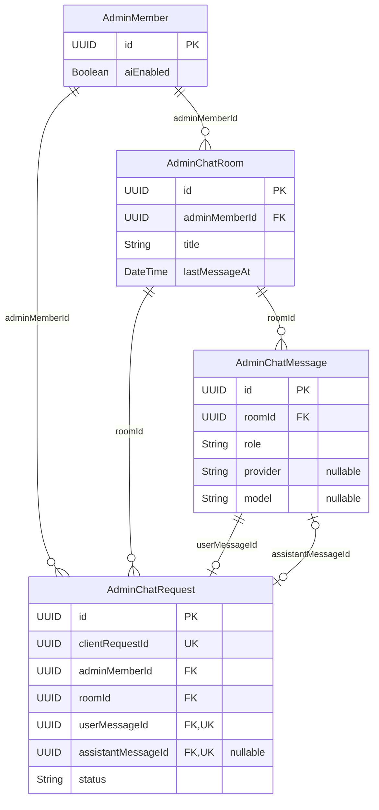

- AiUsageEvent.adminMemberId เป็น FK ไป AdminMember แต่ไม่มี usage→AdminChatRequest FK; billing เชื่อมเชิง logic ผ่าน idempotency key ของ request
- Sources: prisma/schema.prisma, prisma/models/admin/adminMember.prisma

## Accuracy notes / documentation drift

ยึด current source รวม uncommitted files ไม่ถือว่า roadmap เป็น implemented behavior. ไม่ยืนยันว่า migrations หรือ feature flags เปิดใน production. การเรียงต่อ user ยังใช้ Map ภายใน process; waiting_admin ไม่ใช่ AI mute. ไม่มี runtime changes หรือ live LINE/AI calls จากการสร้างเอกสารนี้

Current-schema update: Product ใช้ companyId+sku unique ไม่มี tenantId และมี active/compareAtPrice; ProductVariant มี compareAtPrice. อ้างอิง migrations 20261011000000_add_product_compare_at_prices, 20261011010000_product_company_sku, 20261011020000_product_business_fields.
