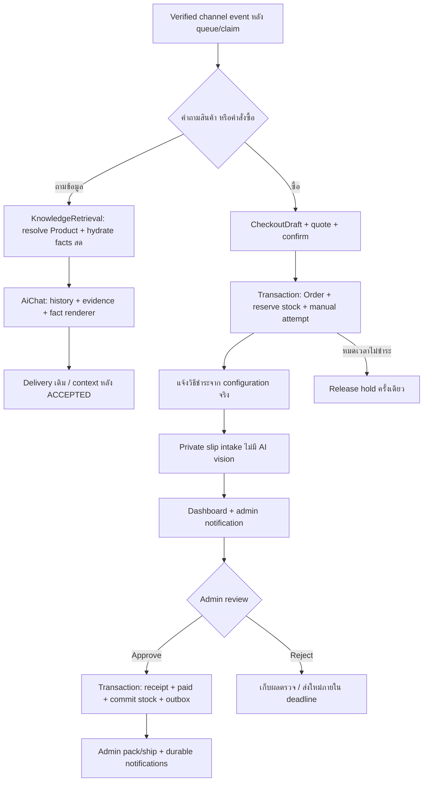

# แผน implementation: Product RAG → Order → Payment review

วันที่ตรวจ: **6 ตุลาคม 2026** · สถานะ: **Phase 1 catalog และ Phase 2–3 Product RAG/indexing มี implementation; checkout/payments Phase 4–7 ทำภายหลัง**

รายละเอียด foundation อยู่ใน [Product/Commerce Phase 1](product-commerce-phase1.md) และส่วนค้น/ตอบสินค้าอยู่ใน [Product RAG Phase 2–3](product-commerce-phase2-3.md) มี exact/lexical/vector search, hydrate facts สด, grounded answer และ durable replay แล้ว การประเมินคุณภาพด้วย provider จริงยังเป็น opt-in; checkout/order/payment review ยังไม่เปิดใช้

เป้าหมายคือให้ลูกค้าถามสินค้าเป็นภาษาธรรมชาติและถามต่อจากข้อความก่อนหน้าได้ ระบบระบุสินค้า/variant ถูก อ่านข้อมูลจริงล่าสุด และส่งหลักฐานให้ LLM เรียบเรียง เมื่อจะซื้อจึงเข้าสู่ checkout ที่ backend ควบคุม ลูกค้าโอนและส่งสลิป แอดมินตรวจผ่าน dashboard แล้วยืนยันเงินและตัด stock ครั้งเดียว

เริ่มจากร้าน e-commerce แบบ standalone หนึ่ง Company/LINE OA เพิ่ม feature ใน NestJS แอปเดิม โครงสร้างข้อมูลและ business services รองรับ identity หลายช่องทางตั้งแต่ต้น โดยยังไม่เปิด SaaS หรือ Facebook/Web chatbot ใหม่ทั้งระบบ

## 1. เอกสารที่อ่านและข้อสรุปที่เลือก

อ่านครบทั้งสี่ไฟล์ และเทียบกับ source/schema/migrations/tests ปัจจุบัน:

1. [product-rag-design-step-by-step.th.md](product-rag-design-step-by-step.th.md)
2. [product-rag-design.th.md](product-rag-design.th.md)
3. [orde-payment-astra.md](orde-payment-astra.md) — ไฟล์จริงชื่อ `orde-` ไม่ใช่ `order-payment-astra.md`
4. [order-payment-claude.md](order-payment-claude.md)

ทั้งสี่เป็นข้อเสนอ ไม่ใช่หลักฐานว่ามี Product/Order/Payment ใหม่อยู่แล้ว เลือกแต่ละแนวทางตามหน้าที่ดังนี้:

| เรื่อง                                                              | ทางที่เลือก                            | เหตุผลและสิ่งที่ปรับ                                                                  |
| ------------------------------------------------------------------- | -------------------------------------- | ------------------------------------------------------------------------------------- |
| Product เป็น source of truth; แยก PRODUCT จาก MicroKnowledge        | ทั้งสอง Product designs                | ไม่ทำราคา/stock ซ้ำใน vector หรือสร้าง Micro pointer ที่ไม่มี answer                  |
| ค้น exact/filter ก่อน semantic; มี cheap probe สำหรับ UNKNOWN       | Product step-by-step                   | ลด false positive และไม่บังคับ full search ทุก source ทุก turn                        |
| ใช้ query embedding ร่วมกัน                                         | Product design ฉบับสั้น                | ใช้เมื่อ query text, task, model/space ตรงกันเท่านั้น ไม่สร้าง embedding แยกต่อ table |
| Follow-up ใช้ product IDs/variants ที่ validate แล้ว + history เดิม | Product step-by-step                   | ไม่ให้ข้อความตอบเก่ากลายเป็น source ราคา/stock และไม่เลือกอันดับหนึ่งแทนลูกค้า        |
| LLM เรียบเรียงข้อมูลจริงตามบริบท                                    | ความต้องการผู้ใช้ + grounded flow เดิม | Product answer ผ่าน AiChatService; ยอดสำคัญใช้ fact tokens/render ฝั่ง backend        |
| Hybrid checkout: ปุ่ม/slot parser + state transition                | Claude                                 | เรียบง่ายกว่าการให้ agent เรียก tool สร้าง order เอง                                  |
| โอน + สลิป + ALWAYS_REVIEW ก่อน; Omise เป็น mock                    | Claude + ความต้องการผู้ใช้             | ได้ feature ทั้งเส้นโดยไม่ต้องเชื่อม provider จริงหรือเพิ่ม slip SDK                  |
| ลด stock ตอนแอดมินยืนยันเงิน                                        | Claude + ความต้องการผู้ใช้             | ใช้ onHand/reserved สอง counter ไม่เพิ่ม allocated ใน MVP; ตอนจัดส่งไม่ลดซ้ำ          |
| Review hold มี deadline และต่อได้แบบจำกัด                           | Astra                                  | ไม่กันสินค้าไว้ตลอดไป และ upload ซ้ำไม่ยืดเวลาใหม่                                    |
| แยก order/payment/fulfillment status; เก็บเงินจริงเมื่อจ่ายช้า/ซ้ำ  | Astra                                  | ไม่ซ่อนเงินที่รับโดยตั้ง Payment เป็น FAILED/DUPLICATE แล้วทิ้ง                       |
| Durable outbox, operation identity และ version guard                | Astra / Product step-by-step           | ใช้เฉพาะ indexing, business events และ replay ของ flow ใหม่; ไม่สร้าง workflow engine |
| Identity กลางไม่ผูก Order กับ LINE user ID                          | เพิ่มจาก requirement นี้               | ลูกค้าเดียวหลายช่องทางใช้ orders/payments ชุดเดียวหลังพิสูจน์การเชื่อมบัญชี           |
| tenantId=null แต่ ownership ชัด                                     | ปรับจากทั้งสอง Payment designs         | เพิ่ม nullable partition เผื่ออนาคต โดยไม่ถอด company ownership เดิม                  |

ข้อเสนอที่ **ไม่ใช้ใน MVP**: ค้นทุกคลังเต็มรูปแบบทุกข้อความ, ใช้ threshold knowledge 0.75 เป็น Product threshold โดยไม่วัด, full dynamic fulfillment profiles, ทุกประเภทธุรกิจพร้อมกัน, OCR/LLM อนุมัติเงิน, auto slip verification, bypass admin mute, และเปลี่ยน core router/provider/billing ทั้งระบบ

## เส้นทางที่ต้องได้เมื่อ implementation ครบ



## 2. สิ่งที่ source ปัจจุบันทำอยู่ และขอบเขตที่ต้องรักษา

| จุดปัจจุบัน                                                                                  | สิ่งที่ตรวจพบ                                                                                                 | แนวทางเพิ่ม                                                                              |
| -------------------------------------------------------------------------------------------- | ------------------------------------------------------------------------------------------------------------- | ---------------------------------------------------------------------------------------- |
| [LINE ingress](../src/modules/line/line-webhook.controller.ts)                               | `/api/line/webhooks` → signature guard → webhook adapter → BullMQ                                             | ใช้ URL, signature, event/job identity เดิม                                              |
| [MessageProcessorService](../src/modules/events/message/message-processor.service.ts)        | ทำงานหลัง worker claim; replay delivery → save inbound → load context → convert turn → Chatbot → save/deliver | คง orchestration นี้; ไม่ใส่ Prisma Product/Order หรือเลือก tenant ใน processor          |
| [LineChannelAdapter](../src/modules/line/line-channel.adapter.ts)                            | resolve LINE thread, แปลง text/postback/image/sticker, persist reply โดยตรวจ claim                            | เพิ่ม trusted commerce identity และ payment image intake เฉพาะ feature ใหม่              |
| [IntentRouterService](../src/modules/chatbot/intent-router.service.ts)                       | rich menu → cancel → REGISTER → greeting/rule → retrieval → low-confidence classifier                         | รักษาลำดับ/ผลเดิมของข้อความเดิม เพิ่ม commerce branch ที่มีเงื่อนไขชัด                   |
| [KnowledgeRetrievalService](../src/modules/chatbot/knowledge/knowledge-retrieval.service.ts) | exact DIRECT, lexical+semantic, RRF, selection/conflict/gates                                                 | ยังเป็น retrieval entry point เดียว; knowledge-only ใช้ implementation เดิม              |
| [SemanticSearchService](../src/modules/chatbot/knowledge/semantic-search.service.ts)         | embedQuery ครั้งเดียวแล้วค้น pattern/micro vectors                                                            | เพิ่ม Product repository/target แบบ optional; default เดิมต้องไม่เปลี่ยน                 |
| [AiChatService](../src/modules/chatbot/aichat.service.ts)                                    | history + evidence, structured output, directlyAnswered/evidenceIds; มี vision path                           | เพิ่ม Product mode ภายใน service เดิม ไม่ย้าย scoring มาไว้ที่ generation                |
| [Prompt composer](../src/modules/chatbot/prompt/ai-setting-prompt.composer.ts)               | serialize เฉพาะ fields ที่กำหนด; ref=`SOURCE:ID`                                                              | เพิ่ม Product public evidence เฉพาะ mode ใหม่ ไม่หวังว่า metadata ทุก field จะเข้าพrompt |
| [UserSessionService](../src/modules/chatbot/user-session.service.ts)                         | workflow หนึ่ง key ต่อ LINE user; REGISTER และ admin mute แยกกัน                                              | ไม่ย้าย key/validator/semantics เดิม; commerce มี session namespace ของตัวเอง            |
| [Member](../prisma/member.prisma) / [LineMember](../prisma/schema.prisma)                    | Member บังคับ username/password/phone/bank fields; LineMember.memberId เป็น optional FK                       | เพิ่ม Customer/ChannelIdentity สำหรับคนยังไม่สมัคร ไม่สร้าง Member ปลอม                  |
| [RegistrationFlowService](../src/modules/registration/registration-flow.service.ts)          | Phase 1 เพิ่ม registerForLine: เมื่อเปิด catalog สร้าง Member และผูก LineMember/Customer ใน transaction เดียว แล้ว clear session | public register DTO/response และคำตอบเดิมคงอยู่; ปิด flag ใช้ register เดิม |
| [PaymentsModule](../src/modules/payments/payments.module.ts)                                 | service/controller ยังว่าง; UserPayment เก่าไม่มี Order/Company                                               | ใช้ module นี้สำหรับ payment ใหม่ แต่เก็บ UserPayment เดิมไว้                            |
| [LineDeliveryService](../src/modules/line/line-delivery.service.ts)                          | text, REPLY/PUSH, retry key, ACCEPTED/finalization/context; auto delivery เคารพ mute                          | เพิ่ม typed payload แบบ backward compatible; state machine เดิมยังเป็นเจ้าของการส่ง      |
| [FileStorageService](../src/infra/storage/file-storage.service.ts)                           | R2 มี private reference; local adapter ไม่มี private area จริง                                                | production slips ใช้ R2 private; local ต้องมี authenticated private path ก่อนใช้สลิปจริง |
| [NotificationService](../src/modules/admin/notification/notification.service.ts)             | DB notification + Socket.IO; metadata เดิมยังไม่มี order/slip IDs                                             | เพิ่ม commerce metadata/dedupe และ company-scoped events แบบ additive                    |

กติกา compatibility:

- ปิด Product/Commerce feature แล้วข้อความเดิมต้องได้ route/prompt/session/usage/delivery เหมือนเดิม และไม่ query catalog หรือสร้าง customer จากทุกข้อความ
- ข้อความ FAQ, REGISTER, เมนูเดิม, cancel เดิม, greeting และภาพทั่วไปที่ไม่เกี่ยวกับ payment ใช้ flow เดิม
- `RuleIntentService` deterministic ไม่มี DB/Redis/provider; router ตัดสิน, ChatbotService เรียก feature services
- `waiting_admin` ยังเป็นคำขอให้คนช่วย AI ยังตอบได้; actual admin reply ใช้ Redis mute TTL เดิม และ resume-bot clear context ตามเดิม
- บัญชีซื้อสินค้าแยกจาก CreditWallet/CreditLedger อย่างสมบูรณ์; indexing/generation ยังผ่าน usage/billing เดิม
- ไม่เปลี่ยน vector dimension, knowledge scope, model prices หรือ ledger history ในงานนี้

## 3. ขอบเขต MVP และ policy เริ่มต้น

| เรื่อง             | ค่า/พฤติกรรมที่วางแผน                                                                                             |
| ------------------ | ----------------------------------------------------------------------------------------------------------------- |
| ร้าน/เงิน          | หนึ่ง Company, THB, จ่ายเต็มจำนวน, Decimal(12,2) สำหรับยอด commerce ใหม่; ไม่แก้ precision เดิม                   |
| สินค้า             | physical goods และสินค้าขายแบบไม่ track stock; ทุก Product มีอย่างน้อยหนึ่ง default variant                       |
| Order              | หนึ่ง variant ต่อ order แต่ quantity > 1 ได้; schema เป็น OrderItem[] เพื่อเพิ่ม cart ภายหลัง                     |
| การสมัคร           | ซื้อได้โดยยังไม่เป็น Member ใช้ Customer กลาง; ไม่บังคับกรอกบัญชีธนาคารจาก REGISTER                               |
| Payment            | MANUAL_TRANSFER → ส่งสลิป → ALWAYS_REVIEW; ไม่มีการตรวจเงินจริงอัตโนมัติ                                          |
| Omise              | adapter mock deterministic; เปิด simulation เฉพาะ test/dev; ไม่มี live URL/key/webhook ใน MVP                     |
| Quote              | อายุเริ่มต้น 5 นาที ปรับจาก config ได้; ราคาเปลี่ยนก่อนยืนยันต้องเสนอใหม่                                         |
| Hold รอชำระ        | เริ่ม 30 นาทีหลังยืนยัน order; ค่า config ถูก validate และเก็บ snapshot ลง order                                  |
| Review hold        | สลิปแรกที่ส่งทันเวลาขยายถึง `max(paymentDueAt, firstSlipAt + 60 นาที)`; ไม่เกิน paymentDueAt + 60 นาที            |
| Upload ซ้ำ/ส่งใหม่ | ไม่ต่อ deadline อัตโนมัติใหม่; จำกัด submission/open orders ต่อ customer                                          |
| ส่งของ             | admin fulfillment + tracking; ค่าเริ่มต้นค่าส่งตายตัวจาก config มิฉะนั้นเก็บพื้นที่ก่อน quote                     |
| ที่อยู่            | เก็บก่อนจ่ายเมื่อมีผลต่อค่าส่ง; หากไม่มีผลขอหลัง approve ได้; เก็บ private record เท่านั้น                        |
| Cancel             | ออกจาก draft แยกจากยกเลิก order; paid order ต้องเปิด cancel/refund review ไม่คืน stock อัตโนมัติ                  |
| ช่องทาง            | LINE จริงก่อน; business contracts/identity รองรับ LINE, FACEBOOK, WEB; ไม่เปิด ingress ใหม่โดยไม่มี auth/delivery |

ตัวเลขเวลาเป็น **policy ที่เสนอสำหรับเริ่มพัฒนา** ไม่ใช่ข้อจำกัดของธนาคาร/Omise ให้ config ปรับได้และทดสอบด้วย clock ที่ควบคุมได้ หลัง review deadline หมดปล่อย hold ได้ แต่เก็บสลิปและงานตรวจต่อ เงินที่อาจโอนแล้วต้องไม่หายไปเพราะ order expired

## 4. Ownership และ tenant=null ที่ใช้กับ standalone ได้

ใช้ scope ภายในจาก backend:

```ts
type CommerceScope = Readonly<{
  companyId: string; // เจ้าของจริงจาก CompanyService/admin authorization
  tenantId: string | null; // null ใน standalone; partition เผื่ออนาคต
}>;
```

Product, Customer และ CommerceOrder มี `companyId` non-null FK และ `tenantId` nullable (เริ่ม null) ตาม requirement นี้ Child records มี companyId และอ้าง parent ใน company เดียวกัน; tenant scope อ่านผ่าน aggregate ไม่ต้องทำ nullable field ซ้ำทุก child

- ทุก query สินค้า/ลูกค้า/order ต้องมี companyId และ exact tenant scope ของ aggregate (`IS NULL` ใน standalone) ห้ามใช้ null เป็น wildcard หรือ `tenantId=request.body.tenantId`
- companyId ใช้ `CompanyService.getCompanyId()` สำหรับ trusted LINE deployment; admin ใช้ company จากข้อมูลที่ authenticate แล้ว ตรวจให้ตรงร้าน standalone ตาม pattern เดิม กรณี admin legacy company=null ต้อง resolve ด้วย policy standalone ที่ชัดและห้ามเลือก arbitrary company
- Knowledge ยังคง `KNOWLEDGE_TENANT_ID`/language เดิม ไม่เปลี่ยน null knowledge records เป็น Company.id และไม่แชร์ knowledge ของทุกบริษัท
- Unique SKU/orderNumber/channel identity ใช้ **companyId ที่ non-null** เป็นส่วนของ key ไม่พึ่ง `@@unique([tenantId, sku])` อย่างเดียว เพราะ PostgreSQL unique ปกติยังให้หลายแถวที่ key มี null ได้ [PostgreSQL constraints](https://www.postgresql.org/docs/current/ddl-constraints.html#DDL-CONSTRAINTS-UNIQUE-CONSTRAINTS)
- parent-child ใช้ `(id, companyId)` unique/composite FK เท่าที่จำเป็น; ประวัติซื้อ/เงินใช้ RESTRICT, catalog ใช้ archive
- tenantId เป็น routing partition ที่ยังไม่เปิดใช้ ไม่ใช่ ownership อีกชุด; ก่อน SaaS ต้องกำหนด mapping/backfill และเพิ่ม ChannelConnection/credentials จริง

จุดที่เตรียม SaaS ได้ทันที: scoped service inputs, scoped uniqueness/FKs, customer identity, opaque order IDs, adapter ports, ไม่มี hard-coded LINE buyer ใน Order ส่วน multi-OA webhook, tenant onboarding, dynamic credentials, dashboard tenant isolation ทั้งระบบ และ Member login ข้ามบริษัทเป็นงานภายหลัง

## 5. Customer กลางและผู้ใช้เดียวกันหลายช่องทาง

ใช้ **Customer** เป็น canonical user ของ commerce ภายใน company ไม่ใช้ LINE ID เป็น buyerId และไม่สร้าง Member พร้อม password/bank data ปลอม

```text
Customer (id, companyId, tenantId=null, memberId?)
  ├─ ChannelIdentity: LINE     + connectionKey + externalUserId
  ├─ ChannelIdentity: FACEBOOK + connectionKey + externalUserId
  ├─ ChannelIdentity: WEB      + authenticatedSubject
  └─ Orders / payment receipts / fulfillment

LineMember ── customerId? ── Customer ── memberId? ── Member.uuid
```

`connectionKey` เป็น trusted namespace ของช่องทาง: LINE standalone ใช้ค่าคงที่จาก deployment ไม่อ้างว่ามี ChannelConnection table แล้ว; Facebook ต่อ Page และ web ต่อ auth realm เพื่อไม่ถือว่า externalUserId unique ทั่วทุก provider

### ขั้นตอน resolve/link

1. LINE adapter รับ verified event หา LineMember ตาม flow เดิม เมื่อเข้า commerce จึง `resolveOrCreateCustomer(company, LINE identity)` แบบ DB unique/upsert
2. ถ้า LineMember.memberId มีอยู่ ใช้ mapping Customer↔Member ที่พิสูจน์แล้ว; backfill เฉพาะ FK เดิมที่มีจริง ไม่เดาจาก profile name/โทรศัพท์
3. เมื่อสมัครผ่านแชตสำเร็จ ให้ RegistrationService มี method/result ภายในแบบ additive ที่คืน Member UUID ให้ caller ที่ถือ trusted identity แล้ว hook ผูก LineMember.memberId, Customer.memberId แบบ idempotent รักษา public register DTO/response/คำตอบเดิม และไม่ query สมาชิกด้วยข้อมูล PII เพื่อเดาตัวตน
4. ผู้ใช้ข้าม Facebook/Web ต้อง login หรือใช้ one-time account-link challenge ที่มี expiry และยืนยันจากบัญชีเดิม รู้ชื่อ/เบอร์/ส่ง userId มาเองไม่พอเป็นหลักฐาน
5. ถ้าสอง identity มี Customer ต่างกันก่อน link: explicit verified merge ใน company เดียวเท่านั้น lock customers/drafts/orders ที่เกี่ยวข้อง ย้าย identity/aggregate references แบบ atomic เก็บ merge audit/alias และ original buyer provenance ไม่แก้ยอด/transaction identity ของ receipt ไม่ให้ active drafts ชนกัน; ไม่มี silent merge
6. order/status API resolve Customer จาก identity ที่ authenticate แล้ว อ่าน DB ของ buyer นั้น ห้ามยอมให้ body ระบุ customerId เพื่ออ่าน order

ลูกค้าที่ยังไม่พิสูจน์ว่าเป็นคนเดียวกันจะไม่แชร์ประวัติ เพื่อป้องกัน takeover หลัง link แล้วทุกช่องทางเห็น orders ชุดเดียวกันทันที ไม่ต้อง copy status ไปที่ LINE/Facebook/Web แยกกัน `Member.statusaccount` เป็นสถานะสมาชิกเดิม ไม่ใช้เป็น paid/unpaid ของ order

Dashboard query เป็น `Customer → Orders → PaymentStatus/FulfillmentStatus` และมี channel identities/Member link สำหรับ admin ไม่เพิ่ม boolean `user.isPaid` ที่ผิดเมื่อผู้ใช้มีหลาย order

## 6. Product และ index ที่พอดีกับ MVP

### โมเดลหลัก

| Model                | Fields/constraints ที่ต้องมี                                                                                                                                                                      |
| -------------------- | ------------------------------------------------------------------------------------------------------------------------------------------------------------------------------------------------- |
| Product              | companyId, tenantId?, code/name/aliases[], description, category, language, status DRAFT/ACTIVE/ARCHIVED, attributes JSONB, basePrice Decimal, currency, **trackStock**, revision, searchRevision |
| ProductVariant       | companyId, productId, SKU unique ต่อ company, attributes เช่น color/size, priceOverride Decimal?, active, version; default variant สำหรับสินค้าที่ไม่มีตัวเลือก                                   |
| InventoryBalance     | variantId unique, companyId, onHand Int, reserved Int, version; CHECK onHand>=reserved>=0                                                                                                         |
| InventoryReservation | orderItemId, variantId, quantity>0, state HELD/COMMITTED/RELEASED/EXPIRED, holdExpiresAt, operationKey unique                                                                                     |
| InventoryMovement    | append-only deltaOnHand/deltaReserved, reason, reference order/reservation, unique operationKey                                                                                                   |
| ProductVector        | productId unique สำหรับ current document, vector(1536), model, contentHash, searchRevision, active                                                                                                |
| ProductIndexJob      | scoped product/revision/model/generation identity, document snapshot/hash, status/lease/retry; commit พร้อม product mutation                                                                      |

ใช้ชื่อ `trackStock` เพราะสื่อว่า “ระบบนับ stock หรือไม่” หาก API ต้องใช้ `isStock` ให้เป็น alias ที่แปลงเข้าค่าเดียว ไม่สร้างสอง field ที่ขัดกัน

- trackStock=true: inventory อยู่ที่ variant ทุกตัว ซื้อได้เมื่อ available พอ
- trackStock=false: ไม่มี inventory counter/hold ของสินค้า แต่ยังมี order/payment deadlines และตรวจ product active/quantity ตาม policy
- stock=0 ยังเป็น ACTIVE และ searchable; ไม่ซ่อนสินค้าเพราะหมดชั่วคราว
- Product มีสีดำ/L และขาว/M ไม่ได้แปลว่ามีดำ/M ต้อง match constraints ที่ variant **เดียวกัน**
- money ส่ง API เป็น decimal string ไม่ JSON float; missing price เป็น unknown และห้าม checkout จนตั้งราคาขายจริง
- เปลี่ยน trackStock ขณะมี HELD reservation ให้ reject/conflict ต้องจบ/ยกเลิกอย่างชัดเจนก่อน ไม่ปล่อย counters ทิ้ง
- admin ปรับ stock ผ่าน InventoryService + movement ใน transaction ห้าม set onHand ต่ำกว่า reserved หรือเขียน reserved จาก body

### Attributes และค้น lexical

เริ่ม `attributes` แบบ JSONB ที่ validate จาก Zod schema/preset ของ e-commerce: material/features/category ใน Product และ color/size ใน Variant alias เป็น String[] ก่อน ไม่สร้าง ProductAlias table แยกถ้ายังไม่มีความจำเป็น

ProductType/AttributeDefinition แบบปรับเองโดย admin เป็นระยะถัดไป เมื่อมีธุรกิจ/fields ที่ preset ไม่พอ อย่าเริ่มด้วย full EAV/schema editor แต่เก็บ version ของ preset และ public/searchable/filterable allowlist ให้ต่อยอดได้ ข้อมูล stock/price ไม่อยู่ JSONB

Exact code/SKU ใช้ indexed lookup ส่วน lexical ใช้ query candidates แบบ bounded จากชื่อ/aliases/category แล้ว Thai tokenization/BM25 เดิม; catalog โตให้วัด recall ก่อนเลือก pg_trgm ไม่ใช้ “500 แถวล่าสุด” เป็นทั้งคลัง และไม่เพิ่ม extension/GIN/expression indexes ที่ยังไม่มี query ใช้

### Indexing

Pure `buildProductDocument()` ใช้ชื่อ/code/aliases/description/public stable attributes และคู่ variant ที่มีจริง ไม่รวมราคา, onHand/reserved, payment, customer PII, updatedAt หรือข้อมูลภายใน

เมื่อแก้ searchable fields: tx update Product/searchRevision + ProductIndexJob(document/model/hash snapshot) แล้ว commit dispatcher ส่ง BullMQ Worker เรียก EmbeddingService นอก tx และ upsert vector เฉพาะ revision/hash/model ยังตรง job; เก่าแล้ว mark SUPERSEDED

ProductIndexJob ทำหน้าที่ durable indexing outbox ด้วย ไม่ต้องสร้าง ProductSearchDocument และ ProductIndexOutbox อีกสองตารางใน MVP หากภายหลังต้องหลายภาษา/chunks ค่อยแยก projection Current vector ต้องตรง source revision; archive/disable ถูก filter ออกจาก source ทันทีแม้ cleanup ยังไม่เสร็จ

ราคา/stock-only update ไม่ re-embed Index pending/fail ยังค้น exact/lexical ได้ แต่ semantic ไม่ใช้ stale revision Provider/billing retry ใช้ `turnId=product-index:<jobId>:<generation>` และ scopeKey `document` เดิม ต้อง pin model ของงานและตรวจ config เมื่อ recovery เพราะ embedding key ปัจจุบันไม่ได้รวม model

## 7. Product RAG: ระบุสินค้าแม่นและส่งข้อมูลจริงให้ LLM

### ลำดับการค้น

`KnowledgeRetrievalService.retrieve()` ยังคงเป็นทางเข้าร่วม เพิ่ม Product plan แบบ optional:

1. feature disabled → เรียก knowledge path เดิมทันที
2. menu/cancel/registration/greeting อยู่เหนือ retrieval ตามเดิม ไม่เอาคำตอบ PII ของ registration เข้า planner
3. pure signals + trusted catalog context แยก KNOWLEDGE / PRODUCT / BOTH / UNKNOWN; “ราคา” หรือ “ซื้อ” คำเดียวไม่ยืนยันว่าลูกค้าถามสินค้าจริง
4. SKU/selected variant ชัด → exact scoped lookup; filters ชัด → SQL read/filter ของข้อมูลจริง
5. UNKNOWN ที่อาจเป็นชื่อสินค้า → bounded alias/name/category probe; collision ให้ถาม ไม่เลือก top-1 อัตโนมัติ
6. semantic need → Product lexical + vector; product+policy ค้นเฉพาะ sources ที่จำเป็น ใช้ embedding เดียวเมื่อ query/space ตรง
7. planner/classifier structured output เมื่อยังคลุมเครือ; มีหนึ่ง planning/classification call ต่อ Product turn ไม่เรียก BUSINESS/GENERAL ซ้ำสำหรับเรื่องเดิม และ generation/critical correction อยู่ภายในเพดานรวม 3 LLM calls ตามนโยบายด้านล่าง
8. ProductCandidate IDs → batch hydrate Product/Variant/price/inventory → recheck company/status/constraints → coverage check → ProductEvidence
9. ส่ง ProductEvidence กับ policy evidence และ redacted recentMessages เข้า AiChatService

ไม่ใช้ top RRF เป็นค่าความมั่นใจของ intent และไม่เปลี่ยน threshold/scoring knowledge เดิม Product confidence policy แยกต่างหาก วัด exactness, variant constraints, Thai-query precision/recall และ ambiguity ก่อนตั้งค่า

Product branch ไม่ใช้ generic conflict check เปรียบราคาคนละ variant เป็นข้อมูลขัดแย้ง และ mixed question ไม่ใช้ FAQ DIRECT shortcut ที่ตอบเพียงครึ่งคำถาม การเปลี่ยนทั้งสองนี้จำกัดเฉพาะ Product/BOTH turn; knowledge-only ไม่เปลี่ยน selection/conflict policy

### Contract ที่เพิ่ม

```ts
type ProductCandidate = {
  productId: string;
  variantId?: string;
  searchRevision: number;
  signals: {
    exactSku: boolean;
    aliasMatch: boolean;
    vectorSimilarity?: number;
  };
};

type ProductEvidence = {
  ref: string; // PRODUCT:<opaque-evidence-id> คงรูป SOURCE:ID
  productId: string;
  variantId?: string;
  name: string;
  publicAttributes: Record<string, string | boolean | string[]>;
  price: { amount: string; currency: 'THB'; unit: string } | null;
  stock: 'IN_STOCK' | 'OUT_OF_STOCK' | 'NOT_TRACKED' | 'UNKNOWN';
  purchasable: boolean;
  fetchedAt: string;
  sourceRevision: number;
};
```

ref เป็น canonical opaque ID ที่ผูก product+variant ภายใน snapshot ไม่เพิ่ม `PRODUCT:productId:variantId` ให้ validator เดิมรับเองโดยไม่ปรับ เพิ่ม `KnowledgeItem.source=PRODUCT` และ typed evidence โดยไม่ยัด live facts ใน arbitrary metadata อย่างเดียว

ผล retrieval แยก FOUND / MISSING_INPUT / NO_MATCH / NO_RELIABLE_CANDIDATE / UNAVAILABLE:

- vector ไม่เจอไม่เท่ากับร้านไม่มีสินค้า; ใช้ clarify/fallback ที่ไม่ยืนยันเท็จ
- source ล่มไม่เท่ากับ stock=0; ใช้ข้อความตรวจสอบไม่ได้ และ admin fallback ตามเดิม
- cheapest/count/list-all ต้อง scoped SQL aggregate/pagination ไม่สรุปทั้งร้านจาก vector top-k
- Product failure ไม่ทำให้ FAQ-only ล้ม เพราะไม่เลือก Product เป็น required source ของคำถามนั้น

### LLM เรียบเรียงตามบริบท แต่ตัวเลขต้องตรง

ลูกค้าพูด “ตัวที่บอกเมื่อกี้สีดำเท่าไร” ระบบใช้ structured selected IDs ร่วมกับ recentMessages เดิม แล้วอ่าน variant สีดำจริง ราคาและ stock ปัจจุบัน LLM ใช้ history เพื่อตีความ/เรียบเรียง ไม่ยกค่าราคาเก่าจาก history มายืนยัน

Product mode ใน AiChatService ใช้ grounded output แบบเดิมและเพิ่ม `answerTemplate`/fact tokens เฉพาะ Product response เช่น:

```json
{
  "decision": "ANSWER",
  "directlyAnswered": true,
  "evidenceIds": ["PRODUCT:e1"],
  "answerTemplate": "รุ่นที่ถามเป็น {{e1.name}} สีดำค่ะ ราคา {{e1.price}} {{e1.stockStatus}}"
}
```

backend allowlist tokens จาก selected evidence, validate required facts/refs และ render name/variant/Decimal price/stock label จาก source Snapshot ที่ LLM เห็นมีข้อมูลจริงครบ แต่ค่าที่แสดงสุดท้ายมาจาก renderer ไม่ให้ LLM พิมพ์ยอด/stock claim ใหม่เอง

เนื้อหาอธิบาย/เปรียบเทียบยังให้ LLM เขียนโดย grounded rules; description เป็น untrusted data, public facts เท่านั้น ข้อความมี token ผิด/ขาดประเด็น/ตัวเลขธุรกิจนอก tokens/หลักฐานไม่พอให้ safe template หรือ configured fallback อนุญาต critical correction เพียงหนึ่งครั้งตามนโยบายด้านล่าง ไม่วน repair loop และไม่ส่ง PII/slip/bank data ให้ provider

### นโยบายจำนวน LLM calls ของ Product feature (แก้ตาม requirement 6 ตุลาคม 2026)

Product feature ใช้ **LLM 1–3 ครั้งต่อข้อความลูกค้า โดย 3 เป็นเพดานสูงสุด และครั้งที่ 3 ใช้เฉพาะเคสสำคัญ** เพื่อให้เข้าใจและตอบตรงความต้องการ:

- 1 ครั้ง: SKU/ตัวเลือกสินค้าชัด → backend exact lookup/live facts → LLM เรียบเรียง
- 2 ครั้ง (เส้นทางปกติของ natural language): LLM แยก PRODUCT/KNOWLEDGE/BOTH/GENERAL และ extract เงื่อนไข/คำถามต่อเนื่อง → backend search/hydrate → LLM ตอบจาก evidence
- สูงสุด 3 ครั้ง: คำตอบจาก evidence ไม่ผ่าน validation และเป็น mixed product+policy, การเปรียบเทียบ หรือคำถามราคา+stock ที่ต้องตอบถูกครบทั้งสองประเด็น จึงให้ LLM แก้ด้วย snapshot/fact tokens เดิมอีกหนึ่งครั้ง หากยังไม่ผ่านใช้ safe template/fallback
- ไม่ใช้ครั้งที่ 3 กับ small talk, provider failure, malformed classifier, evidence ไม่พอ หรือการเดาสินค้าที่ลูกค้ายังไม่เลือก; กรณีเหล่านี้ clarify/fallback ได้ทันที
- Deterministic menu/cancel/REGISTER และ clarify/fallback ที่ไม่ต้อง generate ใช้ 0 ครั้งได้ ไม่บังคับเรียกให้ครบขั้นต่ำ
- นับ planner, answer และ correction รวมกัน; ไม่เรียก generic BUSINESS/GENERAL classifier ซ้ำหลัง Product planner แล้ว ไม่ให้ model เรียก tools หรือเขียน order/payment
- Persist `CommerceLlmCall` request/result และ ordinal; unique turn/slot, ordinal 1–3, ordinal 3 ต้องเป็น CRITICAL_REPAIR; snapshot/provider/model/operation key คงเดิมเมื่อ retry จึงไม่เกิด call/charge ชุดใหม่
- Query/document embedding เป็นคนละประเภท usage (`query`/`document`) และไม่นับเป็น text-generation LLM calls ในเพดานนี้; ทั้งสองยังผ่าน billing/budget เดิม

คุณภาพ intent/discovery ต้องประเมินด้วย representative Thai queries และ provider จริงแยกจาก mocked correctness tests ก่อนรับรอง precision/recall หรือเปิด rollout เต็ม

สำหรับ mixed product+policy ใช้ evidence budget เดิมอย่างระวัง ให้ทั้งสองประเด็นมีหลักฐานในขนาดที่จำกัดก่อน generation ไม่ลดนโยบายออกเพราะ product variants กิน top-3 ทั้งหมด

### Follow-up context

`CatalogContextService` แยกจาก REGISTER: company/customer/channel-conversation, bounded presented product/variant IDs, selected ID?, filters, expiresAt เก็บ IDs ไม่เก็บราคาหรือ stock เป็น truth

Presented IDs ของคำตอบบอต commit หลัง delivery ACCEPTED ตาม context policy เดิม คำสั่งเลือกจากลูกค้าที่ validate แล้วบันทึกได้ตาม command เมื่อแสดงหลายสินค้าต้องถาม “ตัวไหน” หากตัวที่เลือกถูก archive/variant เปลี่ยนต้อง resolve ใหม่ Clear catalog context เมื่อ topic reset/resume-bot/TTL; ไม่ clear order/receipt ด้วยการ clear context

### Replay ที่ต้องทำก่อนเปิด Product generation

ราคาอ่านสดเฉพาะ **turn ใหม่** ส่วน retry event เดิมต้องใช้ snapshot/result เดิม:

- `CommerceTurn` unique `(companyId, channel namespace, externalEventId)` เก็บ validated plan, evidence/refs, redacted history, prompt version + final generation request, pinned provider/model, state/lease, response หรือ result reference
- snapshot ต้อง commit ก่อนเริ่ม billed generation; concurrent retry claim ด้วย DB fence และใช้ snapshot เดียวกัน
- generation ผ่าน UsersAiProviderService/AiBillingService เดิม เพิ่ม optional pinned selection/operation context สำหรับ turn ใหม่โดย default callers เดิมยังเลือก settings เดิม ไม่เรียก provider ตรงจาก Product service
- หาก usage settled แล้ว แต่ persist delivery ล้ม ใช้ stored provider result/request เดิม; ห้าม hydrate ราคาใหม่แล้วสร้าง prompt/key ใหม่จน bill เพิ่ม
- ถ้ามี LineDelivery อยู่แล้ว MessageProcessor replay delivery เดิมทันที; ACCEPTED แล้ว local finalize ล้มให้ repair ตามเดิม
- ไม่อ้างว่าปิดช่องว่าง provider success ก่อน local settlement ทุกกรณีได้ด้วย snapshot; ambiguous billable result ใช้ pending/reconciliation policy ของ usage module และระบุข้อจำกัดเดิม

## 8. ตัวอย่าง Product RAG และเจตนาซื้อ

| ข้อความ/บริบท                       | ผลที่ต้องได้                                                                                                 |
| ----------------------------------- | ------------------------------------------------------------------------------------------------------------ |
| “เสื้อรุ่น LIN-A ราคาเท่าไร”        | ระบุ Product ถูก hydrate ราคาจริง; query embedding=0; LLM เรียบเรียงจาก evidence                             |
| “เสื้อดำไซซ์ M ไม่เกิน 500 มีไหม”   | SQL filters ใน variant เดียวกัน + price สด; ไม่ invent ดำ/M จากคู่สี/size อื่น                               |
| “อยากได้รองเท้าใส่เดินนาน ๆ”        | semantic product search ไม่สร้าง order; shortlist พร้อมข้อมูลจริง                                            |
| “อันนี้ราคาเท่าไร” หลังส่ง 3 สินค้า | CLARIFY ไม่เลือกสินค้าแรก                                                                                    |
| “สีดำล่ะ” หลังเลือก LIN-A/M         | ใช้ selected Product หา variant สด; ถ้ายังไม่ระบุ size ต้องถาม                                               |
| “ราคาอะไรแพงจัง” ไม่มีสินค้าที่อ้าง | UNKNOWN/GENERAL ตามบริบท ไม่จับ Product เพราะคำว่าราคา                                                       |
| “คืนสินค้าได้กี่วัน”                | knowledge policy เดิม ไม่ query inventory                                                                    |
| “LIN-A ราคาเท่าไร คืนได้ไหม”        | BOTH: ราคาสด + policy ครบ ไม่ถูก exact FAQ ตัดคำถามราคา                                                      |
| “สนใจตัวนี้”                        | เสนอขั้นตอน/ปุ่มซื้อได้ แต่ยังไม่สร้าง order หรือ hold                                                       |
| “เอา LIN-A ดำ M 2 ตัว”              | เข้า draft; validate variant/quantity → quote → ขอ confirm                                                   |
| “ไม่ซื้อแล้ว”, “ซื้อของที่ไหน”      | ไม่เป็น purchase command; parser ต้องตรวจ negation และรูปคำถาม                                               |
| “โอนแล้ว”                           | ยังไม่ PAID; ขอแนบสลิป/เลือก order และแสดงวิธีตรวจสถานะ                                                      |
| สินค้า stock=0 ถามรายละเอียด        | ตอบรายละเอียด/ราคาได้ ระบุหมดตามข้อมูลสด                                                                     |
| สินค้า stock=0 แล้วขอซื้อ           | ไม่สร้าง payable order/hold; ให้ LLM เรียบเรียง OUT_OF_STOCK evidence เสนอสินค้าทดแทนที่มีจริง หรือ fallback |

Purchase extraction แยกจาก product retrieval ถ้าจะให้ LLM ช่วย extract คืนเฉพาะ mention/variant/quantity ที่ backend validate ไม่มีราคา, company, buyer, payment status หรือ SQL ที่ LLM เลือกเอง และ confirmation ยังเป็นคำสั่งแยกที่อ้าง quote จริง

## 9. Checkout และ session ของ order/payment

เลือก **CheckoutDraft ใน DB + Redis session pointer ของ commerce** เพื่อกู้หลัง Redis หายและถามข้ามช่องทางได้ ไม่เพิ่ม CHECKOUT ลง session key เดิมแล้วทำ REGISTER หาย

```ts
type CommerceSession = {
  companyId: string;
  customerId: string;
  draftId?: string;
  orderId?: string;
  step:
    | 'SELECT_VARIANT'
    | 'QUANTITY'
    | 'SHIPPING'
    | 'CONFIRM'
    | 'WAITING_PAYMENT'
    | 'WAITING_REVIEW'
    | 'ADDRESS';
  expectedVersion: number;
};
```

Redis key เช่น `commerce:session:<companyId>:<customerId>` TTL เริ่ม 30 นาที ข้อมูลเป็น pointer/step/version ไม่เก็บราคา/สลิป/ที่อยู่/password Session หมดไม่ได้ expire order; deadlines ทั้งหมดอยู่ DB และ Redis อ่านไม่ได้ให้กู้จาก DB

CheckoutDraft เก็บ selected variant/quantity, step, public delivery option, quote snapshot/version/expiry, status/version และ ownership ที่ชัดเจน private contact แยก records การแก้ slot เป็น conditional transition พร้อม expectedVersion ไม่เก็บ business state ใน Redis อย่างเดียว

### Flow หลัก

1. resolve trusted Customer และ purchase signal; ยังไม่ hold จากคำว่า “สนใจ”
2. เปิด/resume draft หนึ่ง active draft ต่อ Customer/company เก็บ intent/selection แบบ validate แล้ว
3. ถามสี/size/จำนวน/วิธีรับ/พื้นที่ที่มีผลต่อค่าส่งตามลำดับ สร้างปุ่มจาก variants ที่มีจริง
4. ใช้ PriceCalculator อ่าน DB คำนวณ Decimal `quantity × unitPrice + shipping - discount` MVP ไม่เพิ่ม promotion/tax engine; หากยังไม่มี pricing source นั้นต้องไม่ invent fee
5. เก็บ quote snapshot บน draft พร้อม quoteVersion/expiry แสดง summary และปุ่มยืนยันซื้อที่มี opaque action token ผูก draft, buyer, company และ expectedVersion
6. ตอน confirm อ่าน owner/status/quoteVersion/expiry/price revision/product/variant ใหม่ ถ้าราคาเปลี่ยนเสนอ quote ใหม่ ไม่สร้าง order จากคำว่า “ตกลง” ที่ไม่มี quote valid
7. ใน transaction: lock draft → unique consume draft → สร้าง Order/OrderItem snapshots → conditional hold stock → สร้าง manual PaymentAttempt → บันทึก command result + outbox
8. stock ไม่พอ rollback ทั้ง transaction ส่งผล OUT_OF_STOCK ให้ตอบแบบ grounded; **ไม่มี order payable/payment instructions จากรายการที่กันของไม่ได้**
9. หลัง commit ส่งวิธีชำระจาก merchant configuration ที่ backend อ่านจริง พร้อม order number, total, deadline และข้อความให้ส่งสลิป
10. สลิปเข้า SlipIntakeService → PENDING review → dashboard notification; session ชี้ order/WAITING_REVIEW
11. แอดมิน approve → PaymentApplicationService → receipt/payment/order + stock commit + outbox แบบ atomic
12. ลูกค้าขอที่อยู่/สถานะหรือ admin กรอก tracking → fulfillment state ตาม DB; complete แล้ว clear commerce session เฉพาะที่ชี้ order นี้

การแจ้งวิธีชำระใช้ได้ทั้ง LLM ที่เห็น public payment instructions และ deterministic renderer สำหรับ order number/ยอด/deadline แต่ confirmation ว่า **รับเงินแล้ว/จัดส่งแล้ว** ใช้ template จาก business event ที่ commit แล้ว หาก AI ล่ม order/payment/slip/admin review ยังทำงานผ่านปุ่มและข้อความ deterministic ได้

### REGISTER, digression, cancel และ stale messages

- ขณะ REGISTER active ให้ branch เดิมรับ slot เดิมก่อน commerce free text ไม่ส่งชื่อ/phone/bank ไป Product planner ถ้าลูกค้าขอซื้อชัด ให้เสนอทำ registration ให้จบ/ออกก่อนโดยไม่ overwrite session
- ขณะ checkout ถาม FAQ/สินค้าแทรก ให้ RAG ตอบโดยคง draft/step/deadline และไม่เลื่อน order expiry เพียงเพราะคุยต่อ
- เมนูเดิมอาจ clear legacy workflow ตาม code เดิม แต่ไม่ลบ order/receipt/stock reservation; commerce session resume จาก DB ได้
- คำว่า “ยกเลิก” ใน draft ออกจาก draft; order ที่รอเงินต้อง explicit cancel confirmation ผูก order/version จึง release hold; paid order เปิด cancel/refund case
- ตอนมีหลาย orders “ส่งสลิป/โอนแล้ว/สถานะ” ต้องถามเลือก order ไม่ auto เลือกล่าสุด การค้นพบ pending order จาก DB เป็นทางกู้ session ไม่ใช่สิทธิ์ผูกภาพใด ๆ กับ order
- group/room chat ไม่เปิดเผย order/contact/payment ส่วนตัวจาก userId อย่างเดียว; MVP commerce ใช้ direct chat หรือ authenticated buyer API
- commands จาก LINE/Facebook/Web ของ Customer เดียวกัน serialize ด้วย DB row lock/CAS ของ draft/order และ unique operation ไม่ใช้ Redis session หรือ Map ใน worker เป็น correctness lock
- ข้อความ/ปุ่มที่ stale ต้องคืนผลเดิมหรือ conflict/ขอ confirm ใหม่ตาม command identity ไม่ apply ลง state ใหม่โดยอัตโนมัติ และไม่ถือว่า CAS count=0 ทุกกรณีแปลว่า replay สำเร็จ

## 10. Stock reservation: กันก่อน ลดจริงเมื่อแอดมิน approve

ใช้ **onHand/reserved** ตามความต้องการนี้:

```text
available = onHand - reserved
confirm checkout: reserved += quantity
approve payment: onHand -= quantity; reserved -= quantity; HELD → COMMITTED
expire/cancel unpaid: reserved -= quantity; HELD → EXPIRED/RELEASED
pack/ship: เปลี่ยน fulfillment อย่างเดียว ไม่ลด onHand อีก
```

ตัวอย่างตั้งต้น `onHand=5,reserved=0`: ยืนยันซื้อ 2 → `(5,2)` available=3; ส่งสลิป → ยัง `(5,2)`; approve → `(3,0)`; จัดส่ง → ยัง `(3,0)` ทุก movement มี originating event/operation key ให้ audit ได้

### Transaction และ concurrency

- hold ใช้ atomic conditional update scoped variant: `UPDATE ... SET reserved=reserved+q WHERE companyId=... AND onHand-reserved>=q` พร้อม insert HELD reservation/movement ใน transaction เดียว
- อ่านค่าในแอปแล้ว increment แยกไม่พอ; CHECK quantity/counters และ transaction rollback เป็นด่านสุดท้าย
- approve/expiry/cancel lock Order แล้ว InventoryReservation แล้ว InventoryBalance ตามลำดับเดียวกัน หากเพิ่มหลาย item ภายหลัง lock variant IDs ตามลำดับคงที่
- approve รับรองเฉพาะ reservation ที่ HELD และ valid; release/commit ที่แข่งกันมีทางชนะได้ครั้งเดียว
- counters ที่เดิมถูก update แต่ transaction ล้มต้อง rollback; retry ใช้ unique transition key ไม่เพิ่ม reserved หรือตัด onHand อีก
- trackStock=false ข้าม inventory services แต่ยังสร้าง/approve order ด้วยกติกา ownership/payment เดียวกัน
- admin restock/adjust stock ต้องมี reason/audit/movement; oversell guard และ reconciliation ไม่ใช้ balance sum อย่างเดียวพิสูจน์ order ถูกต้อง

### Expiry และสลิปที่รอตรวจ

Expiry worker หา deadlines จาก DB ไม่ใช้ Redis TTL ใช้ transaction และ state predicate เดียวกับ approval มี periodic scanner กู้เวลาที่ missed หลัง process หยุด

สลิปแรกที่ upload/persist สำเร็จก่อน paymentDueAt ขยาย hold ถึง review deadline แบบ bounded ตาม policy snapshot ไม่ใช้ `PAYMENT_REVIEW` เป็นข้อยกเว้นถาวร Sweeper ที่ชน slip intake ต้อง lock Order เดียวกันแล้ว recheck deadline ล่าสุด

เมื่อ review deadline หมด: release HELD หนึ่งครั้ง Order เป็น EXPIRED/UNPAID แต่ SlipSubmission ยังค้าง review ได้ หาก approve ภายหลังต้องอ่านผลการรับเงินและลอง reacquire แบบ atomic ห้าม commit reservation ที่ถูกปล่อยแล้ว

กรณี late payment ที่เงินจริงได้รับ:

- ของยังมี/quote เดิม honor ได้ตาม policy → reacquire quantity แบบ conditional แล้วตัด stock/confirm order ใน tx เดียว เก็บ audit ว่าจ่ายช้า ไม่ reprice ย้อนหลังโดยไม่แจ้ง
- ของไม่พอหรือ product ถูก archive → เก็บ receipt และ PAID summary ที่มีหลักฐาน, Order=EXCEPTION/fulfillment=MANUAL_REQUIRED, เปิด refund/จัดหาสินค้า case ไม่ตัด stock ติดลบ
- order CANCELLED → เก็บ receipt และ exception ก่อน **ไม่ revive purchase อัตโนมัติ**
- การคืนเงินไม่คืน stock เสมอ: ก่อนส่งให้ admin ยืนยันการคืนสินค้าเข้าขายด้วย RESTOCK movement แยก; หลังส่งต้องตรวจรับของคืนก่อน

## 11. Slip intake, manual approval และ Omise mock

### รับสลิปก่อน AI vision

เพิ่ม payment image intake ใน **LineChannelAdapter.toChatTurn** หลัง inbound persist และก่อนสร้าง `kind=image`:

1. resolve scoped Customer และ explicit payment upload context; ใช้ durable order/upload context ใน DB กู้เมื่อ Redis หมด รวม recent expired/cancelled order ที่ยังรับ late-payment evidence และ order paid ที่มีการแจ้งโอนซ้ำ ไม่จำกัดเฉพาะ active Redis session
2. มี active payment flow/order ที่เจ้าของมีสิทธิ์ → media ดาวน์โหลดจาก LINE API เดิม ไม่ fetch arbitrary URL จาก user
3. ถ้ามีหลาย orders หรือไม่ชัดว่าภาพของ order ไหน เก็บเป็น private unassigned submission ผูก Customer แล้วถามเลือก owner order; ไม่ส่งภาพนี้เข้า vision และไม่ต่อ hold ให้ทุก order
4. ตรวจ MIME จริง/ขนาด/จำนวนรูป บันทึก submission/storage ref/hash ด้วย idempotency จาก channel namespace+message/event ID; original LINE image ID ยังอยู่ history เดิม
5. สร้าง SlipSubmission=PENDING และ outbox `SLIP_SUBMITTED` พร้อม safe acknowledgement `kind=response`, `contextPolicy=EXCLUDE`; business intake ยังทำได้ระหว่าง admin mute แต่ delivery เคารพ mute เดิม
6. เมื่อไม่มี commerce/payment context ให้ภาพทั่วไปวิ่ง AI path เดิม ไม่อ้างว่าการเพิ่ม flow นี้ทำให้ภาพทุกภาพปลอด PII อัตโนมัติ

เมื่อ payment context คลุมเครือให้ถามวัตถุประสงค์/เลือก order โดยไม่ส่งภาพเข้า AI ภาพทั่วไปใน context นี้กลับ flow เดิมได้หลังลูกค้าระบุวัตถุประสงค์ทั่วไปชัดเจน; ไม่ใช้ vision เป็นตัวตัดสินว่าภาพธนาคารปลอดภัย

MVP slip API/controller/upload ต้องชัดเจนว่าเป็นหลักฐานโอนและผูก order/Customer ที่ server ยืนยันแล้ว ภาพที่มาจากช่องทาง Web/Facebook ใช้ command contract เดียวกัน แต่ต้องมี auth/media adapter ของช่องทางนั้นก่อนเปิดรับจริง

### ความเป็นส่วนตัวและ storage

- ไม่ส่ง slip bytes/OCR/account/address ให้ AI, embeddings หรือ chat context; รูปเข้า private storage เท่านั้น ชื่อ ref ใน logs ต้องไม่เปิดเผยข้อมูลส่วนตัว
- ใช้ FileStorageService + R2 private ที่มีอยู่; **ห้ามเก็บสลิปจริงใน local adapter ปัจจุบัน** เพราะ `/uploads` สาธารณะ ถ้าต้องใช้ local ต้องเพิ่ม private directory แยกจาก static root + authenticated download route ก่อน
- upload/read/cleanup นอก DB transaction สร้าง submission state RECEIVING/READY และ retry ที่ผูก stable submission ID; orphan cleanup/retry ต้องไม่ลบไฟล์ของ submission ที่ commit แล้ว
- admin request ตรวจ role/company/order ก่อน generate signed URL; URL อายุสั้น/response no-store และไม่ส่ง storage ref/signed URL ทาง Socket.IO
- retention ของรูปและ private contact ตั้งค่าได้ เก็บ decision/audit/receipt ที่จำเป็นตาม policy; ไม่ใส่ตัวเลขวันลบเป็นข้อกฎหมายที่ยืนยันแล้ว

### หน้า dashboard ที่ต้องมี

Backend นี้เตรียม API และ notifications; frontend dashboard อยู่คนละ codebase จึงต้องมีงาน UI แยก ไม่ถือว่า API สำเร็จแปลว่าหน้าจอเสร็จ

รายการ review แสดง order number, Customer/channel, ยอดที่ต้องชำระ, receipt evidence, รูป private, receivedAt, hold/review deadlines, current stock และผู้ตรวจ มี approve/reject พร้อม reason/requestId/expectedVersion และลิงก์เปิด conversation

Approve ต้องให้ admin ยืนยันจากรายการเงินจริงและกรอก transaction identity/ยอด/เวลา/receiver ที่ตรวจแล้ว **รูปสลิปหรือข้อความ “โอนแล้ว” ไม่ใช่หลักฐานว่าธนาคารรับเงินจริง** ไม่มี bank API ใน MVP จึงเป็น HUMAN_VERIFIED ที่มี actor/time/audit ไม่แสดงว่า API verified

- reject submission: ไม่สร้าง receipt/PAID ไม่ตัด stock ให้ส่งใหม่ได้ภายใน deadline; ไม่ auto cancel order หรือ release hold ก่อน deadline
- submission ใหม่/รูปเดิม: เก็บ dedupe/review history ไม่ยืด hold ไม่ทิ้ง request เดิมจน replay ไม่ได้
- transaction reference ใช้ bank/merchant account/reference namespace ที่ตรวจแล้ว รูป hash เป็นสัญญาณ duplicate ไม่ใช้แทนเงินจริง identity
- SlipSubmission หลายแถวอ้าง transaction เดียวกันได้เพื่อ audit; **unique transaction อยู่ PaymentReceipt** เพื่อป้องกันใช้เงินจริงก้อนเดียวซื้อสอง order โดยยังรับการส่งหลักฐานใหม่ได้
- ไม่มี reference ที่พิสูจน์/ยืนยันได้ต้อง review ต่อ ห้ามสร้าง random receipt identity เพื่อให้ approve ผ่าน
- ต่อมาเพิ่ม SlipVerificationAdapter ได้ แต่ไม่เพิ่ม SlipOK/QR decoder/OCR library หรือ auto approval ในชุดแรก

### Omise adapter ที่ mock ไว้

```ts
interface PaymentGateway {
  createAttempt(input: TrustedPaymentRequest): Promise<PaymentAttemptResult>;
  readAttempt(providerReference: string): Promise<PaymentAttemptResult>;
}
```

MockOmiseGateway คืน mock reference/status deterministic จาก attempt operation key; รองรับ PENDING/SUCCEEDED/FAILED/EXPIRED/UNKNOWN ด้วย fake clock/test fixtures เพื่อทดสอบ state transitions ไม่มี fetch ไป Omise, ไม่มี key จริง และ mock QR/ลิงก์ต้องแสดงว่าเป็น DEMO ไม่ให้ลูกค้าโอนจริง

Public payment method เริ่ม MANUAL_TRANSFER เท่านั้น Mock gateway ใช้ test/dev ที่ authenticate และปิดใน production; mock success ห้ามยืนยัน order เงินจริง หาก expose simulator route ต้อง guard environment+admin role และไม่ใช่ public webhook

เมื่อเชื่อม Omise จริงค่อยตรวจ wire contract/auth/signature/idempotency/refund capability จาก docs ณ ตอนนั้น เพิ่ม durable provider inbox และ reconcile โดยผล normalized เข้า PaymentApplicationService ตัวเดิม ไม่คัดลอก HMAC/range/refund claims จากเอกสารเก่ามาใช้โดยไม่ตรวจ

## 12. Payment application และสถานะที่ไม่ปนกัน

เลือกสถานะหลักที่อ่านได้ทั้ง API/dashboard:

| Record                | States                                                                           |
| --------------------- | -------------------------------------------------------------------------------- |
| CheckoutDraft         | ACTIVE / READY / CONSUMED / CANCELLED / EXPIRED                                  |
| Order lifecycle       | AWAITING_PAYMENT / CONFIRMED / COMPLETED / CANCELLED / EXPIRED / EXCEPTION       |
| Order payment summary | UNPAID / REVIEW_PENDING / PAID / REFUND_PENDING / REFUNDED                       |
| PaymentAttempt        | PENDING / UNDER_REVIEW / SUCCEEDED / REJECTED / EXPIRED / UNKNOWN                |
| Slip review           | PENDING / APPROVED / REJECTED; verification=NOT_RUN/HUMAN_VERIFIED แยกจาก review |
| InventoryReservation  | HELD / COMMITTED / RELEASED / EXPIRED                                            |
| Fulfillment           | WAITING_INPUT / READY / PACKING / SHIPPED / COMPLETED / MANUAL_REQUIRED          |

Payment summary derive/update จาก receipt allocation ใน transaction ของ PaymentApplicationService เท่านั้น PaymentAttempt REJECTED ในที่นี้คือผล attempt ไม่ได้แทน reject ของ slip หนึ่งใบ; slip reject แล้ว attempt ยังคง PENDING/UNDER_REVIEW ตาม submissions ที่เหลือได้

MVP ไม่มี partial payment/split allocation หนึ่ง verified receipt apply เต็มจำนวนกับ order เดียว ใช้ `PaymentReceipt.appliedOrderId?` แทนสร้าง PaymentAllocation framework; under/overpayment มี record ของเงินจริงและ review case แต่ไม่ auto PAID จน exact full-payment policy ผ่าน

### Transaction กลางสำหรับ approve หรือ normalized gateway result

```text
BEGIN
  lock Order → pending Slip/Attempt → reservations → inventory ตามลำดับคงที่
  validate company/customer linkage, expectedVersion, amount/currency, receiver
  insert/load receipt ด้วย unique verified transaction identity
  replay เดิมและ decision เดิม → คืนผลเดิม ไม่มี side effect ซ้ำ
  decision/action คนละแบบที่ขัดกัน → conflict ไม่ overwrite
  receipt ถูกใช้กับอีก order → reject allocation + exception; ไม่เปิดข้อมูลอีก buyer
  receipt จริงอีกก้อนหลัง order paid → เก็บ excess/unallocated + review/refund case
  exact amount + eligible order:
    commit valid HELD หรือลอง reacquire ตาม late-payment policy
    stock พอ → onHand/reserved + movements, order CONFIRMED/PAID
    stock ไม่พอ → order EXCEPTION/PAID + manual/refund case
  create/update fulfillment แบบ unique, audit และ DomainOutbox events
COMMIT
workers แจ้ง admin/customer; ไม่มี LINE/storage/provider call ใน tx
```

Approve/reject ใช้ `PENDING + expectedVersion` ภายใต้ lock และ transaction เดียวกับผลธุรกิจ ผิด ownership/version/state ต้อง conflict/forbidden ตาม pattern ไม่คืน success เพียงเพราะ updateMany.count=0

การบันทึกเงินที่ยอดไม่ตรงให้ receipt ระบุเงินจริงและ UNALLOCATED/EXCEPTION ไม่แก้ order.total ย้อนหลัง เงินเกิน/โอนซ้ำไม่เปลี่ยน successful receipt เป็น FAILED และไม่ fulfill/cut stock ซ้ำ

Refund MVP เป็น manual review + CommerceRefund record (Decimal amount, receipt/order, actor, state, evidence, unique request key) ไม่เรียก refund API; รวม refunded amount ต้องไม่เกิน received amount และไม่ claim ว่าคืนแล้วก่อนมีหลักฐานจริง คืน stock เป็น movement แยกตามการตรวจสินค้า ไม่แก้ receipt/order history ทิ้ง

## 13. Durable events, notifications และ recovery

ใช้ DomainOutbox สำหรับ commerce events ที่ commit กับ aggregate; ProductIndexJob มี recovery ของตัวเอง ไม่ต้องให้ทุก event ในระบบย้ายเข้า generic event bus

| Event                   | ผลที่ทำหลัง commit                                        | Unique identity ตัวอย่าง          |
| ----------------------- | --------------------------------------------------------- | --------------------------------- |
| PRODUCT_SEARCH_CHANGED  | enqueue index job/current revision                        | product+revision+model+generation |
| ORDER_AWAITING_PAYMENT  | persisted payment instructions + แจ้ง order ใหม่          | orderId+version+eventType         |
| SLIP_SUBMITTED          | admin review notification + acknowledgement               | submissionId+eventType            |
| SLIP_REJECTED           | แจ้งเหตุผลที่ปลอดภัย/ให้ส่งใหม่                           | submissionId+reviewVersion        |
| PAYMENT_APPROVED        | order paid notification + fulfillment READY/WAITING_INPUT | receiptId+applicationVersion      |
| ORDER_EXPIRED/CANCELLED | release hold ใน originating tx; outbox แจ้งสถานะ          | orderId+transitionVersion         |
| ORDER_EXCEPTION         | admin case + safe customer message                        | orderId+case reason+version       |
| SHIPMENT_DISPATCHED     | แจ้ง tracking ที่มีจริง                                   | fulfillmentId+version             |
| REFUND_RECORDED         | แจ้งคืนเงินเมื่อมีหลักฐาน                                 | refundId+version                  |

Outbox scanner enqueue pending/lease-expired jobs หลัง DB commit แม้ Redis/BullMQ ล้ม Worker idempotent จาก DB identities; BullMQ jobId ใช้ stable safe encoding ตามข้อจำกัด queue ไม่ถือว่า retention/dedup เท่ากับ immutable business dedupe [BullMQ idempotent jobs](https://docs.bullmq.io/patterns/idempotent-jobs)

หนึ่ง outbox event อาจมี admin/customer effects แยกกัน แต่ไม่ mark COMPLETED จนทุก effect ถูก persist หรือ delegated เป็น durable task ที่ recover ได้ notification retry ไม่ไป create order/payment/reservation ใหม่

### LINE และ admin mute

- customer notification ใช้ LineDelivery.key จาก business event, retryKey และ ACCEPTED/finalized ของเดิม ห้ามยิง LINE ตรงจาก PaymentsService
- admin approve ไม่มี reply token ใช้ PUSH ตาม quota/policy ถ้าส่งไม่ได้เก็บ pending/deferred notification ที่ dashboard เห็น Payment/stock ที่ commit แล้วไม่ rollback
- ไม่เลือกแนวทาง Claude ที่ให้ transactional message bypass mute เพราะจะเปลี่ยน behavior เดิม ต้องมี commerce notification DEFERRED เมื่อ actual admin mute และประเมิน state ล่าสุดก่อนส่งหลัง mute หมด; ไม่เพิ่ม mute จาก auto commerce messages
- business intake/approval/expiry ทำงานแม้ mute หรือ AI credit หมด; waiting_admin ไม่ทำให้ค้าง approval และ notification รีวิวไม่เรียก requestAdmin เพื่อเปลี่ยนห้องโดยไม่จำเป็น
- เพิ่ม LINE payload schema แบบ optional/versioned สำหรับ quick reply/image/Flex เมื่อจำเป็น; readers รองรับ text เดิมก่อนเปิด writer ใหม่ ทั้ง branch REPLY/PUSH และ history/context ต้องรองรับเหมือนกัน
- MVP ส่ง text instructions พร้อมปุ่ม confirm/status/upload ได้ หากร้านมี QR image public ที่กำหนดเองจึงใช้ image message; ไม่สร้าง provider QR หรือ renderer engine ที่ยังไม่ใช้

### Dashboard notifications

เพิ่ม optional fields ใน notification metadata: orderId/customerId/slipSubmissionId/eventId และ eventKey nullable unique/company ownership สำหรับ commerce notifications โดย parser ยังรับ legacy metadata เดิม

Socket.IO ของ source ปัจจุบัน authenticate admin แล้วแต่ CORS ยัง `*` และ emit broadcast ทุก admin ก่อนเปิด commerce ต้อง enforce approved origins และ room ตาม company สำหรับ **commerce event**; legacy behavior ที่ต้องเปลี่ยนให้แยกทดสอบ/ระบุผล ไม่อ้างว่า tenant isolation ทั้ง gateway พร้อมอยู่แล้ว

DB review list เป็น source of truth Socket reconnect อ่านรายการค้างได้ emit ซ้ำให้ UI dedupe eventId/notificationId และไม่มี signed slip URL/PII ใน event payload

### Recovery ที่ต้องมีใน MVP

- active Product ที่ขาด/current vector ไม่ตรง revision → retry index job
- HELD ที่ถึง deadline → expiry transaction; check reservation/counters reconciled
- paid order ที่ fulfillment/notification ยังไม่ ready → repair จาก DB/outbox
- outbox persist แล้ว enqueue ล้ม หรือ worker lease หมด → retry ด้วย key เดิม
- upload นอก tx สำเร็จแต่ DB update ล้ม → submission state/orphan cleanup ที่ไม่ทำรูปหาย
- result สงสัยว่า provider/delivery accepted แล้ว → UNKNOWN/manual reconciliation ไม่ blind resend/recreate

## 14. Data model ที่เพิ่มแบบ additive

ส่วน Identity/Catalog และ stock adjustment audit มี Prisma schema/migration ใน Phase 1 แล้ว ส่วน vectors/index jobs, checkout/orders, payments, fulfillment และ replay ของ Product generation ในตารางนี้ยังเป็น logical design สำหรับ phases ถัดไป:

| กลุ่ม              | ตาราง/fields สำคัญ                                                        | Invariants                                                                                                                                                                |
| ------------------ | ------------------------------------------------------------------------- | ------------------------------------------------------------------------------------------------------------------------------------------------------------------------- |
| Identity           | Customer, ChannelIdentity, optional LineMember.customerId/Member link     | company ownership, channel namespace+externalUserId unique, verified link, nullable unique Member mapping มี company scope                                                |
| Catalog            | Product, ProductVariant, InventoryBalance, ProductVector, ProductIndexJob | unique scoped code/SKU; counters nonnegative; current model/revision; soft archive                                                                                        |
| Checkout           | CheckoutDraft ที่มี current quote snapshot/quoteVersion/expiry            | หนึ่ง active draft ต่อ Customer/company; CONSUMED แก้ไม่ได้; Order.checkoutDraftId unique                                                                                 |
| Order              | CommerceOrder, OrderItem                                                  | scoped orderNumber, buyerCustomerId, sourceChannelIdentityId/conversation ref?, lifecycle/payment/version; frozen names/SKU/quantity/unitPrice/fees/total/policy snapshot |
| Inventory          | InventoryReservation, InventoryMovement                                   | unique operation keys; HELD totals reconcile; COMMITTED ครั้งเดียว; movement ไม่ rewrite                                                                                  |
| Payment            | PaymentAttempt, PaymentReceipt, SlipSubmission                            | attempt namespace/env, requested/received amounts แยก; receipt transaction unique; message/submission unique                                                              |
| Review/fulfillment | CommerceAudit, CommerceCase, OrderFulfillment, CommerceRefund             | approve/reject actor/time/reason; one fulfillment ต่อ MVP order; real refund evidence                                                                                     |
| Private            | OrderContact, private slip storage ref                                    | owner/role/retention/no provider context                                                                                                                                  |
| Events/replay      | DomainOutbox, CommerceTurn                                                | aggregate/version/event unique, stable command outcome, pinned generation snapshot/lease                                                                                  |

PaymentReceipt/SlipSubmission ไม่ cascade ลบทิ้งเมื่อ customer/product ถูก archive/delete Order snapshots ต้องยังอ่านได้ และ Customer ที่มีประวัติการซื้อใช้ status/deactivation แทน hard delete

Partial unique indexes ที่ต้อง review ใน migration SQL: หนึ่ง ACTIVE/READY draft ต่อ company/customer, หนึ่ง active attempt ต่อ order (ยังเก็บประวัติ attempts), optional `(companyId, memberId)` mapping เมื่อ memberId non-null ส่วน receipt identity อยู่ non-null normalized key

เงิน commerce ใหม่ใช้ Decimal(12,2) และ currency THB; inventory quantity เป็น integer; new model field precision เป็น design ใหม่ ไม่ลด/เปลี่ยน Decimal(20,6) ใน UserPayment/usage เดิม FK/index/check ต้องทดสอบด้วย clean DB และ upgrade fixtures ตาม deployed PostgreSQL/Prisma version จริง

## 15. โครงสร้าง feature modules และทิศทาง dependencies

ใช้ feature modules ตาม NestJS และ exports เท่าที่ callers ต้องใช้ ไม่ทำ generic repositories ทุก entity หรือ global service ใหม่โดยไม่มีเหตุผล [NestJS modules](https://docs.nestjs.com/modules)

```text
src/modules/customers/
  customers.module.ts
  customer-identity.service.ts
  account-link.service.ts
  dto/ types/ tests/

src/modules/products/
  products.module.ts
  product.service.ts                # catalog admin mutations
  product-search.service.ts         # exact/filter/lexical candidates
  product-evidence.service.ts       # batch hydrate public live facts
  inventory.service.ts              # hold/commit/release/adjust อยู่ที่เดียว
  indexing/                         # document builder, vector repo, job worker
  dto/ types/ tests/

src/modules/commerce/
  commerce.module.ts
  checkout/                         # draft, parser, quote, session
  orders/                           # commands/query/state transitions
  fulfillment/                      # admin pack/ship, private order contact
  events/                           # outbox/expiry/recovery workers
  turns/                            # command outcome / product turn snapshot
  dto/ types/ tests/

src/modules/payments/               # module เดิม เพิ่ม feature ที่นี่
  payments.module.ts
  payment-application.service.ts
  payment-review.service.ts
  slips/                            # intake/storage/review query
  gateways/                         # PaymentGateway + MockOmiseGateway
  dto/ types/ tests/

src/modules/chatbot/                 # extension points เดิม
  knowledge/                        # retrieve Product plan/candidate/evidence
  aichat.service.ts                 # Product grounded generation mode
  prompt/                           # serialize evidence/fact tokens
  intent-router.service.ts          # decisions เท่านั้น

src/modules/line/
  line-channel.adapter.ts            # trusted identity/slip intake/media
  line-delivery.service.ts           # durable outbound payload เดิม

prisma/models/products/*.prisma
prisma/models/commerce/*.prisma
prisma/models/customers/*.prisma
```

`prisma.config.ts` ชี้ schema directory `prisma` อยู่แล้ว ใช้ PrismaModule, RedisModule, BullMQ, StorageModule และ NotificationModule เดิม อย่าเพิ่ม folder/schema root อีกชุด

Dependency ที่ตั้งใจให้ไม่มีวงจร:

- ProductsModule และ CustomersModule ไม่ import Chatbot/LINE/Payments; feature services รับ trusted IDs/scope
- PaymentsModule import Products/Customers เพื่อ application/review แต่ไม่ import CommerceModule; tx helper ของ order transitions ใช้ pure shared types/policy และ Prisma ใน application service โดยมี mutation owner ชัดเจน
- CommerceModule import Products/Customers/Payments และ notification infrastructure; แยก customer outbound handler อยู่ฝั่ง LINE ผ่าน queue/port เพื่อไม่ให้ Commerce import LineModule แล้วย้อนกลับ Chatbot
- AiModule import Products สำหรับ retrieval แล้ว ChatbotModule import Commerce สำหรับ checkout orchestration; Products ไม่ดึง AiModule กลับ หาก indexing ต้อง EmbeddingService ให้ register worker ใน ProductIndexingModule แยก composition layer
- โครงสร้างจริงตอน implement ต้อง trace exports ของ EmbeddingService/AI providers และแก้ DI ตาม dependency graph ไม่แก้ด้วย forwardRef โดยไม่จำเป็น

### จุดแตะ core ที่จำกัดไว้

| ไฟล์                        | การเพิ่มที่ยอมรับ                                                                        | สิ่งที่ไม่เปลี่ยน                                      |
| --------------------------- | ---------------------------------------------------------------------------------------- | ------------------------------------------------------ |
| chat.types.ts / intent maps | optional commerce context/action/source PRODUCT; trace callers/tests                     | intent/response เดิมยัง valid                          |
| IntentRouterService         | commerce postback/session/purchase decisions โดยรักษา REGISTER/menu/cancel priority เดิม | ไม่มี stock/payment mutation หรือ DB code inline       |
| ChatbotService              | call CheckoutFlow/OrderQuery สำหรับ actions ใหม่หลัง gates ที่เหมาะสม                    | registration/general/knowledge-only handlers เดิม      |
| KnowledgeRetrievalService   | feature/target branch สำหรับ Product/BOTH, candidate hydration/coverage                  | old knowledge-only path/gates เดิม                     |
| SemanticSearchService       | optional Product vector target/query context                                             | default pattern+micro search และ model space เดิม      |
| AiChatService/composer      | Product output mode/public evidence/fact renderer                                        | legacy grounded/general/image output contract เดิม     |
| LineChannelAdapter          | identity/slip intake และ typed response metadata                                         | save inbound/claim fence/delivery key/replay เดิม      |
| LineDeliveryService         | optional payload และ accepted catalog-context hook; deferred notification caller         | state machine/reply policy/admin mute เดิม             |
| RegistrationService/Flow    | optional UUID result/hook สำหรับ trusted link                                            | public DTO, validation และ workflow เดิม               |
| admin notification/storage  | commerce metadata/dedupe/scope; private slip requirements                                | existing uploaded refs/legacy notifications ยังอ่านได้ |

MessageProcessorService ยังใช้ adapter port หลัง queue เหมือนเดิม อาจเพิ่ม optional context metadata/hook แบบ typed เท่าที่ acceptance ต้องใช้ แต่ไม่ย้าย product/order business logic เข้า processor

## 16. API/dashboard contracts ที่จะเพิ่ม

ชื่อ routes เป็น proposal ให้ใช้ prefix/style เดิมของ repo ตอน implement ทุก mutation ใช้ Zod DTO, role/owner checks, idempotency และ expectedVersion ตามความเสี่ยง

| Endpoint/command                              | ผู้เรียก                                            | สิ่งที่ตรวจ                                                                    |
| --------------------------------------------- | --------------------------------------------------- | ------------------------------------------------------------------------------ |
| `/api/admin/products` CRUD/archive/variants   | authenticated admin ของ company                     | trusted scope, Decimal/attribute validation, version; stock adjust แยก command |
| `/api/admin/products/:id/reindex`             | owner/dev หรือ role ที่กำหนด                        | company ownership, pinned job identity/model/revision                          |
| `startDraft / updateDraft / quote / confirm`  | trusted channel worker; buyer API เมื่อมี auth จริง | Customer/company/variant, quote version/expiry, command request ID             |
| `getOrders / getOrderStatus`                  | trusted channel หรือ authenticated buyer            | Customer owner, company; ไม่ใช้ order number อย่างเดียวเป็นสิทธิ์              |
| `submitSlip / selectSlipOrder`                | verified owner                                      | namespace/message identity, private file limits, pending/late policy           |
| `/api/admin/orders` + detail/customer orders  | admin                                               | scope/pagination, public summary แยก private contact                           |
| `/api/admin/payments/slips` list/detail/image | admin ของ company                                   | order/company/role ก่อน signed URL                                             |
| `/api/admin/payments/slips/:id/approve`       | owner/admin ที่อนุญาต                               | expectedVersion, unique requestId, receiver/amount/reference evidence          |
| `/api/admin/payments/slips/:id/reject`        | owner/admin ที่อนุญาต                               | pending decision/version, safe reason, replay/conflict                         |
| `/api/admin/orders/:id/ship`                  | admin fulfillment                                   | order PAID/READY, valid tracking, expectedVersion, unique command              |
| `/api/admin/orders/:id/refunds`               | owner ตาม policy                                    | receipt available amount, evidence, no automatic stock return                  |
| `linkChannelIdentity`                         | authenticated/proven Customer                       | single-use challenge, company match, no arbitrary subject/body buyerId         |

ไม่มี public Omise webhook ใน MVP และไม่มี customer HTTP controller ที่เชื่อ userId/companyId จาก body หากยังไม่มี buyer authentication ให้ใช้ trusted channel commands ก่อน

Dashboard UI ขั้นต่ำ: product/variant/stock editor, order list/detail + Customer history, slip review queue/detail, deadline badge, approve/reject reason, fulfillment/tracking, exception/refund list และ notifications ที่เปิด order/conversation ถูก ไม่ใส่ costThb, provider errors หรือ secret ลง UI

## 17. Event/use-case matrix สำหรับร้านแบบ Shopee ขนาดเล็ก

### Fixture สมมติสำหรับ automated tests

| Product/variant             | ราคา THB | Stock            | วัตถุประสงค์                                  |
| --------------------------- | -------- | ---------------- | --------------------------------------------- |
| LIN-A ดำ/M, SKU LIN-A-BK-M  | 490.00   | onHand=2         | ขายปกติ/last-item/concurrency                 |
| LIN-A ขาว/M, SKU LIN-A-WH-M | 520.00   | onHand=0         | สินค้าหมดแต่ค้น/ถามข้อมูลได้                  |
| LIN-A ดำ/L, SKU LIN-A-BK-L  | 490.00   | onHand=3         | variant constraints และถามต่อ                 |
| SHOE-001 ดำ/42              | 1290.00  | onHand=1         | คำอ้อม/แย่งชิ้นสุดท้าย                        |
| GUIDE-01 default variant    | 199.00   | trackStock=false | order/payment เดียวกันโดยไม่มี inventory hold |
| DRAFT-01 / ARCHIVE-01       | 99.00    | มี stock         | visibility/status guard                       |

LIN-A ไม่มีขาว/L เพื่อทดสอบว่าไม่ประกอบ combination เอง Shop A และ Shop B มี code/SKU/orderNo คล้ายกันสำหรับ ownership tests และ tenant null ต้องยังแยกด้วย company ทุกค่าเป็น synthetic ไม่ใช้ customer records จริง

### Basic shopping, order และ payment events

| #   | Event/use case                                     | Expected behavior/state ที่ต้อง assert                                                         |
| --- | -------------------------------------------------- | ---------------------------------------------------------------------------------------------- |
| 1   | LINE text ใหม่/duplicate/redelivery                | inbound/unread เดิมไม่เพิ่มซ้ำ; Product turn/result/delivery identity เดิม                     |
| 2   | ถาม SKU/name/alias/Thai-English/สะกดผิด            | product/variant ถูก; alias collision เป็น clarify; ไม่ normalize SKU leading zero/hyphen จนผิด |
| 3   | ถามราคา/สต็อกซ้ำหลัง admin เปลี่ยน                 | turn ใหม่ได้ข้อมูลสด; price-only ไม่ embed; turn retry ใช้ snapshot เดิม                       |
| 4   | ถามพร้อม filters color/size/budget                 | constraints ผ่าน variant เดียว; money compare ด้วย Decimal                                     |
| 5   | semantic recommendation ไม่ระบุชื่อ                | gold candidate/selected evidence ถูก; ไม่สร้าง order จากคำแนะนำ                                |
| 6   | ถามต่อหลังบอตเสนอ 1 กับ 3 สินค้า                   | selected ID เดียวใช้ต่อ; หลายตัวต้องเลือก; pending delivery ยังไม่เพิ่ม presented context      |
| 7   | FAQ/social/REGISTER/cancel/rich menu เดิม          | route/context/prompt/usage เหมือน baseline เมื่อไม่ใช่ commerce                                |
| 8   | mixed price+return policy / หลายราคา               | evidence ครบและไม่ conflict เพราะคนละ variant; ราคาเก่าจาก history/KB ไม่ override DB          |
| 9   | stock=0 ถามรายละเอียด vs ขอซื้อ                    | ตอบข้อมูลได้; ซื้อไม่ได้ ไม่มี hold/payable order/คำสั่งให้โอน                                 |
| 10  | trackStock=false ขอซื้อ quantity=2                 | order/amount/review ทำงาน; ไม่มี reservation/movement counter ของ inventory                    |
| 11  | “สนใจ”, “เอาตัวนี้”, “ไม่ซื้อ”, “ซื้อที่ไหน”       | distinguish interest/purchase/negation/question; ambiguous entity ไม่ซื้อให้เอง                |
| 12  | quantity=0/-1/1.5/สูงเกิน policy                   | validated error/ถามใหม่ ไม่สร้าง quote/hold                                                    |
| 13  | checkout ถามแทรก FAQ แล้วกลับ                      | draft/step คงอยู่ ไม่เพิ่ม expiry ไม่ overwrite REGISTER                                       |
| 14  | quote หมด/ราคาหรือ variant เปลี่ยน/ปุ่มเก่า        | re-quote + reconfirm; ไม่ charge หรือ hold ตามราคาที่ลูกค้าพิมพ์                               |
| 15  | confirm ซ้ำ, คนละ requestId บน draft เดิม          | Order.checkoutDraftId unique; order/hold/payment/outbox ครั้งเดียว                             |
| 16  | สอง customer แย่ง stock ชิ้นสุดท้าย                | สำเร็จรายเดียว; countersไม่ติดลบ; รายที่แพ้ไม่มี instructions รับเงิน                          |
| 17  | customer เดียว confirm จาก LINE/Web พร้อมกัน       | buyer identity เดียว, consumed draft/order เดียว, conflict/replay ถูก                          |
| 18  | ลูกค้าโอนแต่ไม่ส่งสลิป / บอก “โอนแล้ว”             | order ยัง UNPAID; hold ถึง deadline แล้ว release; ไม่เชื่อข้อความเป็น PAID                     |
| 19  | อัปโหลด slip ใน context ที่ถูกต้อง                 | private submission, pending review, admin notification; AI vision/generation ไม่ถูกเรียก       |
| 20  | รูป duplicate/event duplicate                      | submission/effect เดิม; ไม่ต่อ deadline/เพิ่ม unread/notification ใหม่                         |
| 21  | หลาย order / Redis หายตอนส่งรูป                    | DB resume; ถามเลือก owner order ไม่เลือก latest; unassigned ไม่ hold ทุกรายการ                 |
| 22  | สลิปยอดขาด/เกิน/ผู้รับผิด/อ่านไม่ชัด               | review/exception, truthful amount, ไม่ auto PAID ไม่ตัด stock                                  |
| 23  | admin approve ปกติ                                 | receipt/payment/order/stock/movement/fulfillment/audit/outbox commit พร้อมกัน                  |
| 24  | admin approve ซ้ำ/approve สองคนพร้อมกัน            | receipt/stock effect หนเดียว คืน replay หรือ conflict ตาม request/version                      |
| 25  | approve vs reject แข่งกัน                          | decision เดียว; ไม่มี last-write-wins; reject ไม่ตัด stock                                     |
| 26  | reject แล้วส่งสลิปใหม่                             | review history อยู่, order ยังจ่ายได้ถ้า deadline valid; ไม่ยืด hold ทุก submission            |
| 27  | bank transaction เดียวสองภาพ/สอง order             | receipt uniqueness กัน apply ซ้ำ; ไม่กล่าวหาจาก image hash อย่างเดียว                          |
| 28  | money สองก้อนสำหรับ order เดียว                    | เก็บ received receipts ทั้งคู่; applied order หนเดียว; excess case ไม่มี stock/fulfill ซ้ำ     |
| 29  | hold หมดก่อน payment vs slip/approval พร้อม expiry | locks/CAS/clock boundary ถูก; release/commit ครั้งเดียว                                        |
| 30  | late approval ของยังมี vs ของหมด                   | reacquire ได้ → confirm; ไม่ได้ → receipt/PAID+EXCEPTION/refund case ไม่ทำเงินหาย              |
| 31  | cancel draft / unpaid order / paid order           | draft exit; unpaid release ที่ confirm แล้ว; paid เป็น refund request ไม่คืน stockทันที        |
| 32  | review ทำช้า/upload ซ้ำ                            | bounded review deadline; ไม่ hold forever; expired review ยังตรวจเงินจริงต่อได้                |
| 33  | pack/ship/tracking ซ้ำ                             | fulfillment outcome จริง; ไม่ลด stockรอบสอง; notification key เดิม                             |
| 34  | refund ก่อนส่ง vs หลังส่ง                          | refund record ไม่ rewrite receipt; restock ต้องมี explicit return/inspection movement          |
| 35  | DB commit แล้ว queue/LINE/Socket ล่ม               | outbox/scanner/retry คืนงาน; payment/stock ไม่ rollback เพราะแจ้งเตือนล้ม                      |
| 36  | LINE ACCEPTED แล้ว local finalize ล้ม              | repair history/context ไม่ re-search/regenerate/resend/charge                                  |
| 37  | actual admin mute/expiry/resume-bot                | intake/payment ทำต่อ; auto notification deferred; waiting_admin AI semantics เดิม              |
| 38  | embedding/LLM ล่มหรือ AI wallet/budgetไม่พอ        | Product ตอบ safe facts/fallback; deterministic checkout/review ยังใช้ได้                       |
| 39  | index revision N จบหลัง N+1 / archiveกลางงาน       | version guard ไม่ revive/overwrite; lexical ยังใช้ source ใหม่                                 |
| 40  | provider success แต่ local vector/result write ล้ม | replay settled operation ไม่ provider/DEBIT ซ้ำ; pending ambiguity ไม่ blind retry             |
| 41  | channel account link ถูก/ผิด/หมดอายุ/merge         | verified identities แชร์ Customer/orders; unverified ไม่มี access และไม่ merge                 |
| 42  | company/tenant/language/status/private fields      | scoped joins/queries, null ไม่ wildcard; draft/archived/private PII ไม่เข้า evidence           |
| 43  | prompt injection ใน product description/ภาพ        | serialized data; ไม่มี unauthorized tool/SQL/payment mutation; สลิปไม่เข้า AI                  |
| 44  | mock Omise success/failure/unknown/duplicate       | deterministic contract tests; no live network; production ไม่เปิด mock settlement              |

การ assert ต้องตรวจ business origin/owner/variant/quantity/operation key และ delivery outcome ด้วย ไม่ใช่เพียงยอด balance หรือ HTTP 200

## 18. Verification และเกณฑ์ยอมรับ

### Tests ที่จะเพิ่มเมื่อ implement

- Pure/unit: document builder/hash, filters/negation/slot parser, Decimal totals, fact tokens, deadline policy และ transition policy
- Retrieval integration: realistic Thai queries กับ actual retrieval orchestration และ mocked embeddings/LLM; exact/filter/hybrid/negative/mixed/follow-up รวมจำนวน provider calls
- Database integration: disposable PostgreSQL/pgvector ตาม migrations ทดสอบ last-item, concurrent confirm/review/expiry, composite FK/unique/check, receipts/refunds/movements/outbox
- Isolated HTTP/Nest DI: admin auth/roles/company, validate DTO, private image access, identity linking, modules bootstrap โดย infrastructure mocks ไม่มี unexpected outbound
- Channel end-to-end: webhook → queue/claim boundary → processor/adapter → RAG/checkout/slip → DB → persisted mocked delivery พร้อม replay/ACCEPTED crash
- หากเพิ่ม optional provider/model pin หรือ billed path ให้ assert wallet/reservations/budgets/usage/ledger ตาม AGENTS: reserve/settle/release/replay, insufficient wallet/budget, provider fail, expiry และ long-context rules เมื่อเกี่ยวข้อง

ทุก automated test mock LINE/AI/Omise/storage network boundary และ reject unexpected outbound calls ไม่ใช้ `test:live-eval` เป็น default เพราะเรียก DB/provider จริงและคิดเครดิต ต้องแยกเป็น opt-in evaluation ภายหลัง

### Acceptance สำหรับ feature ใหม่

1. Price/quantity/total/payment/stock correctness ต้องตรง source ทุกเคส critical ในชุด fixtures และทุก concurrency scenario; ยืนยันตัวเลขจาก rendered facts ไม่วัดจาก evidenceIds อย่างเดียว
2. มี negative-query set พอวัด Product intent precision/recall ไม่ใช้ทุกคำว่า “ราคา/ซื้อ” เป็น positive; report false-positive/false-negative และ gold product/variant correctness
3. benchmark SQL-only/lexical/hybrid ด้วย dataset เดียวกัน เลือก thresholds จากผล ไม่ copy 0.75/RRF threshold พร้อมรายงาน candidate recall@k, selected accuracy, clarify/fallback rates
4. exact SKU/read live facts ไม่เสีย query embedding; Product semantic ใช้หนึ่ง vector เมื่อ query shared; ไม่มี classifier/planner+classifier ซ้ำเพื่อเรื่องเดิม
5. feature disabled/knowledge-only ผ่าน legacy behavior regression; ไม่มีการเปลี่ยน business expectation เพื่อทำ tests เขียว
6. tenant null/company scoped, verified linked user มี orders/status เหมือนกันทุก trusted identity; wrong-owner/company ถูกปฏิเสธ
7. สลิปไม่เข้า vision/context/log; review UX ทำงานจริงผ่าน dashboard; storage private ที่เลือกใช้งานจริงถูกตรวจแล้ว
8. duplicate/retry/crash ไม่สร้าง order/hold/receipt/stock mutation/usage/notification/delivery ซ้ำ แต่ ambiguous external acceptance ยังต้องมี UNKNOWN/manual recovery
9. expired holds reconcile, review hold ไม่ยืดไม่สิ้นสุด, late payments ไม่หายจาก accounting
10. เก็บ metrics latency/call count/index lag/expired holds/review backlog/outbox retries/deferred delivery; ไม่กำหนด SLA วัดจริงจากตัวเลขประมาณในเอกสารเก่า

ยังไม่ประกาศ “ความแม่นยำสูง” จากผล mock LLM เพียงอย่างเดียว หลัง automated correctness ผ่านต้องประเมิน representative Thai catalog queries และข้อความจริงที่ผ่านการ redact โดยแยก deterministic facts correctness ออกจากภาษา/coverage ของ generation

## 19. ลำดับลงมือทำแบบ PR/phase ที่รีวิวได้

สถานะ implementation: Phase 0–1 มี foundation ตาม [บันทึก Phase 1](product-commerce-phase1.md); Phase 2–3 มี Product RAG/indexing ตาม [บันทึก Phase 2–3](product-commerce-phase2-3.md) การ calibrate กับ live provider/catalog ยังไม่ทำ Account linking เป็น internal command และ reject silent merge ส่วน Phase 4 checkout/hold และ Phase 5–7 payments/fulfillment รวม frontend dashboard และ Facebook/Web adapters ทำภายหลังตาม requirement ล่าสุด

| Phase                            | งาน                                                                                                                                        | Gate ก่อนทำต่อ                                                                                           |
| -------------------------------- | ------------------------------------------------------------------------------------------------------------------------------------------ | -------------------------------------------------------------------------------------------------------- |
| 0: baseline/contracts            | ตรวจ failures เดิม, approved ownership/null scope, identity/slip/storage/mute policy, event/command DTO, e-commerce fixtures               | แยก baseline defects จาก feature ใหม่; ไม่แก้ semantics ให้ test ผ่าน; dependency graph/ผลกระทบ core ชัด |
| 1: identity + catalog DB         | Customer/ChannelIdentity + verified Member hook/link flow, Product/Variant/Inventory, additive migration, CRUD/stock editor APIs           | ownership/FK/unique/clean upgrade; ไม่แตะ REGISTER output เดิม; ยังไม่ขาย                                |
| 2: live Product answers          | single retrieval entry, exact/filter/hydration, catalog context, Product prompt/fact rendering, CommerceTurn replay                        | Thai positive/negative/mixed/follow-up, ราคาใหม่/stock0, LLM facts ถูก, feature off เดิม                 |
| 3: semantic/indexing             | pure builder, index job/outbox, worker/version/model/replay, query vector shared, evidence confidence calibration                          | index crash/retry/old revision/deactivation/accounting และ retrieval benchmark ผ่าน                      |
| 4: checkout/hold ไม่มีเงินจริง   | draft/quote/session/version, confirm order/hold/payment attempt, instructions/typed buttons, expiry scanner                                | last-item/concurrent confirm/quote stale/cancel/TTL/trackStock=false ผ่าน DB tests                       |
| 5: slip review + stock commit    | private intake, review API/dashboard notification, receipt/approval/reject/refund case, PaymentApplicationService, bounded review deadline | slip ไม่เข้า AI; approve+expiry race/duplicate/late payment และ admin UI ใช้งานได้                       |
| 6: fulfillment/delivery/recovery | private contact, pack/ship/tracking, customer outbox/deferred mute notifications, accepted-context repair, exception UI                    | DB business event→delivery outcome/late refunds/restart recovery ครบทั้งเส้น                             |
| 7: mock provider + rollout       | MockOmiseGateway contract scenarios, feature flags, migration/backfill audit, operational checks                                           | mock ไม่รั่ว production; legacy regression/AI billing/full relevant E2E ผ่าน                             |

Phase 2 exact path ใช้ LLM เรียบเรียงได้ก่อน semantic แต่ **ยังไม่รับรอง Product discovery ครบ** จน Phase 3 benchmark ผ่าน และ Phase 4–5 เป็นลำดับพัฒนาใน test/dev ไม่ใช่เปิดรับเงินก่อน Phase 6–7 พร้อม

ใช้งานหลายช่องทางแบ่งสองส่วน: Customer/ChannelIdentity/link/ownership พร้อมตั้งแต่ Phase 1; actual Facebook/Web ingress/auth/media/outbound rollout เป็นงานถัดไปที่ทดสอบกับ port เดิม หากต้องเปิดช่องทางเหล่านี้ใน MVP จริงต้องเพิ่ม adapter workstream และ authorization tests ก่อนเปิด ไม่ให้ช่องทางเหล่านั้นเขียน LineMember ปลอม

สิ่งที่เลื่อนออกไป: SaaS tenant onboarding/multi-OA, multi-item cart, marketplace settlements, live Omise/automatic slip API, deposits/split payment, coupon/promotion engine, shipping carrier API, email, hotel/room-night booking, service slots, license provisioning, course enrollment และ generic fulfillment configuration UI

Hotel availability ในเอกสารเดิมเป็น phase ภายหลัง “คืนนี้ว่างไหม” ต้อง dates/occupancy/nightly availability domain จริง ไม่ใช้ trackStock integer ของสินค้ามาตอบโรงแรม

## 20. Migration, backfill และ rollout

1. เพิ่ม schema ใน directory เดิมตาม prisma.config.ts ตรวจ deploy database version/extension จริง; สร้าง reviewed additive migrations ไม่มี db push/rename/delete ประวัติเดิม
2. Product/commerce companyId non-null FK; tenantId=null ใน standalone; scoped unique/composite FKs, partial indexes, Decimal/counters/deadline constraints และ RESTRICT history deletes
3. backfill Customer จาก LineMember ที่มี explicit Member FK และ verified mapping เท่านั้น; LineMember ที่ไม่เคยเข้า commerce อาจ lazy-create Customer ได้ ไม่ merge ผู้ใช้จากชื่อ/เบอร์เดียวกันโดยไม่มี proof
4. legacy UserPayment ยัง read-only/flow เดิม ไม่ convert เป็น paid CommerceOrder เมื่อไม่มี product/owner/transaction evidence ที่ตรวจได้
5. audit public AP/Micro ที่มีราคา/stock เมื่อสินค้าเดียวกันเปิดใช้ Product จึงย้าย assertion ที่ตรงกันไป source จริงและ deactivate เฉพาะแถวที่ยืนยัน mapping แล้ว ไม่ปิด knowledge ทั้งคลังหรือย้าย knowledge tenant อัตโนมัติ
6. optional LineDelivery payload/catalog metadata: deploy reader รองรับ text เดิมก่อน writer ใหม่; backfill/version ไม่เปลี่ยน pending delivery keys/accepted states
7. Product backfill/indexing ผ่าน job เดียวกับ CRUD pin model/generation ตรวจ hash/revision coverage ก่อนเปิด semantic ยังมี exact/lexical fallback
8. เปิด feature flag เป็นลำดับ Product read → checkout test/dev → manual-transfer live เมื่อ identity/private storage/review/expiry/outbox/delivery พร้อม ไม่มี mock paid path ใน production
9. rollout เดิมหนึ่ง company/process ก่อน; code ปัจจุบันมี Map ordering ใน worker และ postback ไม่มี lineMessageId dedupe จึง **ยังไม่รับรอง distributed conversation ordering** commerce mutations/replay ต้อง DB-safe แต่หากจะเพิ่ม worker processes ต้องแก้ durable ordering/causal version และ inbound postback event-to-history dedupe ด้วย migration แยกก่อน
10. rollback ปิด new writes/features และหยุดสร้างรายการซื้อใหม่ แต่ต้องปล่อย payment review/expiry/refund/recovery ของ orders เดิมทำต่อ ไม่หยุด jobs แล้วทิ้ง HELD; ไม่ลบ receipt/ledger/source Product เพื่อ rollback

เมื่อทำ schema จริง: trace DTO/fixtures/seeds/services, regenerate client, clean migration + representative upgrade test, verify uniqueness/null behavior/delete/indexes และ backfill report ก่อนเปิด writer ใหม่

## 21. Documentation drift และ baseline ก่อนเริ่ม implementation

- `order-payment-astra.md` ไม่มีใน tree; ใช้ [orde-payment-astra.md](orde-payment-astra.md) ไม่ rename ไฟล์ของผู้ใช้
- Payment proposals ยังชี้ image handling ที่ LineWebhookService แต่ตอนนี้อยู่ LineChannelAdapter และ processor อยู่ `src/modules/events/message/` ไม่ใช่ `src/modules/messaging/`
- ข้ออ้างว่า local storage private ใน design เก่าคลาดเคลื่อน: source local adapter ระบุเองว่าไม่มี private area ส่วน R2 มีจริง
- ก่อน Phase 1 Member↔LineMember relation มี schema แต่ไม่มี writer ใน registration flow; Phase 1 เพิ่ม atomic trusted LINE hook แบบ opt-in และพบว่ามigration เดิมเพิ่ม memberId โดยไม่มี FK จึงเพิ่ม NOT VALID FK สำหรับ new writes พร้อมแผน audit ข้อมูลเก่า
- Notification gateway มี admin auth แต่ CORS/broadcast ยังไม่พร้อม multi-company commerce; metadata ไม่มี order/slip refs
- Product design ฉบับสั้นเอา knowledge tenant เป็น product scope และใช้ nullable uniqueness; แผนนี้แยก company owner/non-null key กับ nullable routing partition
- Claude เสนอ review hold ไม่หมดและ transactional bypass mute; แผนนี้เลือก bounded deadlines และ preserve mute ตาม requirement/core policy
- CAS count=0 ไม่ได้แปลว่าสำเร็จเสมอ; Omise create timeout ไม่ได้พิสูจน์ว่า charge ไม่มีใครจ่าย; masked receiver/image QR ไม่พิสูจน์เงินจริง แผน mock/manual review จึงยังไม่ใช้ claims เหล่านั้น
- เอกสาร AGENTS อ้าง docs/mvp-line-rag-billing-flow.md และ docs/service-flow.md แต่ไม่พบใน tree ที่ตรวจ ใช้ source/tests/schema และ LINE flow ปัจจุบันเป็นหลัก

### Checks ที่รันวันที่ 5 ตุลาคม 2026

รัน baseline ก่อนเพิ่มเอกสาร โดยไม่แก้ runtime/tests เดิม:

```bash
bun run test --runInBand --runTestsByPath \
  src/modules/chatbot/knowledge/test/knowledge-retrieval.service.spec.ts \
  src/modules/chatbot/knowledge/test/retrieval-query-planner.spec.ts \
  src/modules/chatbot/knowledge/test/semantic-search.service.spec.ts \
  src/modules/registration/registration.controller.spec.ts \
  src/modules/line/line-admin-control.spec.ts \
  src/modules/line/line-conversation-order.spec.ts \
  src/modules/line/line-delivery-mute.spec.ts

bunx tsc --noEmit --incremental false
```

ผล baseline: **7 suites: 5 ผ่าน / 2 ไม่ผ่าน; 68 tests: 60 ผ่าน / 8 ไม่ผ่าน**

- KnowledgeRetrievalService: 7 failures — 6 เคส expect RAG แต่ได้ LOW_CONFIDENCE และ 1 เคส expect 3 contexts แต่ equivalent evidence dedup เหลือ 1 ต้องตรวจ fixtures/policy ไม่ลด production threshold เพื่อให้ tests ผ่าน
- Line admin resume: 1 failure `this.sessions.resume is not a function` จาก test constructor ที่ยังส่ง dependencies แบบเก่าให้ service ที่เปลี่ยนเป็น 6 arguments
- Typecheck ไม่ผ่าน 4 จุด: constructor เก่า 8 arguments ใน line-ingress.audit, line-admin-control, line-conversation-order และ historyMessages ใน ai-setting-prompt.composer.spec.ts:13

ผลเหล่านี้คือ baseline ของ working tree ณ งานนี้ ไม่ใช่ failures จาก Product implementation และไม่ใช้ผล 34 tests/build จากบทสนทนาก่อนหน้ามารับรอง tree ปัจจุบันที่เปลี่ยนแล้ว

ข้อความในหัวข้อ Checks นี้เป็นผลช่วงเขียนแผนก่อน implementation ซึ่งยังไม่เพิ่ม schema/API/worker runtime ผลหลัง Phase 1 (migration/concurrency/HTTP/isolated DB และข้อจำกัด checks เดิม) อยู่ใน [บันทึก Phase 1](product-commerce-phase1.md) ไม่รัน provider/live LINE/live-eval/Omise หรือใช้ production DB

## 22. ข้อสรุปการลงมือ

เริ่มจาก **canonical Customer + Product/Variant/Inventory จริง → exact/live Product RAG ที่ LLM เรียบเรียงด้วย fact tokens → semantic index/replay → checkout/order/hold → private slip/manual approval → stock commit/outbox/dashboard/fulfillment**

ใช้ patterns ที่มีอยู่ ไม่ย้าย core ทั้งระบบ การรับเงินและลด stock ต้องถูกต้องแม้ LLM, Redis, queue หรือ LINE แจ้งเตือนล้ม เป้าหมายก่อนเปิดใช้คือ flow ใหม่ทั้งเส้นผ่าน tests พร้อม legacy regression และข้อมูลสินค้าถูกตาม source โดยยังรักษา standalone และ nullable tenant ตามที่ตกลงในแผนนี้
