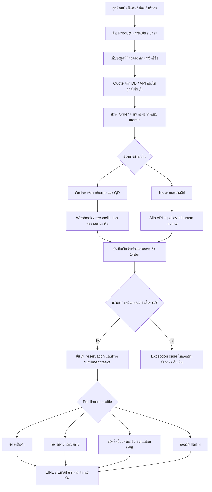

# ออกแบบ Order → Payment → Fulfillment ต่อจาก Product RAG

วันที่: 3 ตุลาคม 2026 · สถานะ: **ข้อเสนอการออกแบบ ยังไม่ได้ implement**

ต่อจาก [Product RAG design](product-rag-design.th.md) และ [Product RAG step by step](product-rag-design-step-by-step.th.md) สำหรับ backend นี้ โดยเริ่มจากหนึ่ง Company/LINE OA และเตรียมขอบเขตข้อมูลให้ขยายได้ ไม่ต้องสร้าง SaaS หรือ workflow engine เต็มรูปแบบก่อน

## 1. แนวทางที่แนะนำ

ให้ **RAG ช่วยหาสินค้าและตอบคำถาม → โค้ดสร้าง Order และกันทรัพยากร → Payment ยืนยันเงิน → Fulfillment ทำงานตามประเภทธุรกิจ → Notification แจ้งผล**

ลูกค้าบอก “สนใจ A” ยังไม่ควรได้รับ QR ทันทีถ้ายังไม่รู้ variant, จำนวน, วันใช้บริการ หรือยอดรวม ให้ถามข้อมูลที่จำเป็น แสดงสรุป และให้ยืนยันก่อนสร้างรายการเรียกเก็บเงิน การกดยืนยันต้องอ้าง quote/version ที่ระบบสร้าง ไม่ใช้ราคาจากข้อความลูกค้าหรือ LLM

แกนร่วมมี 5 ส่วน:

| ส่วน                 | หน้าที่                                 | ตัวอย่าง                                                |
| -------------------- | --------------------------------------- | ------------------------------------------------------- |
| Catalog / Quote      | เลือกสิ่งที่จะซื้อ คำนวณราคาและเงื่อนไข | เสื้อ A สีดำ M × 2; ห้อง 2 คืน; คอร์สรุ่นตุลาคม         |
| Order                | เก็บข้อตกลงการซื้อและเจ้าของรายการ      | รายการ ยอดรวม currency นโยบายและราคาขณะยืนยัน           |
| Resource reservation | กันสิ่งที่มีจำกัด                       | จำนวนสินค้า ห้องในช่วงวัน ที่นั่งเรียน เวลาช่าง         |
| Payment              | รับและตรวจหลักฐานการชำระเงิน            | Omise หรือโอนตรงพร้อมสลิป/แอดมินตรวจ                    |
| Fulfillment          | ส่งมอบสิ่งที่ซื้อ                       | เตรียมจัดส่ง ยืนยัน booking เปิด license ลงทะเบียนเรียน |

เริ่มด้วย NestJS modular monolith + PostgreSQL + BullMQ ที่มีอยู่ ใช้ transaction, inbox/outbox และ handler แบบกำหนดชนิดชัดเจน ยังไม่ต้องเพิ่ม microservices, agent framework หรือระบบลากวาง workflow

**ข้อเสนอ MVP:** หนึ่ง order มีหนึ่งรายการ/variant และหนึ่ง fulfillment profile, ชำระเต็มจำนวน THB, ไม่รองรับ split payment/มัดจำ/subscription ต่ออายุอัตโนมัติในรอบแรก แต่ให้หนึ่ง order มีหลาย payment attempts ได้ รองรับหลายประเภทธุรกิจผ่าน profile โดยเปิดใช้งานทีละประเภท

## 2. สิ่งที่พบใน repo และผลต่อการออกแบบ

| จุดที่ตรวจ                                                                                                                           | ปัจจุบัน                                                                  | สิ่งที่ต้องเพิ่ม                                                                                               |
| ------------------------------------------------------------------------------------------------------------------------------------ | ------------------------------------------------------------------------- | -------------------------------------------------------------------------------------------------------------- |
| [PaymentsService](../src/modules/payments/payments.service.ts), [controller](../src/modules/payments/payments.controller.ts)         | ยังเป็น class ว่าง                                                        | Payment orchestration, adapter, webhook และ review API                                                         |
| [UserPayment](../prisma/payment.prisma)                                                                                              | ผูก Member ด้วย username มี amount/status/ผู้อนุมัติ                      | ยังไม่มี Order, provider attempt, receipt identity, reservation หรือ fulfillment; ไม่ควรฝืนใช้เป็นแกนใหม่ทันที |
| [Prisma schema](../prisma/schema.prisma) และ Product design                                                                          | ยังไม่มี Product/Inventory/Order/Booking ที่เสนอ                          | ต้องทำ catalog และ authoritative availability ก่อนเปิดขายอัตโนมัติ                                             |
| [IntentRouterService](../src/modules/chatbot/intent-router.service.ts), [intent maps](../src/modules/chatbot/intent/intent.maps.ts)  | มี rule/menu และ REGISTER flow; ยังไม่มี checkout actions                 | เพิ่ม deterministic commerce actions และ flow ที่ validate ได้                                                 |
| [UserSessionService](../src/modules/chatbot/user-session.service.ts), [session types](../src/modules/chatbot/types/session.types.ts) | Redis workflow เดียวต่อ user, default sliding TTL 30 นาที; แยก admin mute | ขยาย validator และ flow types; session เป็น pointer ไม่ใช่ order หรือหลักฐานเงิน                               |
| [ChatbotService](../src/modules/chatbot/chatbot.service.ts)                                                                          | รูปเข้าเส้นทาง `answerImage()` หลัง mute gate                             | ต้องมี slip intake ก่อน general AI image analysis สำหรับบริบทชำระเงิน                                          |
| [LineDeliveryService](../src/modules/line/line-delivery.service.ts), `LineDelivery`                                                  | durable retry/accepted/finalized; payload หลักเป็น text                   | ขยาย typed persisted payload รองรับ QR image/Flex โดยรักษา recovery เดิม                                       |
| [AiBillingService](../src/modules/usage/billing/ai-billing.service.ts)                                                               | เครดิตสำหรับเรียก AI, reserve/settle/replay                               | ใช้ต่อเฉพาะ AI; **เงินซื้อสินค้าไม่เข้า CreditWallet/CreditLedger**                                            |
| [delivery mute tests](../src/modules/line/line-delivery-mute.spec.ts)                                                                | มี regression เรื่อง admin mute/accepted                                  | ต้องรักษาพฤติกรรมนี้เมื่อเพิ่ม payment notification                                                            |
| [E2E เดิม](../test/app.e2e-spec.ts)                                                                                                  | เป็น root endpoint smoke test                                             | ยังไม่ใช่หลักฐานว่า payment/booking รองรับ concurrency                                                         |

ข้อแตกต่างของเอกสารเดิม: Product design ฉบับแรกเสนอค้นทุก source แต่ฉบับ step-by-step เสนอเลือกแผนตาม query; checkout นี้ไม่ขึ้นกับทางเลือกนั้น เมื่อได้ product ID ที่ยืนยันแล้วให้อ่าน DB/API โดยตรง นอกจากนี้ `docs/mvp-line-rag-billing-flow.md` และ `docs/service-flow.md` ที่ถูกอ้างในเอกสารปัจจุบันไม่พบใน working tree ที่ตรวจ จึงใช้ source และ [LINE flow](line-message-e2e-current.md) ประกอบแทน

Product design มี `tenantId` nullable สำหรับ search; commerce ใหม่ควรใช้ `companyId` ที่ไม่เป็น null และ FK จริง ต้องกำหนด mapping จาก knowledge scope → Company ให้ชัด ห้ามเอา null scope มาใช้เป็นสิทธิ์อ่าน order ข้ามบริษัท

## 3. ภาพรวมการทำงาน



LLM ไม่เป็นผู้อนุมัติเงิน ไม่คำนวณยอด ไม่ลด stock ไม่สร้าง booking โดยตรง และไม่ตัดสินจากรูปว่าสลิปจริง การแจ้งรับเงินสำเร็จใช้ template จาก business event ได้เลย จึงทำงานได้แม้ AI ล่มหรือเครดิต AI หมด

## 4. Flow ร่วมก่อนชำระเงิน — ทีละขั้น

1. LINE webhook ผ่าน signature/deduplication/queue ตามเดิม บันทึกข้อความเข้าเพียงครั้งเดียว
2. ลูกค้าถาม “มี A ไหม” → Product RAG ค้นและ hydrate ราคา/availability สด คำตอบว่ามีของยังไม่ใช่การกันของ
3. ลูกค้าบอก “เอา A” หรือกดซื้อ → resolve `productId/variantId` จากรายการที่เสนอ หาก “เอาตัวนี้” อ้างได้หลายรายการ ให้ถามก่อน ห้ามเลือกตาม similarity อย่างเดียว
4. สร้างหรือ resume `CheckoutDraft` ที่ผูก Company, LINE member และ conversation; Redis เก็บเฉพาะ draft/order pointer กับ step
5. เก็บข้อมูลก่อนจ่ายตาม profile: สินค้า=variant/จำนวน/วิธีรับ; ห้อง=วันเข้าออก/จำนวนคน; นัดหมาย=บริการ/วันเวลา; คอร์ส=รุ่น/ผู้เข้าเรียนที่จำเป็น; software=plan/ระยะเวลา/บัญชีปลายทาง
6. อ่าน source of truth และคำนวณ `Quote` ด้วย Decimal รวมส่วนลด ภาษี ค่าส่ง และค่าใช้จ่ายอื่นที่ธุรกิจใช้ เก็บรายละเอียดแต่ละรายการ, policy version และ `expiresAt`
7. แสดงยอดสุดท้ายและเงื่อนไขให้ยืนยันด้วยปุ่มที่อ้าง `quoteId/version` หากค่าจัดส่งขึ้นกับที่อยู่ ต้องขอข้อมูลพื้นที่ก่อนจ่าย จะขอที่อยู่ทั้งหมดหลังจ่ายได้เฉพาะเมื่อยอดรวมไม่เปลี่ยน
8. เมื่อยืนยัน ตรวจ owner, quote expiry, product active, eligibility และ availability อีกครั้ง หากราคาเปลี่ยนนอกเงื่อนไข quote ให้เสนอราคาใหม่และขอยืนยันใหม่
9. ใน DB transaction เดียว: consume quote แบบ idempotent → สร้าง Order/OrderItem snapshot → กันทรัพยากร → สร้าง PaymentAttempt `CREATING` และ outbox สำหรับสร้าง QR
10. หลัง commit worker เรียก payment provider แล้วบันทึก charge ID/QR/expiry จากนั้นส่ง QR พร้อม order number, ยอด, เวลาหมดอายุ และปุ่มตรวจสถานะ/แจ้งปัญหา
11. ลูกค้าถามแทรกเรื่องสินค้าได้โดยไม่ลบ draft/order เมื่อกลับมาทำต่อโหลดสถานะจาก DB; ปุ่มเดิมต้องตรวจ version และสถานะทุกครั้ง

ตั้ง idempotency ของการยืนยันที่ `(companyId, buyerId, clientRequestId)` และ unique `Order.quoteId` เพื่อกันทั้ง retry เดิมและการกดหลายครั้งที่สร้างคนละ request ID ต้องมีการออก quote ใหม่อย่างชัดเจนสำหรับการซื้อซ้ำจริง

## 5. ช่องทาง A: Omise PromptPay

Omise รองรับ charge ของ PromptPay และ QR ของรายการ, event `charge.complete` และการอ่านสถานะ charge; `expires_at` ใช้กำหนดอายุ QR ได้ตามข้อจำกัด provider การตั้ง local order expired อย่างเดียวไม่ได้ทำให้ QR ของ provider หมดอายุ เอกสาร PromptPay ที่ตรวจยังระบุว่าไม่รองรับยกเลิก/คืนเงินผ่าน Omise สำหรับวิธีนี้ จึงต้องมี manual refund path และตรวจ capability จริงก่อนเปิดใช้ [เอกสาร PromptPay](https://docs.omise.co/th/promptpay/thailand)

### 5.1 สร้างและแสดง QR

1. Adapter รับ amount จาก order snapshot แปลง Decimal THB เป็นจำนวนสตางค์แบบ exact และตรวจ range ห้าม `Number(amount) * 100` เป็นการคำนวณ authoritative
2. เก็บ `merchantAccountId`, environment, attempt ID, request identity และเริ่มเรียก charge API **นอก transaction** ใช้ provider idempotency เฉพาะเมื่อ endpoint/version นั้นรองรับและทดสอบแล้ว
3. รับ charge ID แล้วผูกกับ attempt แบบ unique; เก็บ QR reference และ provider expiry ส่งผลเข้า outbox
4. ถ้า timeout หลังส่ง request ให้เป็น `UNKNOWN` และ reconcile ก่อน ห้ามสร้าง charge ใหม่โดยอัตโนมัติ ถ้า provider ไม่มีทางค้นกลับได้แน่นอนให้เปิด review case
5. QR จาก provider อาจเป็น SVG; แปลงอย่างปลอดภัยเป็น PNG/JPEG สำหรับ LINE image message หรือใช้หน้าชำระเงิน ห้ามส่ง SVG เป็น LINE image โดยตรง ตาม [LINE Messaging API](https://developers.line.biz/en/reference/messaging-api/nojs)
6. เก็บ immutable delivery payload; retry ใช้ QR เดิมของ attempt เดิม หาก QR หมดอายุก่อนส่งให้ยกเลิก notification นั้นและเสนอ flow สร้างรายการใหม่ที่ตรวจ stock อีกครั้ง

### 5.2 เมื่อโอนจริง

1. Payment webhook controller ตรวจ raw-body signature ตาม integration ที่ตั้งค่า, validate shape และผูก merchant/environment จาก trusted configuration
2. บันทึก `PaymentInboxEvent` แบบ durable/unique แล้วตอบ 2xx เร็ว; หาก DB บันทึกไม่ได้ให้ตอบ retryable error ไม่ตอบรับแล้วทิ้ง event ใช้ DB dispatcher กู้คืนการ enqueue ที่ล้มเหลว
3. Worker อ่าน charge จาก provider ด้วย credential ฝั่ง server ตรวจ `successful/paid`, amount, currency, merchant, environment และความสัมพันธ์กับ attempt ที่เคยสร้างไว้
4. อย่าเชื่อชื่อ event ว่าแปลว่าจ่ายสำเร็จเสมอ และอย่าเชื่อ order ID ใน metadata เพียงอย่างเดียว; event ที่หา attempt ไม่เจอเข้าคิว reconcile
5. ส่งผลที่ normalize แล้วเข้า `PaymentApplicationService` เดียวกับช่องทางสลิป ทำ transaction ตามข้อ 8
6. Outbox สร้าง fulfillment และ notification โดยไม่ต้องมีข้อความจากลูกค้าเข้ามาใหม่ ใช้ PUSH ตาม delivery/quota policy ไม่ใช้ reply token เก่า
7. Scheduled reconciliation ตรวจ attempt ที่ pending/unknown/ใกล้หมดอายุ เพื่อรับมือ webhook หายหรือมาช้า; ใช้ transition เดียวกันกับ webhook

Omise ปัจจุบันมีเอกสาร signature HMAC-SHA256 บน timestamp + raw body และ webhook secret ที่แยก test/live; adapter ต้องรองรับ rotation และมี replay protection ตามที่ตั้งค่า หากใช้ event verification แทนต้องเป็น deployment policy ที่ชัดเจน ห้าม fallback เมื่อ signature ผิด สำหรับระบบนี้เสนอให้ตรวจ signature และอ่าน charge ยืนยันอีกชั้น [เอกสาร Webhooks](https://docs.omise.co/api-webhooks?version=2019-05-22)

## 6. ช่องทาง B: โอนตรง + สลิป + ตรวจโดยคน

### 6.1 API และ library ที่พิจารณาได้

| ตัวเลือก                                                                     | ใช้ทำอะไร                                                                                                              | ขอบเขตที่ต้องเข้าใจ                                                                                                                           |
| ---------------------------------------------------------------------------- | ---------------------------------------------------------------------------------------------------------------------- | --------------------------------------------------------------------------------------------------------------------------------------------- |
| [SlipOK API](https://slipok.com/api-documentation/check-slip/)               | รับไฟล์/QR data/URL เพื่อตรวจข้อมูลธุรกรรม; รองรับ expected amount และ `log: true` สำหรับตรวจผู้รับที่ผูกไว้และสลิปซ้ำ | ไม่ส่ง `log: true` จะไม่ได้ตรวจซ้ำตามโหมดนั้น ต้องเก็บ dedupe ใน DB ของเราเองเสมอ                                                             |
| [EasySlip developer portal](https://developer.easyslip.com/)                 | ตัวเลือกบริการตรวจสลิปอีกเจ้า                                                                                          | หน้า portal ที่ตรวจไม่คืนรายละเอียด endpoint ให้เครื่องมืออ่าน จึงยังไม่ยืนยัน field/version/เงื่อนไข dedupe; ทำ sandbox comparison ก่อนเลือก |
| [promptpay-qr](https://github.com/dtinth/promptpay-qr/blob/master/README.md) | สร้าง payload QR พร้อมเพย์สำหรับโอนตรง                                                                                 | ไม่ยืนยันเงินเข้า ไม่สร้าง webhook และไม่ตรวจสลิป                                                                                             |
| QR decoder / OCR                                                             | อ่านข้อมูลภาพหรือรหัสบนสลิป                                                                                            | ไม่ใช่หลักฐานว่าบัญชีร้านได้รับเงินจริง ต้องส่งไปตรวจแหล่งที่เชื่อถือได้                                                                      |

สำหรับ MVP เลือก **หนึ่ง SlipVerificationAdapter** เริ่มทดลอง SlipOK ได้จากเอกสารที่ตรวจพบ อย่าผูก core กับ response ของผู้ขาย และอย่าเพิ่มหลาย SDK ตั้งแต่ต้น ใช้ HTTP client ที่ repo มีอยู่ได้ ทดสอบธนาคารที่ลูกค้าใช้, รูปเบลอ, ความล่าช้า, quota, masked recipient และข้อกำหนดเก็บข้อมูลก่อนตกลงใช้งานจริง ไม่สมมุติราคา/SLA หรือความครอบคลุมทุกธนาคาร

**QR โอนตรงแม้ใส่ยอดก็ไม่ได้เป็น charge ที่ติดตามโดย provider:** ลูกค้าอาจโอนหลังหมดเวลา หรือหลายคนโอนยอดเท่ากัน ต้องจับคู่ด้วย order + หลักฐานธุรกรรม ไม่ใช้ยอดเงินหรือชื่อผู้โอนเป็น identity

### 6.2 Flow รับและตรวจสลิป

1. Order อยู่ในขั้นรอชำระเงิน ลูกค้าเลือก “แจ้งโอน/ส่งสลิป” ระบบผูกการอัปโหลดกับ order ที่เจ้าของมีสิทธิ์
2. LINE image event ดาวน์โหลดผ่าน media API ฝั่ง server แล้วเก็บ private object storage ตรวจ MIME จริง ขนาด และรูปแบบ ห้ามเอา arbitrary URL จากผู้ใช้ไป fetch โดยไม่ป้องกัน SSRF
3. Image intake ตรวจ durable pending payment context ก่อน general AI image flow; ถ้ามีหลาย order ให้ถามเลือกรายการ ถ้าไม่มีบริบทให้ขอให้เลือก order/วัตถุประสงค์ ไม่เอารูปที่ยังไม่ระบุบริบทเข้า LLM โดยอัตโนมัติ
4. บันทึก `SlipSubmission` ผูก LINE message ID; event ซ้ำไม่สร้าง submission ซ้ำ ส่งงานตรวจ API นอก transaction รูป/PII ไม่เข้า RAG, prompt หรือ chat context
5. Slip adapter เก็บ normalized transaction reference, amount, receiver, transfer time และ verification result; เก็บ raw evidence แบบจำกัดสิทธิ์และมี retention
6. Policy ตรวจความถูกต้องของธุรกรรม ผู้รับ/merchant ที่ตั้งค่าไว้ ยอดตรง currency และช่วงเวลาที่อนุญาต รวมถึงการใช้ธุรกรรมนั้นไปแล้ว ต้องตรวจผู้รับจากผลที่เชื่อถือได้; masked account/ชื่อคล้ายกันที่พิสูจน์ไม่ได้ให้ review
7. บันทึก bank transaction identity แบบ unique ข้าม slip submissions และข้าม verification vendors ที่อ้างธุรกรรมเดียวกัน; image hash ช่วยจับรูปเดิมแต่ใช้แทน bank reference ไม่ได้
8. ตั้ง review policy แยกจาก API result: `AUTO_WHEN_VERIFIED`, `ALWAYS_REVIEW` หรือ `REVIEW_ON_EXCEPTION` สำหรับเริ่มใช้งานเสนอ `ALWAYS_REVIEW` แล้วค่อยเปิด auto หลังวัดผลจริง
9. ถ้ารอคน ระบบตอบ “ได้รับสลิปแล้ว อยู่ระหว่างตรวจสอบ” พร้อมเปิด admin case ไม่ตอบว่าได้รับเงินแล้ว API timeout เป็น `INCONCLUSIVE/RETRYABLE` ไม่กล่าวหาว่าสลิปปลอม
10. แอดมินที่มี role/Company ถูกต้องตรวจข้อมูลกับรายการเงินจริง กด approve/reject ด้วย request ID, expected version, เหตุผล และหลักฐาน อนุมัติจากรูปดูน่าเชื่อถืออย่างเดียวไม่พอ
11. Approve ที่ผ่านเงื่อนไขเรียก transaction ชุดเดียวกับ gateway; approve ซ้ำ/concurrent ต้องคืนผลเดิม Reject submission ไม่แปลว่า cancel order และให้ส่งหลักฐานใหม่ได้ตาม deadline/policy

แยก `verificationStatus`, `reviewStatus` และ `paymentStatus`: “API ตรวจสลิปได้” อาจยังไม่ผ่าน policy; “แอดมินรับเรื่องแล้ว” ยังไม่ใช่เงินรับเข้า ห้าม approve ทะลุข้อห้าม duplicate transaction, cross-company หรือรับเงินไม่ครบ โดยการเปลี่ยน boolean เดียว

หากลูกค้าจ่าย Omise แล้วแนบสลิป ให้ตรวจ charge เดิมก่อน สลิปเป็นหลักฐานประกอบ ห้ามนับเป็นเงินโอนตรงอีกครั้ง สร้าง manual-transfer attempt ได้เมื่อมีการเปลี่ยนช่องทางอย่างชัดเจน และตรวจ QR เดิม/ความเสี่ยงจ่ายซ้ำ

## 7. State model: แยกสถานะเพื่อไม่ให้ “จ่ายแล้ว” แปลว่า “ส่งมอบแล้ว”

ชื่อด้านล่างเป็น contract ที่เสนอ ไม่ใช่ enums ที่มีอยู่แล้วใน repo

| Entity              | สถานะหลักที่เสนอ                                                                                     | ความหมาย                                                        |
| ------------------- | ---------------------------------------------------------------------------------------------------- | --------------------------------------------------------------- |
| Order               | `DRAFT → AWAITING_PAYMENT → CONFIRMED → COMPLETED`; `CANCELLED / EXPIRED / EXCEPTION`                | ภาพรวมข้อตกลงและการส่งมอบ                                       |
| PaymentAttempt      | `CREATING → PENDING → SUCCEEDED / FAILED / EXPIRED`; `UNKNOWN` รอ reconcile                          | ผลจากช่องทางชำระเงิน; slip pending อาจมี review ค้างอยู่        |
| Order payment state | `UNPAID / PAID / REFUND_PENDING / PARTIALLY_REFUNDED / REFUNDED`                                     | สรุปจาก receipt allocation/refund ไม่ใช่สถานะของ attempt ล่าสุด |
| ResourceReservation | `HELD → COMMITTED / RELEASED / EXPIRED`                                                              | กันชั่วคราวแล้วแปลงเป็นการจัดสรรจริงเพียงครั้งเดียว             |
| FulfillmentTask     | `PENDING → WAITING_INPUT / RUNNING → SUCCEEDED`; `RETRYABLE / UNKNOWN / MANUAL_REQUIRED / CANCELLED` | งานแต่ละขั้นหลังเงินเข้า                                        |
| Slip review         | `PENDING → APPROVED / REJECTED`                                                                      | การตัดสินโดย policy/คน พร้อม audit                              |

ตัวอย่างที่ถูกต้อง: `Order=EXCEPTION`, payment=`PAID`, fulfillment=`MANUAL_REQUIRED` เมื่อเงินมาหลังห้องถูกขายไปแล้ว ห้ามซ่อนเงินที่รับโดยเปลี่ยน attempt เป็น failed

เมื่อ receipt ที่สองเข้ามาหลัง order paid ให้เก็บเป็นเงินจริงอีกก้อนและเปิด overpayment case ไม่ fulfill ซ้ำ และไม่ทิ้ง webhook ด้วยเหตุผลว่า “order จบแล้ว” การคืนเงินมี record แยก ไม่แก้ประวัติ receipt สำเร็จเป็นล้มเหลว

## 8. Transaction กลางเมื่อยืนยันเงิน

ทุกทางเข้า ได้แก่ gateway webhook, polling reconciliation และ manual approval ต้องจบที่ application service เดียว ไม่ทำ stock decrement แยกใน controller แต่ละตัว

```text
รับ verified payment result (เรียก provider เสร็จนอก transaction)
BEGIN
  lock Order + PaymentAttempt + reservation/resource rows ตามลำดับคงที่
  ตรวจ company/owner, amount/currency, attempt identity และ state/version
  insert หรือโหลด PaymentReceipt ด้วย unique external transaction identity
  ถ้า receipt นี้ถูก apply แล้ว: คืนผลเดิม โดยไม่สร้าง effect ซ้ำ
  ถ้า order paid แล้ว: เก็บ excess receipt + exception case ไม่ fulfill ซ้ำ
  ถ้ารายการพร้อมรับเงินตามข้อตกลง:
    allocate receipt ให้ order; ตั้ง payment state = PAID
    commit HELD reservation ที่ยังใช้ได้
    หรือ reacquire แบบ atomic ตาม late-payment policy
    ถ้าสำเร็จ: Order = CONFIRMED; สร้าง FulfillmentTask ที่ unique
    ถ้าไม่สำเร็จ: Order = EXCEPTION; สร้าง case สำหรับจัดสรรใหม่/คืนเงิน
  ถ้ายอดไม่ตรง/รายการถูกยกเลิก: เก็บเงินจริงเป็น unallocated receipt + case
  บันทึก audit + outbox events ที่ unique ต่อ business transition
COMMIT
outbox workers ส่ง notification / เรียก fulfillment provider
```

Reject review และ approve ต้องใช้ compare-and-set จาก `PENDING` ภายใต้ lock เดียวกัน ถ้ามีคนตัดสินแล้วคืนผลเดิมหรือ conflict ที่ระบุได้ ห้าม last-write-wins; การแก้คำตัดสินใช้คำสั่งแยกและ audit ใหม่

หนึ่ง receipt จัดสรรได้ไม่เกินเงินจริง และ MVP หนึ่งธุรกรรมใช้กับหนึ่ง order; การโอนขาด/เกินไม่ auto accept ให้แอดมินแก้ผ่าน adjustment/refund process ที่แยกชัดเจน ห้ามแก้ total ของ order ย้อนหลังเพื่อให้ตรงสลิป

## 9. Stock, ห้องพัก, ที่นั่ง และเวลานัด

### 9.1 สินค้าจำนวนชิ้น

เสนอใช้ `onHand`, `held`, `allocated` แยกกัน:

```text
available = onHand - held - allocated
ยืนยัน checkout: held += quantity เมื่อ available เพียงพอ
ยืนยันเงิน:     held -= quantity; allocated += quantity
หมดอายุก่อนจ่าย: held -= quantity
ส่งสินค้า:      onHand -= quantity; allocated -= quantity
```

ทั้งหมดเปลี่ยนใน transaction พร้อม reservation/movement ที่มี operation key และ DB constraint ป้องกันค่าติดลบ การยกเลิกก่อนจัดส่งคืน allocation ได้ตาม policy; คืนเงินหลังส่งของไม่เพิ่ม stock ทันที ต้องมี return inspection ที่ยืนยันว่ารับสินค้าคืนจริง

จุดสำคัญ: ของขายได้ลดตั้งแต่ **HELD**; ของที่จ่ายแล้วไม่ถูกคืนเพียงเพราะลูกค้ายังไม่กรอกที่อยู่ และไม่ควรลดจำนวนซ้ำทั้งตอนจ่ายและตอนจัดส่งโดยไม่มีนิยาม counter ชัดเจน

### 9.2 ห้องพัก

1. เก็บ local stay dates ของโรงแรมและ timezone; ช่วง `[checkIn, checkOut)` เช่น เข้า 10 ออก 12 ตุลาคม = ใช้คืนวันที่ 10 และ 11
2. ถ้าขายตาม room type ใช้ capacity รายวัน ต้อง lock/update ทุกคืนใน transaction เดียวกันตามลำดับวันที่ ถ้าขาดคืนใดคืนหนึ่ง rollback ทั้งหมด
3. จ่ายแล้วแปลง hold เป็น confirmed booking allocations; hold TTL ใช้กับช่วงรอเงินเท่านั้น ไม่ใช้เป็นวันหมดอายุ booking ที่จ่ายแล้ว
4. ถ้าขายห้องหมายเลขเฉพาะ ใช้ช่วงเวลาที่ป้องกัน overlap ที่ DB เช่น exclusion constraint พร้อม migration ที่ทดสอบแล้ว; unique `(roomId, checkIn)` อย่างเดียวกันวันซ้อนกันไม่ได้
5. เลื่อนวันพักเป็น workflow ใหม่: ตรวจราคา/availability และ swap allocations แบบ atomic; ไม่เขียนวันใหม่ทับแล้วหวังว่าห้องยังว่าง

### 9.3 บริการ คอร์ส และ software

| ธุรกิจ               | สิ่งที่กันก่อนจ่าย                                | หลังจ่าย                                                            |
| -------------------- | ------------------------------------------------- | ------------------------------------------------------------------- |
| นัดบริการ            | provider/resource + time slot + capacity          | ยืนยัน appointment หรือรอแอดมินจัดคิวตามที่แจ้งก่อนจ่าย             |
| คอร์สเรียน           | cohort/session + seat count                       | สร้าง Enrollment แบบ unique ต่อ order item และตรวจนโยบายผู้เรียนซ้ำ |
| Software license     | license pool ถ้ามีจำนวนจำกัด; ถ้าไม่จำกัดใช้ NONE | provision account/entitlement ผ่าน API และเก็บ external reference   |
| บริการที่ต้องประเมิน | ตาม policy หรือ NONE                              | สร้างงานให้แอดมิน ไม่สัญญาว่าได้รับบริการเรียบร้อยแล้ว              |

ใช้ `ResourceReservation` เป็นหัวรายการร่วม แต่แยกตาราง/adapter inventory, nightly capacity และ time slots ตาม semantics ห้ามใช้ stock integer ตัวเดียวแทนทุกธุรกิจ

### 9.4 Expiry และการแข่งขันกับเงินเข้า

กำหนด `quoteExpiresAt`, `paymentExpiresAt`, `holdExpiresAt` แยกกัน เช่น quote 5 นาที, QR 15 นาที, hold ถึง QR expiry + reconciliation grace เป็นเพียงค่าตัวอย่าง ต้องกำหนดตามธุรกิจและ provider ไม่ใช้ Redis TTL เป็นตัวหมดอายุธุรกรรม

Expiry worker กับ payment worker ใช้ row locks/CAS ชุดเดียวกัน ก่อน release ตรวจผล provider นอก transactionแล้วกลับมาตรวจ state อีกครั้ง ใช้ `paidAt` ประกอบ แต่ timestamp เพียงอย่างเดียวไม่ทำให้ทรัพยากรที่ปล่อยไปแล้วกลับมาว่าง

หาก provider ยัง unknown เมื่อถึง deadline ให้ policy เลือก hold grace แบบมีเพดานหรือ release แล้วเปิดความเสี่ยง late payment ชัดเจน ห้าม hold ตลอดไปและห้ามถือว่าไม่ได้เงินเพียงเพราะ timeout

โอนตรงไม่มี provider expiry ที่บังคับธนาคารหยุดรับเงินได้; ส่งสลิปก่อน deadline อาจขยาย hold ถึง review deadline แบบจำกัด แต่ไม่อนุญาตให้อัปโหลดซ้ำเพื่อยืดเวลาไม่สิ้นสุด

## 10. งานหลังชำระเงินที่ใช้ร่วมกันได้

ใช้ **FulfillmentProfile แบบ versioned** ประกอบจาก handler ที่ระบบอนุญาต แทนการใส่ prompt ว่า “ถ้าลูกค้าจ่ายแล้วให้ทำอะไรก็ได้” บันทึก version ลง order ตอนยืนยัน เพื่อไม่ให้ admin เปลี่ยน config แล้ว order เก่าเปลี่ยนพฤติกรรม

| Profile               | ลำดับงานหลัก                                                                       | ข้อความที่แสดงได้                                                                |
| --------------------- | ---------------------------------------------------------------------------------- | -------------------------------------------------------------------------------- |
| `PHYSICAL_SHIPPING`   | collect missing address → validate → create shipment task → admin/carrier dispatch | “ได้รับชำระเงินแล้ว กรุณาระบุที่อยู่” แล้วค่อยแจ้งเลขติดตามเมื่อมีจริง           |
| `ROOM_BOOKING`        | confirm booking allocation → collect remaining guest details → issue confirmation  | “ยืนยันการจอง 10–12 ต.ค.” เมื่อ booking สำเร็จจริง                               |
| `SERVICE_APPOINTMENT` | confirm slot → collect service details → notify staff                              | “ยืนยันนัดเวลา…” หรือ “รับชำระแล้ว รอเจ้าหน้าที่นัดหมาย” ตามผลจริง               |
| `SOFTWARE_ACCESS`     | collect/verify destination account → provision entitlement → send activation link  | “ได้รับชำระแล้ว กำลังเปิดสิทธิ์” ก่อน API สำเร็จ และ “เปิดสิทธิ์แล้ว” หลังสำเร็จ |
| `COURSE_ENROLLMENT`   | collect learner details → enroll cohort → send schedule/access                     | “ลงทะเบียนเรียนสำเร็จ” เมื่อ Enrollment commit แล้ว                              |
| `ADMIN_FOLLOWUP`      | create case with owner/SLA → notify admin → staff completes task                   | “ได้รับชำระเงินแล้ว เจ้าหน้าที่จะติดต่อเพื่อดำเนินการต่อ”                        |

ตัวอย่าง configuration ที่เสนอ (ไม่ใช่ runtime config ปัจจุบัน):

```json
{
  "key": "PHYSICAL_SHIPPING",
  "version": 1,
  "reservationKind": "INVENTORY",
  "paymentMethods": ["OMISE_PROMPTPAY", "MANUAL_TRANSFER"],
  "slipReviewPolicy": "ALWAYS_REVIEW",
  "requiredBeforePayment": ["variantId", "quantity", "shippingMethod"],
  "steps": [
    { "key": "address", "handler": "COLLECT_SHIPPING_ADDRESS" },
    {
      "key": "shipment",
      "handler": "CREATE_SHIPMENT_TASK",
      "dependsOn": ["address"]
    }
  ],
  "notifications": [
    {
      "event": "PAYMENT_APPLIED",
      "channel": "LINE",
      "template": "payment_received"
    },
    {
      "event": "SHIPMENT_DISPATCHED",
      "channel": "EMAIL",
      "template": "shipment_dispatched"
    }
  ]
}
```

ตัวอย่างนี้ใช้ได้เมื่อค่าส่งตายตัวและไม่ขึ้นกับที่อยู่ มิฉะนั้นเพิ่มข้อมูลคำนวณค่าส่งใน `requiredBeforePayment` schema config ต้องตรวจ handler allowlist, prerequisites, dependency cycles และ field definitions ห้ามรัน arbitrary code/URL จาก JSON

เก็บ core invariants เป็น typed columns ส่วน custom fields ใช้ JSONB + Zod schema ตาม version แยก PII ออกจาก generic metadata และแยก `collect input`, `business effect`, `notification` เป็นคนละ task เพื่อ retry email แล้วไม่ provision license ซ้ำ

งานที่เรียก API ภายนอกใช้ idempotency key คงที่และเก็บ external reference หาก timeout และปลายทางไม่มี idempotency/status lookup ให้ `UNKNOWN → MANUAL_REQUIRED` ก่อนลองใหม่ ห้ามอ้าง exactly-once สำหรับ side effect ที่ปลายทางไม่รองรับ

หาก inventory/booking อยู่ใน PMS/ERP ภายนอก ให้ระบบนั้นเป็นเจ้าของ availability ใช้ remote hold ID และ saga แบบ persist intent → call → reconcile/compensate ไม่อ้างว่า DB transaction ของเราครอบคลุมปลายทาง ถ้าไม่มี API กันทรัพยากรที่เชื่อถือได้ให้ใช้แอดมินยืนยันก่อนเรียกเก็บเงินสำหรับของมีจำกัด

## 11. Session, การถามที่อยู่ และ admin handoff

**DB เป็นสถานะธุรกิจ; Redis เป็นตำแหน่งบทสนทนา** เช่น:

```json
{
  "flow": "CHECKOUT",
  "step": "WAITING_PAYMENT",
  "data": { "draftId": "...", "orderId": "...", "expectedVersion": 3 }
}
```

เป็นเพียงส่วนของ proposed session; implementation ต้องคง `userId/status` ตาม type เดิมและเพิ่ม CHECKOUT ใน runtime validator ด้วย หลังจ่ายอาจเป็น `FULFILLMENT_INPUT` ที่ชี้ task ID ไม่เก็บจำนวนเงินเป็นความจริงใน session

1. เมื่อ Redis หมดอายุ โหลด order/task ที่ยังเปิดอยู่จาก DB ของ buyer เดิม ถ้ามีหลายรายการให้เลือก ห้ามเดาจาก “ล่าสุด” แล้วแนบสลิปผิดรายการ
2. Payment webhook อัปเดต DB และสร้างข้อความได้โดยไม่พึ่ง session; ไม่เขียนทับ REGISTER หรือ checkout อื่นที่ลูกค้ากำลังทำอยู่
3. ที่อยู่/ข้อมูลผู้เรียนเก็บในแบบฟอร์มที่ตรวจสอบสิทธิ์และ validate ได้ เช่น authenticated LIFF/หน้าเว็บที่ต้องพัฒนาเพิ่ม หากรับผ่านแชต ให้ deterministic parser รับข้อมูลและ redact ก่อนเข้าสู่ context/log
4. ก่อนจ่ายเก็บเฉพาะข้อมูลที่จำเป็นต่อราคา/availability/eligibility; หลังจ่ายเก็บส่วนที่เหลือได้ ข้อมูลที่จำเป็นต่อส่งมอบขาดให้ task `WAITING_INPUT` พร้อม reminder/SLA ไม่ถือว่า order ล้มเหลวทันที
5. CANCEL ระหว่าง draft = ออกจาก flow; ยกเลิก order ที่มี QR ต้องเข้าคำสั่ง cancel เฉพาะและ reconcile; order paid ต้องเข้าคำขอยกเลิก/คืนเงิน ไม่ใช้การ clear session แทน
6. รักษา `waiting_admin` ว่าเป็นคำขอให้คนช่วย และยังถาม AI ได้; actual admin reply ใช้ mute TTL เดิม ไม่ลบ registration เพื่อแสดง handoff
7. แม้ admin mute อยู่ webhook/receipt/fulfillment worker ต้องทำธุรกรรมต่อได้ ส่วน customer notification เคารพ mute เดิม: เก็บ notification task เป็น deferred และแจ้ง admin; เมื่อหมด mute ประเมินข้อความล่าสุดก่อนส่ง ไม่ส่งข้อความที่แอดมินตอบไปแล้วซ้ำโดยอัตโนมัติ
8. เส้นทางรับสลิปในช่วง mute ต้องออกแบบเป็น business intake ที่ยังบันทึกหลักฐาน/เปิด review ได้ โดยไม่เปิด AI กลับเองและไม่ bypass นโยบายข้อความอัตโนมัติ

## 12. Data model ที่เสนอ

ยังไม่ใช่ Prisma schema พร้อม migrate รายชื่อด้านล่างคือ boundaries และ constraints ที่ต้องออกแบบ migration ต่อ ทุกข้อมูล commerce มี `companyId` บังคับและใช้ composite FK/validation กัน reference ข้ามบริษัท

| Entity                                 | ข้อมูลสำคัญ / constraint                                                                                                            |
| -------------------------------------- | ----------------------------------------------------------------------------------------------------------------------------------- |
| `CheckoutDraft`                        | buyer, conversation, selected item, step, version, expiry; ล้างตาม retention                                                        |
| `OrderQuote`                           | items/price/fees snapshot, currency, policy/profile version, expiresAt, owner                                                       |
| `CommerceOrder`                        | companyId, buyerLineMemberId, quoteId unique, orderNumber unique ต่อ company, total Decimal, lifecycle/version                      |
| `OrderItem`                            | product/variant reference, ชื่อ/SKU/ราคา/จำนวน snapshot, fulfillmentProfileVersion; ประวัติยังอ่านได้เมื่อ catalog ปิดใช้งาน        |
| `ResourceReservation`                  | orderItem, kind, status, expiresAt, operationKey unique; มี child allocations ตามชนิด                                               |
| `InventoryBalance/InventoryMovement`   | counters และ append-only movement พร้อม unique operation key                                                                        |
| `RoomNightAllocation / SlotAllocation` | resource/date/quantity และ constraint ตาม capacity; ไม่เก็บเฉพาะข้อความวันใน JSON                                                   |
| `PaymentAttempt`                       | order, method, merchant/environment, requested amount, state, provider charge ID unique ใน namespace provider                       |
| `PaymentReceipt`                       | external transaction identity unique,เงินจริง/เวลา/แหล่ง/verification evidence; ไม่ลบ receipt เมื่อ refund                          |
| `PaymentAllocation`                    | receipt → order, amount, operation key; serialize allocation ป้องกันใช้เงินก้อนเดียวซ้ำ                                             |
| `SlipSubmission / SlipReview`          | owner/order/message ID/file key, normalized evidence, review status, reviewer/reason/version                                        |
| `PaymentInboxEvent`                    | provider + merchant + environment + eventId unique, payload hash, lease/retry/status; event ID เดิมแต่ payload เปลี่ยนต้องแจ้งเตือน |
| `OutboxEvent`                          | aggregate ID/version + event type unique, payload ที่ไม่เกินจำเป็น, dispatch lease/retry                                            |
| `FulfillmentTask`                      | unique `(companyId, orderItemId, profileVersion, stepKey)`, state, input reference, external ID, attempt/lease                      |
| `OrderPrivateDetails`                  | shipping/guest/learner/email data ที่จำกัดสิทธิ์และ retention แยกจาก context                                                        |
| `NotificationTask`                     | unique business event + channel + template version + recipient identity; delivery ID/provider ID/status                             |
| `CommerceCase / AuditEvent`            | review/exception/fulfillment owner, dueAt, reason, actor, transitions                                                               |
| `CommerceRefund`                       | receipt/order, amount, reason, approval, method, external reference, state, idempotency key                                         |

ข้อกำหนดเพิ่มเติม:

- เงินใช้ Decimal ใน DB/service; provider payload ใช้ minor units ที่แปลง exact เก็บ requested/received/refunded แยกกัน ไม่เปิดเผยค่าต้นทุน provider หรือ AI cost ให้ลูกค้า
- Receipt dedupe ของโอนตรงควร normalize ตาม bank/recipient account/transaction reference ตามความหมายจริงของ provider ห้ามใส่ชื่อ slip vendor ใน key แล้วทำให้ธุรกรรมเดียวใช้ซ้ำผ่านอีก vendor ได้ หาก reference พิสูจน์ความเป็นเอกลักษณ์ไม่ได้ให้ manual review
- หากหลาย Company ใช้บัญชีรับเงินเดียว ต้องมี account-level dedupe ข้าม Company โดยไม่เปิดเผยข้อมูล order ของอีกบริษัท ทางเลือกง่ายสำหรับระยะแรกคือบังคับหนึ่งบัญชีต่อ Company
- อย่าใช้ nullable tenant ใน unique ทางการเงิน; indexes ครอบคลุม `(companyId, buyerId, createdAt)`, pending expiry/retry, provider identity และ case dueAt
- ใช้ restrictive delete/FK กับประวัติเงินและ order; soft-disable catalog/profile แทน cascade ลบประวัติซื้อ
- Refund รวมต้องไม่เกินเงินที่รับ ห้ามถือว่าสั่ง refund แล้วคืนสำเร็จ ต้องเก็บ acceptance/result และ reconcile; manual bank refund เก็บหลักฐานและผู้อนุมัติ และห้าม retry โอนเงินเมื่อผลยัง unknown

## 13. โครงสร้าง module และ API ที่ควรเพิ่ม

```text
src/modules/commerce/
  checkout/        CheckoutFlowService, QuoteService
  orders/          OrderService, OrderQueryService
  reservations/    ResourceReservationService + inventory/room/slot adapters
  fulfillment/     FulfillmentOrchestrator + allowlisted handlers
  notifications/   NotificationTaskService (เรียก LINE delivery เดิม / email adapter)
  events/          Inbox/Outbox dispatcher + recovery
src/modules/payments/
  PaymentApplicationService, PaymentReviewService, PaymentReconciliationService
  providers/       PaymentGateway interface + Omise adapter
  slips/           SlipVerification interface + SlipOK adapter
  webhooks/        provider controller / validated DTO
```

ชื่อ/path เป็นข้อเสนอ ปรับตาม boundaries ที่มีจริงตอน implement; ใช้ Prisma/Redis/BullMQ/NotificationService เดิม ไม่สร้าง infrastructure ซ้ำ

| Command/API ที่เสนอ                      | สิทธิ์และพฤติกรรม                                                                                         |
| ---------------------------------------- | --------------------------------------------------------------------------------------------------------- |
| create quote / confirm checkout          | authenticated buyer หรือ trusted LINE worker; server resolve company/buyer; idempotency + expectedVersion |
| get order / get payment status           | ตรวจ company และ buyer ownership; backend อ่าน provider เมื่อจำเป็นโดย rate limit                         |
| submit slip / fulfillment input          | ตรวจ order/task ownership และสถานะ; จำกัดขนาด/จำนวน submission                                            |
| payment webhook                          | provider authentication, durable inbox; ไม่ใช้ admin JWT และไม่เชื่อ company ใน body                      |
| admin approve/reject slip                | admin JWT + role + company ownership + audit + CAS                                                        |
| admin retry fulfillment / refund request | role เฉพาะ, audit, business transition และ idempotency                                                    |

Router เพิ่ม actions เช่น `START_CHECKOUT`, `CONTINUE_CHECKOUT`, `CHECK_ORDER_STATUS`, `SUBMIT_PAYMENT_EVIDENCE` และ `CONTINUE_FULFILLMENT` โดย trace union/maps/switch/menu tests ทั้งหมดก่อนเปลี่ยน `RuleIntentService` ยังห้าม I/O; `IntentRouterService` ตัดสิน route; `ChatbotService` เรียก flow service ที่ทำงานจริง

KnowledgeRetrievalService ยังเป็น retrieval entry point เดียว LLM extract ความต้องการเป็นข้อมูลที่ยังต้อง validate ได้ แต่ห้ามรับ tool call จาก LLM แล้วลด stock/approve เงินโดยข้าม confirmation และ ownership checks

## 14. LINE, Email และ notification หลังชำระเงิน

1. แยก event `PAYMENT_APPLIED`, `ORDER_EXCEPTION`, `BOOKING_CONFIRMED`, `ACCESS_PROVISIONED`, `ENROLLMENT_CONFIRMED`, `SHIPMENT_DISPATCHED`; เลือก template ตาม event ไม่ใช้ข้อความ “สำเร็จ” ก้อนเดียวทุกสถานะ
2. ขยาย durable LINE payload แบบ versioned เช่น text/image/Flex พร้อม migration/backfill จาก text เดิม และรองรับ legacy readers ช่วง deploy; QR และปุ่มต้อง replay ได้โดยไม่สร้าง order ใหม่
3. Notification worker สร้าง `LineDelivery.key` จาก task/business event แบบคงที่ ใช้ delivery retry/accepted/finalized เดิม ไม่ยิง LINE โดยตรงจาก payment service
4. Provider webhook ไม่มี LINE reply token; ใช้ PUSH ภายใต้ policy/quota ถ้าส่งไม่ได้เก็บ task และแจ้งแอดมิน ผลการชำระเงินยังสำเร็จ
5. Email เป็น adapter แยก ส่งเมื่อมี email ที่ลูกค้าให้สำหรับธุรกรรมนี้ ตรวจรูปแบบและยืนยันการเป็นเจ้าของก่อนส่ง access link/ข้อมูลอ่อนไหว ใช้ short-lived activation link ไม่ส่ง plaintext password/license secret ลงแชตหรือ log
6. Persist template version + rendered payload ที่จำเป็นแบบเข้าถึงจำกัด; retry ไม่เรียก LLM เขียนใหม่ และไม่ทำ business effect ซ้ำ
7. Email timeout อาจมีการส่งสำเร็จแล้ว หาก provider ไม่มี idempotency/status lookup ต้องแสดง `UNKNOWN` และใช้ policy ที่ยอมรับ duplicate risk อย่างชัดเจน ไม่อ้างรับประกัน exactly-once

## 15. Failure cases ที่ต้องตัดสินใจก่อนเปิดใช้

| เหตุการณ์                                 | พฤติกรรมที่แนะนำ                                                                                   |
| ----------------------------------------- | -------------------------------------------------------------------------------------------------- |
| ซื้อชิ้นสุดท้ายพร้อมกัน                   | transaction/conditional update ให้สำเร็จได้รายเดียว อีกคนไม่เห็น QR ที่รับเงินแล้วส่งของไม่ได้     |
| charge create timeout                     | UNKNOWN + reconcile; ไม่ออก QR ใหม่จนรู้ผล                                                         |
| webhook ซ้ำ/สลับลำดับ                     | unique inbox + monotonic business transitions; event เก่าไม่เปลี่ยน paid กลับ pending              |
| DB commit แล้ว queue ล่ม                  | outbox/inbox dispatcher enqueue ใหม่โดยไม่ต้องรอลูกค้าทัก                                          |
| LINE ส่งรับเงินล้มเหลว                    | retry notification; ไม่ย้อน receipt/stock                                                          |
| โอนหลัง hold หมด                          | บันทึกเงิน ตรวจ availability ใหม่แบบ atomic; ไม่พอให้ exception/refund case                        |
| จ่ายสอง attempt                           | เก็บเงินจริงทั้งคู่ fulfill หนเดียว ส่วนเกินเข้าคืนเงิน/review                                     |
| สลิปใบเดียวส่งสอง order                   | DB unique transaction identity ปฏิเสธ allocation ครั้งที่สอง                                       |
| Slip API คืน duplicate เพราะ retry ของเรา | อ่านผลและ receipt เดิม จับคู่ identity; ห้าม reject ลูกค้าอัตโนมัติโดยดูคำว่า duplicate อย่างเดียว |
| สลิปยอดขาด/เกิน/ผู้รับไม่ชัด              | review ไม่ auto confirm; คง audit หลักฐานและยอดจริง                                                |
| คนตรวจช้ากว่า hold deadline               | review SLA/extension แบบมีเพดาน; approve ต้องตรวจ resource ใหม่                                    |
| booking/license API ล่มหลัง paid          | order paid + fulfillment retryable/manual; แจ้งว่ากำลังดำเนินการ                                   |
| เปลี่ยนใจหลังจ่าย                         | cancellation/refund workflow แยก; ไม่ clear session แล้วปล่อย stock ทันที                          |
| ส่งของแล้วขอคืนเงิน                       | ตรวจ return/refund policy; ไม่เพิ่ม stock จนรับของคืนจริง                                          |
| Redis หาย/ลูกค้ากลับวันถัดไป              | resume จาก DB; order/booking/payment ไม่สูญหาย                                                     |

## 16. ลำดับ implementation ที่แนะนำ

| ขั้น | งาน                                                                    | เกณฑ์เสร็จ                                                                                               |
| ---- | ---------------------------------------------------------------------- | -------------------------------------------------------------------------------------------------------- |
| 1    | Product/variant + authoritative price/availability ตาม design ก่อนหน้า | ค้นเจอ ID และอ่านข้อมูลสด; ไม่มี mutable facts ใน vector เป็นแหล่งตัดสิน                                 |
| 2    | กำหนด profile แรกและ policy                                            | แนะนำสินค้าจัดส่ง + full payment + manual review + admin fulfillment; ระบุ quote/hold/review expiry      |
| 3    | Commerce schema, migrations และ constraints                            | มี Company scope, snapshots, receipt identity, reservation, inbox/outbox, audit; migration clean DB ผ่าน |
| 4    | Quote/confirm/reservation แบบไม่มี payment provider                    | concurrency ชิ้นสุดท้ายและ confirm retry ผ่าน DB tests                                                   |
| 5    | Manual transfer/slip upload/review                                     | approved ใช้ application service กลาง; duplicate/refund/expiry cases มี admin UI หรือ API ที่ใช้งานได้   |
| 6    | Slip provider adapter หนึ่งเจ้า                                        | contract tests + sandbox validation; ยังให้คน review ระยะแรก                                             |
| 7    | Fulfillment task + collecting address + admin follow-up                | paid ไม่หายเมื่อ session หมด; retry ไม่สร้าง shipment task ซ้ำ                                           |
| 8    | Durable LINE image/Flex + notifications                                | QR replay ได้; PUSH/mute/quota/accepted recovery tests ผ่าน                                              |
| 9    | Omise adapter + signed webhook + reconciliation                        | test-mode charge ตั้งแต่ QR ถึง receipt; unknown/late/duplicate charge มีทางออก                          |
| 10   | เพิ่ม booking หรือ course เป็น profile ถัดไป                           | capacity/date concurrency และข้อความสำเร็จตามผลจริงผ่าน                                                  |
| 11   | Software/email integrations                                            | idempotency และ unknown result recovery ผ่านก่อนเปิด automation                                          |
| 12   | เปิด auto review แบบจำกัด                                              | มีข้อมูลคุณภาพ, exception dashboard, alert และ fallback คนดูแล                                           |

ขั้น 5–9 เป็นลำดับพัฒนา ไม่ใช่ให้เปิดขาย production ก่อน notification/expiry/recovery พร้อม หากธุรกิจแรกเป็นโรงแรมให้ใช้ booking adapter ตั้งแต่ขั้น 2–4 ไม่ใช้ stock ของสินค้ามาแทนห้องพัก

ยังไม่ทำในรอบแรก: multi-item mixed fulfillment, recurring subscriptions, split payment, deposit/balance, arbitrary workflow designer และ marketplace settlement ขยายได้ภายหลังโดยไม่เปลี่ยนหลักการ receipt/order/fulfillment ที่แยกกัน

## 17. Migration, verification และ deployment

### Migration/data plan

1. เพิ่มตาราง commerce แยกจาก `UserPayment` และเครดิต AI เดิม ยังไม่ลบ/rename ประวัติใด ตรวจข้อมูลจริงและ callers เพิ่มก่อนตัดสินใจ legacy backfill
2. เก็บ source reference สำหรับรายการเก่าที่มีหลักฐานพอ ถ้าไม่มี order/tenant/transaction identity ห้ามสมมุติว่าเป็น paid order ใหม่ ให้อยู่ legacy read-only จนตรวจครบ
3. เพิ่ม typed LINE payload แบบ nullable/versioned และ dual-read text ก่อน backfill; deploy reader ที่รองรับก่อนเปิด writer ใหม่
4. FK, unique, check constraint, indexes, Decimal precision และ room overlap constraints ต้องตรวจ migration SQL จริง พร้อม rollback ด้วย feature flags/หยุดสร้างรายการใหม่ โดยไม่ลบเงินรับเข้า
5. Regenerate Prisma client และทดสอบ clean database + representative upgrade fixtures; ไม่ใช้ `db push` แทน migration
6. เปิด provider test/live ด้วย account/secret/webhook namespaces แยกกัน ตั้งค่า merchant owner, receiver account, profile/policy versions และ reconciliation jobs ก่อน live

### Test matrix ที่ต้องเพิ่มเมื่อ implement

- Checkout: confirm ซ้ำ, stale quote, ราคาหรือ variant เปลี่ยน, wrong owner/company, deterministic Thai utterances เช่น “เอาตัวนี้ 2 ชิ้น”, “โอนแล้ว”, “ขอเช็กออเดอร์”, cancel ระหว่าง register/checkout
- Resource: last-item concurrency, multi-night booking ขาดคืนเดียว, ช่วงวันที่ติดกันไม่ทับกัน, overlapping room/slot, timezone และ concurrent expiry/payment
- Payment: fake/modified webhook, signature rotation/replay, wrong merchant/environment/amount, webhook ก่อน local charge mapping, out-of-order, missing webhook และ reconcile
- Slip: image/message duplicate, transaction เดิมจากต่างรูป/ต่าง vendor/ต่าง order, unreadable/masked recipient, API timeout/quota, API duplicate จาก retry, concurrent approve/reject, late review
- Side effects: crash ก่อน/หลัง provider acceptance, ก่อน/หลัง DB commit, outbox enqueue failure, fulfillment/email UNKNOWN; resume ต้องไม่สร้าง booking/license/charge ซ้ำ
- LINE: QR รูปแบบถูกต้อง, payload replay, reply-token expiry, PUSH quota, mute/deferred messages, ACCEPTED แต่ยังไม่ finalized และ admin handoff semantics เดิม
- DB assertions: receipt/allocation/refund amounts, order states, reservation และ inventory counters/movements, fulfillment task uniqueness, audit/outbox และ delivery outcome ไม่ตรวจเพียง HTTP 200
- PII: slip/address/learner/email ไม่เข้า embeddings/LLM/context/log; private attachments ต้องตรวจ company/role ก่อนเปิดดู
- AI failure/budget: payment confirmation และ fulfillment ที่ deterministic ยังทำงานได้; RAG ไทยที่เกี่ยวข้องทดสอบเมื่อเปลี่ยน retrieval/prompt/parser
- ทุก automated test mock LINE/Omise/slip/email/software API และปฏิเสธ outbound call ที่ไม่คาดหมาย ไม่ส่ง LINE จริง

Repo มีทั้ง `package-lock.json` และ `bun.lock` โดย package.json ไม่ระบุ packageManager; ต้องยึดตัวที่ CI/deployment ใช้ก่อน install ใหม่ scripts ที่มีคือ `test`, `test:e2e`, `build`, `lint` (มี `--fix`) และ `prisma:generate` (เรียก bunx) ไม่มี script typecheck เฉพาะ งาน implementation ให้รัน targeted Jest ก่อน ตามด้วย typecheck/build/lint และ E2E ตามความเสี่ยง ไม่ใช้ live-eval เป็น default payment test

### สถานะของงานเอกสารนี้

อ่าน product designs, router/session/image handling, payment schema/migration, delivery และ tests ที่เกี่ยวข้อง พร้อมตรวจเอกสาร provider ที่ลิงก์ไว้ ข้อเสนอ policy/architecture ในไฟล์นี้เป็นการออกแบบสำหรับ repo ไม่ใช่การรับรอง capability ทุกข้อของผู้ให้บริการ

ยังไม่ได้สร้าง schema/API/worker ใหม่ ไม่ได้ต่อบัญชีจริง ไม่ได้ทดสอบ sandbox Omise/SlipOK/EasySlip และไม่ได้รัน runtime tests ในงานเอกสารนี้ ก่อน deploy implementation ต้องยืนยัน provider capability โดยเฉพาะ create idempotency, expiry/refund, recipient verification และ external fulfillment recovery
