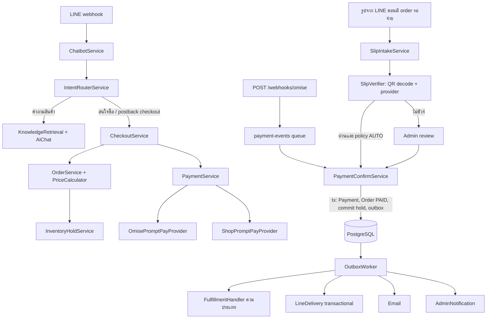
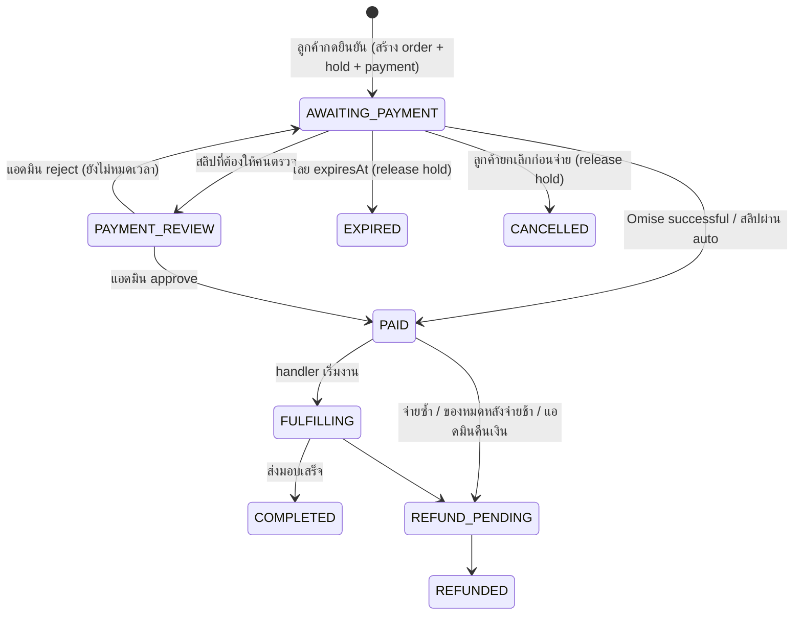
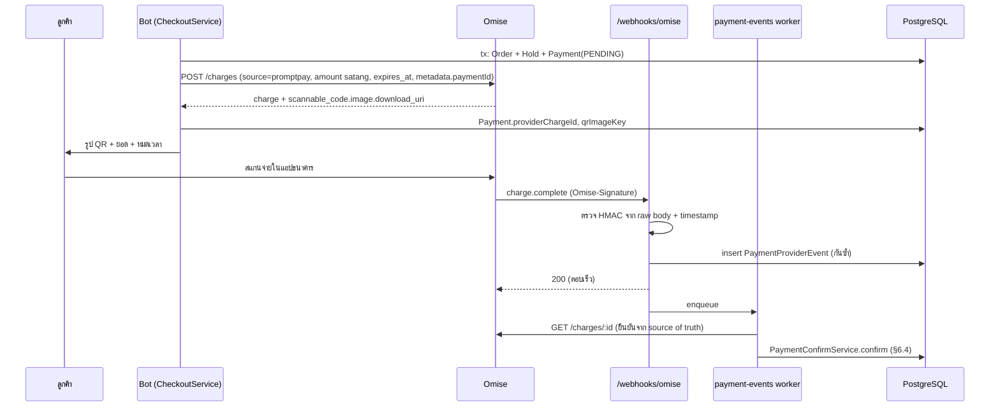
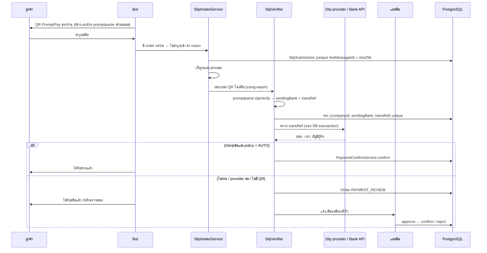

# ออกแบบ Order + Payment + Fulfillment ต่อจาก Product RAG

สถานะ: **ข้อเสนอการออกแบบ ยังไม่ได้ implement** (ตรวจ source วันที่ 3 ตุลาคม 2026)

ต่อจาก: [product-rag-design.th.md](product-rag-design.th.md) และ [product-rag-design-step-by-step.th.md](product-rag-design-step-by-step.th.md) เอกสารนี้เริ่มตอนลูกค้าบอกว่า "สนใจซื้อ A" แล้วจบตอนส่งมอบของหรือบริการเสร็จ

## สรุป

1. **LLM/RAG คุยกับลูกค้า แต่ state machine เป็นตัวทำธุรกรรม** RAG ช่วยเลือกของและตอบคำถาม ส่วนการสร้าง order, คิดเงิน, จองสต็อก, ยืนยันการจ่ายเงิน และข้อความหลังจ่ายเงิน ทำด้วยโค้ดที่ deterministic + template ทั้งหมด LLM แค่แปลงข้อความอิสระเป็นข้อมูลที่ backend validate ซ้ำอีกที
2. **แยก 3 ชั้นเพื่อให้ใช้ได้หลายธุรกิจ:** `Order` (ซื้ออะไร ราคาเท่าไร) → `Payment` (จ่ายทางไหน ยืนยันยังไง) → `Fulfillment` (จ่ายแล้วทำอะไรต่อ) ชั้นที่ต่างกันตามธุรกิจมีแค่ Fulfillment ทำเป็น handler แบบ plugin ตาม `fulfillmentType` ได้แก่ ส่งของ, จองห้อง, นัดบริการ, ส่ง software/license, ลงทะเบียนเรียน และให้แอดมินดูแลเอง
3. **ข้อมูลที่มีผลกับราคาหรือของว่างต้องเก็บก่อนจ่ายเงิน** เช่น วันเข้าพัก จำนวนคน ไซซ์ รอบเรียน ส่วนข้อมูลที่ใช้ส่งมอบอย่างเดียว เช่น ที่อยู่ อีเมล ให้กำหนดได้ต่อ product type ว่าจะเก็บก่อนหรือหลังจ่าย
4. **Payment มี 2 ทาง แต่ใช้ interface เดียวกัน:**
   - `OMISE_PROMPTPAY` — ยืนยันด้วย webhook ที่ตรวจลายเซ็น HMAC แล้ว GET charge จาก Omise ซ้ำอีกครั้ง
   - `SLIP_TRANSFER` — ส่ง QR PromptPay ของร้าน ลูกค้าส่งสลิปมา ระบบอ่าน QR ในสลิป ตรวจกับ API ของธนาคารหรือบริการตรวจสลิป แล้ว approve อัตโนมัติหรือส่งให้คนรีวิว
5. **จองสต็อก/ห้องตอนสร้าง order ด้วย hold ที่มีวันหมดอายุ** ใช้แบบเดียวกับ `CreditReservation` คือจ่ายแล้วค่อย commit ส่วนหมดเวลาหรือยกเลิกก็ release ครั้งเดียว
6. **งานหลังจ่ายเงินทั้งหมดขับด้วย transactional outbox** เปลี่ยน order เป็น `PAID` แล้วเขียน event ใน transaction เดียวกัน จากนั้น worker ส่ง LINE, อีเมล, แจ้งแอดมิน และเริ่ม fulfillment แบบ idempotent
7. **ห้ามส่งสลิปหรือที่อยู่ให้ AI provider** ตอนนี้รูปทุกรูปเข้า `answerImage` (vision) ต้องเปลี่ยนให้รูปที่ส่งมาตอนมี order รอจ่ายเงินเข้า slip pipeline ก่อนถึง AI
8. **เงินของลูกค้าไม่ใช่ AI credit** Order/Payment คือบัญชีระหว่างร้านกับลูกค้า ส่วน `CreditWallet`/`CreditLedger` คือเงินที่ tenant จ่ายค่า AI ห้ามปนกัน

## 1. ท่าที่แนะนำ: LLM คุย, state machine ทำธุรกรรม

| ท่า                                                               | ข้อดี                               | ปัญหา                                                                                               |
| ----------------------------------------------------------------- | ----------------------------------- | --------------------------------------------------------------------------------------------------- |
| Agent + tools (ให้ LLM เรียก `create_order`, `check_payment` เอง) | เขียนเร็ว ยืดหยุ่น                  | LLM เรียก tool ผิดหรือซ้ำ, ตอนนี้ retry แล้ว order ซ้ำ, อาจแต่งราคา, ทดสอบยาก, เสีย credit ทุก step |
| State machine ล้วน (กดปุ่มอย่างเดียว)                             | ปลอดภัย ทดสอบง่าย                   | ลูกค้าพิมพ์อิสระแล้วไปต่อไม่ได้                                                                     |
| **Hybrid (แนะนำ)**                                                | ธุรกรรมปลอดภัย และลูกค้ายังพิมพ์ได้ | ต้องเขียน slot parser กับ validator                                                                 |

กติกาของท่า hybrid:

- ทุก step ที่สำคัญมีปุ่ม (quick reply/postback) ที่ handle แบบ deterministic ตามกฎ AGENTS.md _every displayed menu option must have deterministic handling_
- ข้อความอิสระให้ rule/parser ลองก่อน ถ้าต้องใช้ LLM ให้คืนเป็น slot ที่มีโครงสร้าง (`productMention`, `quantity`, `checkIn`) แล้ว backend ไป resolve และ validate เอง **LLM ห้ามกำหนดราคา ยอดเงิน หรือสถานะ**
- ระหว่าง checkout ลูกค้าถามเรื่องอื่นได้ (digression) แบบเดียวกับ REGISTER คือตอบด้วย RAG แล้วเตือน step ที่ค้างอยู่
- ข้อความยืนยันการจ่ายเงินและการจองทุกข้อความ render จาก DB ด้วย template ไม่ผ่าน LLM
- Checkout ที่เป็น deterministic ทั้งหมดไม่มีค่า AI credit

## 2. สภาพ repo ตอนนี้ที่เกี่ยวข้อง

| เรื่อง                                                                                                          | ตอนนี้                                                                                                                                                             | ผลต่อ design                                                                           |
| --------------------------------------------------------------------------------------------------------------- | ------------------------------------------------------------------------------------------------------------------------------------------------------------------ | -------------------------------------------------------------------------------------- |
| [payments module](../src/modules/payments/)                                                                     | `PaymentsService` กับ `PaymentsController` ยังว่าง                                                                                                                 | ใช้เป็นที่อยู่ของ Payment ได้                                                          |
| `UserPayment` + `Member` ([payment.prisma](../prisma/payment.prisma), [member.prisma](../prisma/member.prisma)) | model เก่า: ผูกกับ `username`, ไม่มี order/company, status เป็นตัวเล็ก                                                                                             | **ไม่ reuse** ให้สร้าง model ใหม่ และอย่าลบหรือ rename ของเดิมถ้ายังไม่มีแผน migration |
| `CreditWallet` / `CreditLedger` / `CreditTopupHistory`                                                          | tenant ซื้อ AI credit และ approve ด้วยสลิป                                                                                                                         | ใช้เป็นต้นแบบ pattern (approve แบบ atomic, idempotency key) แต่ห้ามเก็บข้อมูลปนกัน     |
| รูปภาพจาก LINE                                                                                                  | [line-webhook.service.ts:134](../src/modules/line/line-webhook.service.ts#L134) → `handleImageMessage` → `aiChatService.answerImage` ซึ่งส่งรูปให้ vision provider | สลิปมีชื่อและเลขบัญชีซึ่งเป็น PII จึงต้อง route ไป slip pipeline ก่อนถึง AI            |
| `LineDelivery`                                                                                                  | เก็บแค่ `text` แล้วส่งด้วย `replyText`/`pushText`                                                                                                                  | ส่งรูป QR, Flex หรือ quick reply ไม่ได้ ต้องขยาย payload                               |
| Admin mute ใน delivery                                                                                          | [line-delivery.service.ts:153](../src/modules/line/line-delivery.service.ts#L153) delivery อัตโนมัติจะถูกตั้งเป็น `FAILED` ถ้าผู้ใช้อยู่ใน admin mute              | ข้อความยืนยันการจ่ายเงินต้องเป็นหมวด transactional ที่ AI mute ไม่กลืน                 |
| Push retry                                                                                                      | ใช้ `retryKey` (X-Line-Retry-Key) และหยุดที่ 23 ชั่วโมง                                                                                                            | ใช้ต่อได้กับ push ที่เกิดจาก event (ซึ่งไม่มี reply token)                             |
| Session                                                                                                         | Redis `ConversationFlow = REGISTER \| GENERAL_QUESTION \| CHECK_STATUS \| CONTACT_ADMIN` และ TTL แบบเลื่อน                                                         | เพิ่ม `CHECKOUT` ให้เป็นตัวชี้ไปที่ order ใน DB ไม่ใช่ที่เก็บ order                    |
| แจ้งแอดมิน                                                                                                      | `AdminNotification` + Socket.IO gateway                                                                                                                            | ใช้แจ้ง "สลิปรอรีวิว", "order ใหม่", "จ่ายแล้วรอส่งของ"                                |
| Storage                                                                                                         | `FileStorageService` + adapter R2/local                                                                                                                            | เก็บรูปสลิปแบบ private และรูป QR                                                       |
| Queue                                                                                                           | BullMQ (`LINE_EVENTS_QUEUE` และ retry queue)                                                                                                                       | เพิ่ม queue สำหรับ payment event และ outbox                                            |
| Product                                                                                                         | ยังไม่มี (เป็นข้อเสนอใน product-rag-design)                                                                                                                        | checkout ต้องรอ Product, Variant, Inventory และ PriceCalculator จากระยะ A ก่อน         |

## 3. ภาพรวมสถาปัตยกรรม



module ที่เสนอ (ชื่อจริงให้เลือกตาม naming ของ repo ตอนลงมือ):

| Module                     | หน้าที่                                                                                         |
| -------------------------- | ----------------------------------------------------------------------------------------------- |
| `src/modules/commerce/`    | Checkout, Order, OrderLine, InventoryHold, PriceCalculator (หรือรวมกับ product module)          |
| `src/modules/payments/`    | Payment, provider adapter (Omise, PromptPay ของร้าน), webhook, slip intake/verify, admin review |
| `src/modules/fulfillment/` | registry ของ handler แยกตาม `fulfillmentType`                                                   |
| `src/infra/email/`         | adapter ส่งอีเมล (เพิ่มเมื่อถึง phase ที่ใช้)                                                   |

## 4. Data model (logical design)

ส่วนนี้เป็น logical design ยังไม่ใช่ schema ที่พร้อม migrate ทุก table ต้องมี `companyId` แบบ non-null และ FK ไป `Company` ส่วน relation ที่ข้าม table ให้ใช้ composite `(id, companyId)` เพื่อกันข้อมูลข้ามบริษัท

```prisma
enum OrderStatus {
  AWAITING_PAYMENT
  PAYMENT_REVIEW    // มีสลิปหรือการจ่ายเงินที่รอคนตรวจ
  PAID
  FULFILLING
  COMPLETED
  CANCELLED
  EXPIRED
  REFUND_PENDING
  REFUNDED
}

enum FulfillmentType {
  SHIP_GOODS
  ROOM_BOOKING
  SERVICE_BOOKING
  DIGITAL_DELIVERY  // software, license, ไฟล์
  ENROLLMENT        // ลงทะเบียนเรียน
  MANUAL            // แอดมินดูแลเอง
}

model Order {
  id              String          @id @default(uuid()) @db.Uuid
  companyId       String          @db.Uuid
  orderNo         String          @db.VarChar(30)   // ORD-20261003-0001 ให้ลูกค้าอ้างถึง
  lineMemberId    String          @db.Uuid
  conversationId  String          @db.Uuid
  checkoutKey     String          @unique           // idempotency ของการสร้าง order
  status          OrderStatus
  fulfillmentType FulfillmentType
  currency        String          @default("THB") @db.VarChar(3)
  subtotal        Decimal         @db.Decimal(12, 2)
  discount        Decimal         @default(0) @db.Decimal(12, 2)
  shippingFee     Decimal         @default(0) @db.Decimal(12, 2)
  total           Decimal         @db.Decimal(12, 2)
  expiresAt       DateTime        // หมดเวลาจ่ายเงิน = ตอนที่ hold หมดอายุ
  paidAt          DateTime?
  version         Int             @default(0)       // optimistic concurrency
  createdAt       DateTime        @default(now())
  updatedAt       DateTime        @updatedAt
  @@unique([companyId, orderNo])
  @@index([companyId, status, expiresAt])
  @@index([lineMemberId, status])
}

model OrderLine {
  id           String   @id @default(uuid()) @db.Uuid
  orderId      String   @db.Uuid
  productId    String   @db.Uuid
  variantId    String?  @db.Uuid
  nameSnapshot String   @db.VarChar(255)   // ชื่อและราคา ณ ตอนสั่ง ไม่เปลี่ยนตาม Product
  unitPrice    Decimal  @db.Decimal(12, 2)
  quantity     Int
  lineTotal    Decimal  @db.Decimal(12, 2)
  details      Json     @default("{}")      // validate ตาม type: checkIn, checkOut, slotId, roundId
}

model InventoryHold {
  id           String   @id @default(uuid()) @db.Uuid
  companyId    String   @db.Uuid
  orderLineId  String   @db.Uuid
  holdKey      String   @unique             // hold:<orderLineId>:<resource>:<date>
  resourceType String   @db.VarChar(30)     // VARIANT_STOCK, ROOM_NIGHT, SERVICE_SLOT, SEAT
  resourceId   String   @db.Uuid
  date         DateTime? @db.Date           // ห้องพัก 1 แถวต่อ 1 คืน
  quantity     Int
  status       String   @default("HELD")    // HELD -> COMMITTED | RELEASED
  expiresAt    DateTime
  @@index([status, expiresAt])
}

model Payment {
  id               String   @id @default(uuid()) @db.Uuid
  companyId        String   @db.Uuid
  orderId          String   @db.Uuid
  paymentKey       String   @unique          // pay:<orderId>:<attemptNo>
  method           String   @db.VarChar(30)  // OMISE_PROMPTPAY | SLIP_TRANSFER
  status           String   @default("PENDING")
  amount           Decimal  @db.Decimal(12, 2)
  currency         String   @default("THB") @db.VarChar(3)
  providerChargeId String?  @unique          // chrg_... ของ Omise
  qrImageKey       String?  @db.VarChar(500) // key ใน storage
  expiresAt        DateTime
  succeededAt      DateTime?
  createdAt        DateTime @default(now())
  // partial unique index ใน migration SQL: 1 Payment ที่ active ต่อ 1 order
}

model SlipSubmission {
  id             String   @id @default(uuid()) @db.Uuid
  companyId      String   @db.Uuid
  orderId        String   @db.Uuid
  paymentId      String?  @db.Uuid
  lineMessageId  String   @unique            // LINE ส่ง event ซ้ำก็ไม่สร้างแถวซ้ำ
  imageKey       String   @db.VarChar(500)   // private storage
  imageSha256    String   @db.VarChar(64)
  sendingBank    String?  @db.VarChar(10)
  transRef       String?  @db.VarChar(64)
  verifyProvider String?  @db.VarChar(30)
  verifyStatus   String   @default("PENDING") // PENDING VERIFIED MISMATCH NO_QR PROVIDER_ERROR DUPLICATE
  verifiedAmount Decimal? @db.Decimal(12, 2)
  transferredAt  DateTime?
  receiverMatched Boolean?
  reviewStatus   String   @default("PENDING") // PENDING AUTO_APPROVED APPROVED REJECTED
  reviewedById   String?  @db.Uuid
  reviewedAt     DateTime?
  rejectReason   String?  @db.VarChar(255)
  createdAt      DateTime @default(now())
  @@unique([companyId, sendingBank, transRef]) // กันสลิปเดียวใช้ซ้ำหลาย order
  @@index([companyId, imageSha256])
  @@index([companyId, reviewStatus, createdAt])
}

model PaymentProviderEvent {
  id              String   @id @default(uuid()) @db.Uuid
  provider        String   @db.VarChar(20)
  providerEventId String   @db.VarChar(100)
  type            String   @db.VarChar(50)   // charge.complete
  status          String   @default("RECEIVED")
  receivedAt      DateTime @default(now())
  processedAt     DateTime?
  @@unique([provider, providerEventId])       // เหมือน ProcessedLineWebhookEvent
}

model Fulfillment {
  id        String          @id @default(uuid()) @db.Uuid
  companyId String          @db.Uuid
  orderId   String          @unique @db.Uuid
  type      FulfillmentType
  status    String          // PENDING_INFO READY IN_PROGRESS DONE FAILED MANUAL
  data      Json            @default("{}")   // เลขพัสดุ, เลขจอง, licenseId (ไม่เก็บ secret ตรงนี้)
}

model OrderContact {               // PII แยก table เพื่อคุมสิทธิ์และ retention
  orderId   String  @id @db.Uuid
  recipient String? @db.VarChar(200)
  phone     String? @db.VarChar(30)
  email     String? @db.VarChar(255)
  address   String? @db.Text
  postcode  String? @db.VarChar(10)
}

model DomainOutbox {
  id            String   @id @default(uuid()) @db.Uuid
  companyId     String   @db.Uuid
  eventKey      String   @unique              // order:<id>:paid
  eventType     String   @db.VarChar(50)
  aggregateId   String   @db.Uuid
  payload       Json                          // ไม่ใส่ PII
  status        String   @default("PENDING")
  attempts      Int      @default(0)
  nextAttemptAt DateTime @default(now())
  leaseOwner    String?
  leaseUntil    DateTime?
  @@index([status, nextAttemptAt])
}
```

ตั้งค่าต่อธุรกิจ/ประเภทสินค้า (ส่วนนี้ทำให้ระบบใช้ได้หลายธุรกิจ):

```prisma
model CommerceProfile {
  id                  String          @id @default(uuid()) @db.Uuid
  companyId           String          @db.Uuid
  productTypeKey      String          @db.VarChar(50)   // ผูกกับ ProductType ของ product design
  fulfillmentType     FulfillmentType
  requirements        Json            // นิยาม field ที่ต้องเก็บ + phase BEFORE_PAYMENT/AFTER_PAYMENT
  holdMinutes         Int             @default(30)
  paymentMethods      String[]        // ["OMISE_PROMPTPAY","SLIP_TRANSFER"]
  slipReviewPolicy    String          @default("ALWAYS_REVIEW") // AUTO_IF_VERIFIED | AUTO_UNDER_AMOUNT
  autoApproveMaxTotal Decimal?        @db.Decimal(12, 2)
  @@unique([companyId, productTypeKey])
}

model MessageTemplate {
  id        String @id @default(uuid()) @db.Uuid
  companyId String @db.Uuid
  key       String @db.VarChar(50)   // PAYMENT_QR, PAYMENT_RECEIVED, ASK_ADDRESS, BOOKING_CONFIRMED ...
  language  String @default("th") @db.VarChar(10)
  body      String @db.Text          // ใช้ได้เฉพาะตัวแปรใน allowlist เช่น {{orderNo}} {{total}}
  version   Int    @default(1)
  @@unique([companyId, key, language])
}
```

ตัวอย่าง `requirements` ของโรงแรมกับร้านเสื้อผ้า ใช้รูปแบบเดียวกับ attribute definition ใน product design:

```json
{
  "ROOM_BOOKING": [
    {
      "key": "checkIn",
      "type": "date",
      "phase": "BEFORE_PAYMENT",
      "required": true
    },
    {
      "key": "checkOut",
      "type": "date",
      "phase": "BEFORE_PAYMENT",
      "required": true
    },
    {
      "key": "guests",
      "type": "integer",
      "phase": "BEFORE_PAYMENT",
      "required": true
    },
    {
      "key": "recipient",
      "type": "text",
      "phase": "BEFORE_PAYMENT",
      "required": true,
      "pii": true
    },
    {
      "key": "email",
      "type": "email",
      "phase": "AFTER_PAYMENT",
      "required": false,
      "pii": true
    }
  ],
  "SHIP_GOODS": [
    {
      "key": "variant",
      "type": "variant",
      "phase": "BEFORE_PAYMENT",
      "required": true
    },
    {
      "key": "quantity",
      "type": "integer",
      "phase": "BEFORE_PAYMENT",
      "required": true
    },
    {
      "key": "address",
      "type": "address",
      "phase": "AFTER_PAYMENT",
      "required": true,
      "pii": true
    }
  ]
}
```

ถ้าค่าส่งขึ้นอยู่กับพื้นที่ ให้ย้าย `address` ไปเป็น `BEFORE_PAYMENT` เพราะยอดเงินต้องนิ่งก่อนส่ง QR

## 5. State machine



กติกาการเปลี่ยนสถานะ:

- เปลี่ยนสถานะด้วย conditional update ตัวเดียว เช่น `updateMany({ where: { id, status: { in: from } }, data: { status: to, version: { increment: 1 } } })` ถ้า `count = 0` แปลว่ามีคนเปลี่ยนไปก่อนแล้ว ให้ return ผลเดิม ไม่ throw (แบบเดียวกับ lease ใน `LineDelivery`)
- รวมทุก transition ไว้ใน `OrderStateService` ที่เดียว ห้าม service อื่น update `status` เอง
- `PAYMENT_REVIEW` ไม่ทำให้ hold หมดอายุ ระหว่างรอแอดมินให้ต่ออายุ hold จนกว่าจะตัดสิน ถ้าไม่ต่อ ลูกค้าที่จ่ายแล้วอาจเสียของให้คนอื่น
- `InventoryHold`: `HELD → COMMITTED` ตอน PAID และ `HELD → RELEASED` ตอนหมดเวลาหรือยกเลิก ทั้งสองทางเป็น conditional update ที่เกิดได้ครั้งเดียว

ตอนจอง hold ต้องเช็กว่าของพอ ด้วย SQL ตัวเดียวแบบนี้ (ห้ามอ่านค่าแล้วค่อยเขียนทีหลัง):

```sql
UPDATE inventory
SET reserved = reserved + $qty
WHERE id = $resourceId AND company_id = $companyId AND on_hand - reserved >= $qty;
-- affected rows = 0 คือของไม่พอ
```

ห้องพักที่ hold หลายคืน ให้ lock แต่ละคืนเรียงตามวันที่ใน transaction เดียวกันเพื่อกัน deadlock ถ้าคืนใดคืนหนึ่งเต็ม ให้ rollback ทั้งหมด

## 6. Flow step by step

### 6.1 จาก "สนใจซื้อ A" ถึงยืนยัน order

1. **RAG ตอบเรื่องสินค้า** (ตาม product design) แล้วแนบ quick reply "สั่งซื้อ" หรือ "จองเลย" ที่เป็น postback `checkout:start:<productId>[:<variantId>]` จากนั้นบันทึกสินค้าที่แสดงลง `CatalogContext` (product design §11.1)
2. **ข้อความอิสระ** เช่น "สนใจซื้อ A", "เอาอันนี้", "จองเลย": `RuleIntentService` จับคำว่า ซื้อ/สั่ง/เอา/จอง ได้แบบ deterministic ไม่มี I/O แล้ว router ตัดสินแบบนี้
   - `CatalogContext` มีสินค้าที่เลือกไว้ตัวเดียว → `START_CHECKOUT`
   - มีหลายตัว → `CLARIFY` พร้อม quick reply ให้เลือก **ห้ามเลือกอันดับหนึ่งแทนลูกค้า**
   - ไม่มีเลย → ค้นสินค้าจากข้อความ แล้วถาม "หมายถึง A ใช่ไหม" พร้อมปุ่ม
3. **เปิด session `CHECKOUT` ใน Redis** ที่เก็บ slot ที่กำลังกรอก ยังไม่สร้าง order ใน DB เพราะยังเป็น workflow ชั่วคราว (ตามกฎ "Redis sessions are temporary workflow state")
4. **กรอก slot ตาม `requirements` ที่เป็น `BEFORE_PAYMENT`** เช่น ไซซ์และสีจาก variant ที่ขายได้จริง (quick reply), จำนวน, วันเข้าพักกับจำนวนคน (เช็กห้องว่างสด), รอบเรียน แต่ละคำตอบผ่าน parser ที่ deterministic ถ้าตอบไม่ถูกให้ถามซ้ำ และถ้าผิดเกิน N ครั้งให้เสนอติดต่อแอดมิน
5. **คิดราคาด้วย `PriceCalculator`** (Decimal) แล้วเช็กของว่างสดอีกรอบ
6. **ส่งการ์ดยืนยัน** ที่มีรายการ ยอดรวม วันหมดเวลา และปุ่ม `[จ่ายผ่าน QR]` `[โอนแล้วส่งสลิป]` `[ยกเลิก]` ปุ่มเป็น postback `checkout:confirm:<nonce>:<method>` โดย `nonce` ผูกกับ session เพื่อไม่ให้การ์ดเก่าที่ลูกค้ากดย้อนหลังสร้าง order ผิด
7. **ลูกค้ากดยืนยัน** ทำงานใน transaction เดียว:
   - สร้าง `Order` (`AWAITING_PAYMENT`) และ `OrderLine` โดยใช้ `checkoutKey = checkout:<conversationId>:<nonce>` เป็น idempotency key
   - จอง `InventoryHold` ทุกบรรทัด ถ้าไม่พอให้ rollback แล้วตอบว่าของหมดและให้เลือกใหม่
   - สร้าง `Payment` สถานะ `PENDING`
8. **นอก transaction:** สร้าง Omise charge (§6.2) หรือสร้าง QR PromptPay ของร้านเอง (§6.3) แล้วส่ง QR เป็นรูปพร้อมยอดเงิน เวลาหมดอายุ และวิธีจ่าย
9. เปลี่ยน session เป็น step `AWAITING_PAYMENT` และตั้ง TTL ให้ไม่น้อยกว่า `expiresAt`

### 6.2 ทาง A: Omise PromptPay



รายละเอียดที่ต้องทำ:

- **จำนวนเงิน:** Omise รับหน่วยสตางค์เป็นจำนวนเต็ม ให้แปลงจาก Decimal × 100 และ assert ว่าเป็นจำนวนเต็ม PromptPay ของ Omise รับ ฿20–฿150,000 ถ้านอกช่วงนี้ให้เสนอแค่ทางโอนแล้วส่งสลิป
- **`expires_at`:** ตั้งเท่ากับเวลาหมดของ hold (Omise default คือ 24 ชั่วโมงและตั้งเกินนั้นไม่ได้) ให้ hold หมดช้ากว่า QR สัก 5–10 นาที เผื่อ webhook มาช้า
- **เรียก Omise นอก DB transaction** สร้างแถว Payment ก่อนแล้วค่อยเรียก ถ้า timeout แล้วไม่รู้ผล ห้ามเรียกสร้าง charge ใหม่ทันที ให้ตรวจก่อนว่า Omise รองรับ idempotency key หรือค้น charge จาก metadata ได้หรือไม่ (_ยังไม่ได้ยืนยันใน docs ต้องตรวจตอน implement_) ทางที่ปลอดภัยคือ ถ้าไม่แน่ใจ ให้ปิด Payment เดิมแล้วสร้าง attempt ใหม่ เพราะ charge ที่ลูกค้าไม่เห็น QR จะไม่มีใครจ่าย
- **รูป QR:** ดาวน์โหลดจาก `download_uri` มาเก็บใน storage ของเรา แล้วส่งเป็น LINE image message (URL ต้องเป็น HTTPS และเปิดได้จนกว่า QR จะหมดอายุ)
- **ตรวจ webhook:** `Omise-Signature` = hex(HMAC-SHA256(base64decode(secret), `<Omise-Signature-Timestamp>.<raw body>`)) เปรียบเทียบแบบ constant-time, ปฏิเสธถ้า timestamp ห่างเกิน 5 นาที และตอนหมุน secret ให้รับลายเซ็นใดก็ได้จากที่คั่นด้วย comma ใช้ raw body แบบเดียวกับ `LineSignatureGuard`
- **อย่าเชื่อ payload ของ webhook อย่างเดียว:** worker ต้อง GET charge ซ้ำแล้วเช็ก `status=successful`, `amount`, `currency` และ `metadata.paymentId` ว่าตรงกับ DB
- **Omise ไม่รับประกันว่าจะส่ง webhook ซ้ำเมื่อส่งไม่สำเร็จ** จึงต้องมี reconciler job ทุก 1–2 นาที ที่ GET charge ของ Payment ที่ยัง `PENDING` และใกล้หรือเลย `expiresAt`
- `failed`/`expired` → Payment `FAILED`/`EXPIRED` แล้ว release hold ถ้า order ไม่มี Payment อื่นที่ยัง active และส่งข้อความว่า QR หมดอายุพร้อมปุ่มขอ QR ใหม่
- **test:** ใช้ test key แล้วเปลี่ยนสถานะ charge เป็น Successful/Failed จาก dashboard ได้ ส่วน automated test ต้อง mock HTTP ห้ามเรียก Omise จริง

### 6.3 ทาง B: QR ของร้าน + สลิป



ทางนี้ไม่มีค่าธรรมเนียม gateway และเงินเข้าบัญชีร้านตรง แต่ต้องมีการตรวจสลิป (รายละเอียด §9)

### 6.4 ยืนยันการจ่ายเงิน (ใช้ร่วมกันทั้ง 2 ทาง)

`PaymentConfirmService.confirm(paymentId, evidence)` ทำทุกขั้นใน transaction เดียว:

1. `Payment`: `PENDING|UNDER_REVIEW → SUCCEEDED` ด้วย conditional update ถ้า `count = 0` แปลว่ามีคนยืนยันไปก่อนแล้ว ให้ return ผลเดิม
2. เช็กว่ายอดเงินและสกุลเงินตรงกับ `order.total`
3. `Order`: `AWAITING_PAYMENT|PAYMENT_REVIEW → PAID` แล้ว
   - ถ้า order เป็น `EXPIRED`/`CANCELLED` อยู่ → ไปทาง **จ่ายช้า** (§6.6)
   - ถ้า order เป็น `PAID` อยู่แล้วจาก Payment อื่น → ตั้ง Payment นี้เป็น `DUPLICATE` และแจ้งแอดมินให้คืนเงิน
4. Hold: `HELD → COMMITTED` และลดสต็อก (`on_hand -= q`, `reserved -= q`)
5. สร้าง `Fulfillment` (เป็น `PENDING_INFO` ถ้ายังมี requirement `AFTER_PAYMENT` ที่ยังไม่ได้เก็บ ไม่งั้นเป็น `READY`)
6. Insert `DomainOutbox` ด้วย `eventKey = order:<id>:paid`

**ห้ามเรียก LINE, Omise, อีเมล หรือ provider ใดใน transaction นี้**

### 6.5 หลังจ่ายเงินแล้ว

`OutboxWorker` อ่าน event `ORDER_PAID` แล้วทำงานต่อไปนี้ โดยแต่ละงานมี idempotency key ของตัวเอง:

1. ส่ง LINE template `PAYMENT_RECEIVED` ด้วย delivery key `order:<id>:paid` หมวด transactional
2. เรียก `FulfillmentHandler.onPaid` ตามประเภท (§7)
3. ถ้ายังมี requirement `AFTER_PAYMENT` ค้างอยู่ เช่น ที่อยู่ ให้ตั้ง session `CHECKOUT` เป็น step `COLLECT_ADDRESS` แล้วส่ง `ASK_ADDRESS`
4. ส่งอีเมลยืนยันถ้ามีอีเมลของลูกค้า
5. แจ้งแอดมินผ่าน `AdminNotification`
6. เก็บข้อมูลครบแล้วให้ clear session `CHECKOUT`

ถ้าต้องการให้ RAG ตอบคำถามต่อได้ เช่น "ส่งของยัง" ให้เพิ่มบันทึกสั้นที่ไม่มี PII ลง context เช่น "order ORD-xxx ชำระแล้ว" แล้วตอบสถานะจาก `OrderStatusService` ที่อ่าน DB โดยกรองตาม `lineMemberId` ของคนถาม **ห้ามเก็บสถานะ order ลง vector**

### 6.6 กรณีขอบที่ต้องออกแบบไว้ก่อน

| กรณี                                      | วิธีจัดการ                                                                                                                                                      |
| ----------------------------------------- | --------------------------------------------------------------------------------------------------------------------------------------------------------------- |
| หมดเวลาก่อนจ่ายเงิน                       | job sweeper ตั้ง Order `EXPIRED`, release hold, expire Payment แล้วส่งข้อความพร้อมปุ่ม "สั่งใหม่" (ถ้าไม่อยากรบกวนลูกค้า จะไม่ส่งก็ได้)                         |
| สลิปมาหลัง order หมดเวลา                  | ลอง hold ใหม่: ถ้าของยังมีให้ไปต่อเป็น PAID ถ้าหมดแล้วให้ `PAYMENT_REVIEW` แล้วแอดมินเสนอของอื่นหรือคืนเงิน **ห้าม auto-fulfill ของที่ไม่มีแล้ว**               |
| ยอดที่โอนไม่ตรง                           | โอนขาดหรือเกิน → `PAYMENT_REVIEW` ทุกครั้ง แอดมินตัดสินว่าให้โอนเพิ่มหรือคืนส่วนเกิน                                                                            |
| ใช้สลิปซ้ำ                                | unique `(companyId, sendingBank, transRef)` ชน → `DUPLICATE` แล้วแจ้งแอดมิน ข้อความถึงลูกค้าต้องเป็นกลาง ("สลิปนี้ถูกใช้ไปแล้ว กรุณาติดต่อแอดมิน")              |
| รูปเดิมส่งซ้ำ                             | sha256 ตรงกับแถวเดิมของ order เดียวกัน → ตอบว่า "ได้รับสลิปนี้แล้ว" ไม่ตรวจซ้ำ                                                                                  |
| จ่ายสองครั้ง (QR + สลิป)                  | Payment ที่สองเป็น `DUPLICATE` → `REFUND_PENDING` ให้แอดมินคืนเงิน                                                                                              |
| webhook มาก่อนบันทึก `providerChargeId`   | หา Payment จาก `metadata.paymentId`                                                                                                                             |
| webhook ไม่มาเลย                          | reconciler GET charge (§6.2)                                                                                                                                    |
| ผู้ให้บริการตรวจสลิปล่ม                   | `PAYMENT_REVIEW` เสมอ **ห้าม auto-reject เพราะระบบเราตรวจไม่ได้**                                                                                               |
| ส่งรูปอื่นที่ไม่ใช่สลิปตอนรอจ่ายเงิน      | ไม่เจอ QR → เก็บไว้ให้แอดมินดู แล้วตอบว่า "ถ้าเป็นสลิปกำลังตรวจให้นะคะ" ไม่ส่งรูปเข้า AI                                                                        |
| ลูกค้ายกเลิกระหว่างรอจ่ายเงิน             | ก่อนจ่ายเงิน: `CANCELLED` + release hold + expire charge ถ้า Omise รองรับ ถ้าเงินเข้าหลังยกเลิกให้ใช้ทางจ่ายช้า ส่วนหลังจ่ายเงินแล้ว ห้ามยกเลิกเอง ให้ส่งแอดมิน |
| อยู่ใน admin mute                         | ข้อความ transactional ยังส่งได้ ส่วนคำถาม checkout แบบอัตโนมัติให้เงียบตาม policy mute และ slip intake ยังทำงานเบื้องหลังแล้วแจ้งแอดมิน                         |
| push ไม่สำเร็จ (quota หมด หรือ `UNKNOWN`) | แอดมินเห็น delivery ที่ค้าง และถ้ามีอีเมลก็ส่งทางอีเมลแทน                                                                                                       |
| คืนเงิน                                   | แอดมินกดคืน: Omise ใช้ refund API ส่วนโอนเองให้บันทึกการโอนคืนด้วยมือ แล้วเปลี่ยนเป็น `REFUNDED` การคืนสต็อกให้แอดมินเป็นคนตัดสิน                               |

## 7. Fulfillment handler: จุดที่ต่างกันตามธุรกิจ

```ts
interface FulfillmentHandler {
  readonly type: FulfillmentType;
  /** เช็กก่อนสร้าง order เช่น ห้องว่างทุกคืน, รอบเรียนยังไม่เต็ม */
  validateBeforePayment(draft: CheckoutDraft): Promise<ValidationResult>;
  /** งาน DB ล้วนที่ต้องเกิดพร้อม PAID (เรียกใน tx ของ confirm) */
  onPaidTx(tx: Tx, order: Order, fulfillment: Fulfillment): Promise<void>;
  /** งานภายนอก (PMS, license API, ขนส่ง) ทำใน worker นอก tx, idempotent ด้วย fulfillment.id */
  run(fulfillment: Fulfillment): Promise<FulfillmentStepResult>;
  /** ตัวแปรสำหรับ template ใช้ได้เฉพาะ field ที่อนุญาต */
  templateVars(order: Order, fulfillment: Fulfillment): Record<string, string>;
}
```

register handler ใน `FulfillmentRegistry` ด้วย DI แล้วเลือกตาม `order.fulfillmentType` ธุรกิจใหม่จะเพิ่มแค่ handler, `CommerceProfile` และ template โดยไม่ต้องแก้ Order/Payment

| ประเภท             | เก็บก่อนจ่าย                                        | หลังจ่ายทำอะไร                                                                                   | ข้อความถึงลูกค้า                                           | แอดมิน                 |
| ------------------ | --------------------------------------------------- | ------------------------------------------------------------------------------------------------ | ---------------------------------------------------------- | ---------------------- |
| `SHIP_GOODS`       | variant, จำนวน (และที่อยู่ ถ้าค่าส่งขึ้นกับพื้นที่) | ขอที่อยู่ถ้ายังไม่มี แล้วสร้างงานแพ็ก เมื่อแอดมินกรอกเลขพัสดุก็ส่ง `SHIPPED`                     | "ได้รับชำระแล้ว รบกวนส่งที่อยู่" → "จัดส่งแล้ว เลขพัสดุ …" | รายการที่ต้องแพ็ก      |
| `ROOM_BOOKING`     | วันเข้าและออก, จำนวนคน, ชื่อผู้เข้าพัก              | commit ห้องรายคืน, เรียก PMS ถ้ามี, ออกเลขจอง                                                    | "จองห้อง X วันที่ 5–7 ต.ค. ยืนยันแล้ว เลขจอง …" + อีเมล    | แจ้ง front desk        |
| `SERVICE_BOOKING`  | วันเวลา (slot), พนักงาน                             | commit slot แล้วตั้ง job เตือนก่อนวันนัด                                                         | "นัดวันที่ … เวลา …"                                       | ตารางนัด               |
| `DIGITAL_DELIVERY` | อีเมล, แพ็กเกจ                                      | จ่าย license จาก pool (`FOR UPDATE SKIP LOCKED`) หรือเรียก provisioning API ด้วย idempotency key | ส่งลิงก์รับ key หรือส่งทางอีเมล                            | แจ้งเมื่อ pool ใกล้หมด |
| `ENROLLMENT`       | รอบเรียน, ชื่อผู้เรียน, ช่องทางติดต่อ               | commit ที่นั่ง แล้วเพิ่มชื่อในรายชื่อผู้เรียน                                                    | "ลงทะเบียนสำเร็จ รอบ … ลิงก์กลุ่ม …"                       | รายชื่อผู้เรียน        |
| `MANUAL`           | ตามที่ตั้งค่า                                       | สร้างงานให้แอดมิน                                                                                | "ได้รับชำระแล้ว เจ้าหน้าที่จะติดต่อกลับ"                   | แจ้งเตือน + เปิดแชต    |

หมายเหตุ:

- **license key หรือ secret ห้ามส่งเป็นข้อความแชตตรง ๆ** เพราะ bot message ถูกเก็บใน `LineChatHistory` ที่แอดมินทุกคนเห็น ให้ส่งเป็นลิงก์ที่ใช้ครั้งเดียวหรือส่งทางอีเมล
- `MANUAL` ใช้เป็น fallback ของทุก handler: ถ้า `run()` ล้มเกิน N ครั้ง ให้เปลี่ยน Fulfillment เป็น `MANUAL` แล้วแจ้งแอดมิน **ห้ามบอกลูกค้าว่าสำเร็จถ้ายังไม่สำเร็จ**
- การแจ้งแอดมินเรื่องนี้เป็นงานใน queue ของแอดมิน ไม่ใช่การตั้ง `waiting_admin` ของ conversation (คนละความหมาย ตาม AGENTS.md)

## 8. ข้อความหลังชำระเงินและการส่ง

- **Template:** `MessageTemplate` render ด้วยโค้ด ใช้ได้เฉพาะตัวแปรใน allowlist เงิน format จาก Decimal และวันเวลาใช้ `Asia/Bangkok` ห้ามใช้ LLM แต่งข้อความยืนยัน
- **ขยาย `LineDelivery`:**
  - เพิ่ม `messages Json?` เก็บ LINE message object ไม่เกิน 5 ชิ้น ที่ validate ด้วย Zod (text, image, flex, quick reply) และเก็บ `text` ไว้ใช้กับประวัติแชตเหมือนเดิม
  - เพิ่ม `category` (`CHAT | TRANSACTIONAL | ADMIN`) โดยหมวด `TRANSACTIONAL` ไม่ถูก admin mute กลืนและไม่ตั้ง mute เพิ่ม
  - key = `order:<orderId>:<templateKey>` ทำให้ส่งซ้ำไม่ได้
- **REPLY หรือ PUSH:** ข้อความที่เกิดจาก event (webhook, แอดมิน approve) ไม่มี reply token จึงเป็น PUSH ซึ่งกิน quota ข้อความของ LINE OA แต่ถ้าสลิปผ่าน auto ในรอบเดียวกับที่ลูกค้าส่งมาและ reply token ยังไม่หมดอายุ ให้ใช้ REPLY (delivery เลือกให้อยู่แล้ว)
- **อีเมล:** ทำ `EmailSender` adapter (เช่น SES, Resend หรือ SMTP ผ่าน nodemailer เลือกตัวเดียว และเพิ่ม dependency ตอนถึง phase ที่ใช้จริง) ผ่าน outbox ด้วย key `email:<orderId>:<templateKey>`
- **ถามสถานะ order:** rule จับคำว่า "สถานะ", "ส่งยัง", "เลขพัสดุ" → `OrderStatusService` อ่าน order ของ `lineMemberId` คนนั้น แล้วตอบด้วย template

## 9. ตรวจสลิป: มี API/Lib อะไรบ้าง

| ทาง                                                                   | ทำอะไร                                                                                                              | ข้อดี                                         | ข้อจำกัด                                                                                                                   |
| --------------------------------------------------------------------- | ------------------------------------------------------------------------------------------------------------------- | --------------------------------------------- | -------------------------------------------------------------------------------------------------------------------------- |
| **API ของธนาคารโดยตรง** (เช่น SCB, KBank slip verification)           | ส่ง `sendingBank` + `transRef` ให้ธนาคารตรวจ                                                                        | ข้อมูลมาจากธนาคารจริง                         | ต้องสมัครเป็นลูกค้า corporate/developer ของธนาคาร และขอบเขตที่ตรวจได้ต่างกันตามธนาคาร ต้องเช็กเงื่อนไขกับธนาคาร            |
| **บริการตรวจสลิป** เช่น SlipOK, EasySlip, Thunder, RDCW               | ส่งรูปหรือ QR payload แล้วได้ยอด เวลา ผู้โอน ผู้รับ                                                                 | ครอบคลุมหลายธนาคาร เริ่มได้เร็ว               | มีค่าบริการต่อครั้งหรือ quota และเป็นการส่ง PII ให้บุคคลที่สาม ต้องระบุใน privacy notice ถ้าส่งแค่ payload ได้ให้ส่งแทนรูป |
| **SDK `slipverify`**                                                  | ใช้ interface เดียวกับ SCB, KBANK, SlipOK, EasySlip, Thunder, RDCW, TrueMoney โดย validate payload ด้วย promptparse | เปลี่ยน provider ง่าย                         | ต้อง decode QR เองก่อน และต้องตรวจ license กับ maintenance ก่อนใช้                                                         |
| **ตรวจในเครื่อง:** `zxing-wasm` decode + `promptparse` `slipVerify()` | ได้ `sendingBank` + `transRef`                                                                                      | ฟรี เร็ว ไม่ส่ง PII ออกไป และใช้กันสลิปซ้ำได้ | **ยืนยันไม่ได้ว่าเงินเข้าจริงเท่าไร** QR ปลอมได้ ใช้เป็นด่านคัดก่อนเท่านั้น                                                |
| `promptpay-slip-parser`                                               | decode + CRC + กันสลิปซ้ำ                                                                                           | รวมหลายขั้นไว้ในตัวเดียว                      | โปรเจกต์ใหม่มาก และเก็บข้อมูลกันซ้ำใน memory/Redis ส่วนเราควรใช้ unique ใน DB แทน                                          |
| OCR / LLM vision                                                      | อ่านตัวเลขจากรูป                                                                                                    | —                                             | **ห้ามใช้เป็นหลักฐาน** เพราะแก้รูปได้ง่าย และเป็นการส่ง PII ให้ provider                                                   |

สร้าง QR ของร้านใช้ `promptparse` (ใช้ `anyId()` สำหรับเบอร์โทรหรือเลขบัตร/เลขภาษี และ `billPayment()` สำหรับ biller ID) แล้วใส่ยอดลงใน QR

**Pipeline ที่แนะนำ:**

1. รูปจาก LINE: ถ้าลูกค้ามี order `AWAITING_PAYMENT`/`PAYMENT_REVIEW` ให้ส่งไป `SlipIntakeService` **ก่อนและแทน** `answerImage`
2. บันทึก `SlipSubmission` (unique `lineMessageId`), ดาวน์โหลดรูปจาก LINE, คำนวณ sha256 แล้วเก็บรูปใน storage แบบ private
3. ใช้ sharp เตรียมรูป (grayscale, resize) แล้ว decode QR ด้วย zxing-wasm ถ้าไม่เจอ QR (สลิป e-wallet บางเจ้าไม่มี) ให้ตั้ง `NO_QR` แล้วไป `PAYMENT_REVIEW`
4. `slipVerify(payload)` → `sendingBank`, `transRef` แล้ว insert unique ถ้าชนก็เป็น `DUPLICATE`
5. เรียก provider ผ่าน adapter **นอก transaction** และผ่าน queue ที่มี timeout กับ retry
6. ตรวจทุกข้อต่อไปนี้:
   - บัญชีหรือ PromptPay ผู้รับตรงกับบัญชีที่ร้านตั้งไว้ (provider มักคืนเลขแบบ mask ให้เทียบส่วนที่เห็นกับชื่อบัญชี)
   - ยอดเท่ากับ `order.total` แบบตรงทุกสตางค์
   - เวลาโอน ≥ เวลาสร้าง order ลบ clock skew และไม่อยู่ในอนาคต
   - สกุลเงินเป็น THB และ transRef ยังไม่เคยใช้
7. ตัดสินตาม `slipReviewPolicy`:
   - `ALWAYS_REVIEW` (แนะนำตอนเริ่ม): ผ่านทุกข้อแล้วยังให้คนกด approve
   - `AUTO_IF_VERIFIED`: ผ่านทุกข้อแล้ว confirm อัตโนมัติ
   - `AUTO_UNDER_AMOUNT`: auto เฉพาะยอดไม่เกิน `autoApproveMaxTotal`
8. **หน้า review ของแอดมิน:** แสดงรูป (presigned URL อายุสั้น), order, ผลจาก provider และ checklist ที่ผ่านหรือไม่ผ่าน มีปุ่ม approve หรือ reject พร้อมเหตุผล การ approve เรียก `PaymentConfirmService` ตัวเดียวกัน (conditional และ idempotent) ถ้าแอดมิน 2 คนกดพร้อมกัน จะมีคนเดียวที่สำเร็จ ส่วน reject ไม่แตะยอดหรือสต็อก
9. **ข้อความถึงลูกค้า:** "ได้รับสลิปแล้ว กำลังตรวจสอบ" → `PAYMENT_RECEIVED` หรือ `SLIP_REJECTED` (พร้อมเหตุผลจาก template และให้ส่งสลิปใหม่)

## 10. Session และ router

- เพิ่ม `CHECKOUT` ใน `ConversationFlow` ([session.types.ts](../src/modules/chatbot/types/session.types.ts)) session เก็บ `{ orderId?, draftSlots, step, nonce }` ก่อนยืนยันใช้ TTL แบบเลื่อนประมาณ 30 นาที หลังยืนยันใช้ TTL ≥ `expiresAt`
- **ข้อมูลจริงอยู่ใน DB:** ถ้า session หมดอายุแต่ยังมี order `AWAITING_PAYMENT` ให้ router สร้าง session ใหม่จาก DB (`OpenOrderLookup`) เช่น ลูกค้าส่งสลิปมาตอนที่ session หมดอายุไปแล้ว
- ลำดับใน router ที่เสนอ:
  1. postback `checkout:*` (deterministic)
  2. rich menu
  3. cancel
  4. session `CHECKOUT` ที่ active (เหมือน REGISTER: `CONTINUE_CHECKOUT` ยกเว้น intent อื่นที่มั่นใจสูง ซึ่งให้ตอบเรื่องนั้นแล้วเตือน step ที่ค้าง)
  5. session `REGISTER`
  6. rule ซื้อ/จอง
  7. retrieval เดิม
- **ตรวจ postback ทุกครั้ง:** ข้อมูลใน postback มีแค่ ID กับ nonce ต้องเช็กว่า `order.lineMemberId` ตรงกับผู้ส่ง และ nonce ตรงกับ session/version ปัจจุบัน
- **ยกเลิก:** ก่อนจ่ายเงิน = ยกเลิก order และ release hold แต่หลังจ่ายเงินแล้ว คำว่า "ยกเลิก" ไม่ยกเลิก order ให้เสนอติดต่อแอดมิน
- **REGISTER กับ CHECKOUT:** session มี key เดียวต่อผู้ใช้ ถ้าธุรกิจบังคับให้สมัครสมาชิกก่อนซื้อ ต้องตัดสินว่าจะทำ registration ให้จบก่อน หรือเก็บ checkout ไว้แล้วกลับมาทำต่อ (§15)
- **PII:** คำตอบที่เป็นที่อยู่ เบอร์ หรืออีเมลใน step `CHECKOUT` ห้ามส่งเข้า AI และห้ามเข้า chat context (ใช้ `redactPii`) ให้เก็บแบบมีโครงสร้างใน `OrderContact` ส่วนข้อความดิบยังถูกบันทึกใน `LineChatHistory` ตาม flow เดิม จึงต้องมี retention policy
- **Abuse:** จำกัดจำนวน order ที่เปิดค้างต่อ member (เช่น 1–3 order) และจำนวนสลิปต่อชั่วโมง

## 11. Idempotency และ concurrency

| จุด                      | กุญแจหรือตัวกัน                                                                                         |
| ------------------------ | ------------------------------------------------------------------------------------------------------- |
| สร้าง order              | `checkoutKey = checkout:<conversationId>:<nonce>` (unique)                                              |
| Hold                     | `holdKey` + conditional `UPDATE … WHERE on_hand - reserved >= q`                                        |
| Payment attempt          | `paymentKey = pay:<orderId>:<attemptNo>` + partial unique index ให้มี Payment active ได้ 1 ตัวต่อ order |
| Omise charge             | `providerChargeId` unique + `metadata.paymentId`                                                        |
| Omise event              | `(provider, providerEventId)` unique                                                                    |
| สลิป                     | `lineMessageId` unique, `(companyId, sendingBank, transRef)` unique, index sha256                       |
| Confirm                  | conditional update ของ Payment และ Order ใน tx เดียวกัน                                                 |
| Outbox                   | `eventKey = order:<id>:paid` unique                                                                     |
| LINE                     | `LineDelivery.key = order:<id>:<template>` + `retryKey`                                                 |
| อีเมล                    | `email:<orderId>:<template>`                                                                            |
| งานภายนอกของ fulfillment | `fulfillment:<id>:<step>` ส่งเป็น idempotency header                                                    |
| แอดมิน approve           | conditional ที่ `reviewStatus = PENDING` + `version`                                                    |

job สำหรับกู้และกระทบยอด:

- hold sweeper: หา `HELD` ที่หมดอายุแล้ว release (ยกเว้น order ที่อยู่ใน `PAYMENT_REVIEW`)
- order expiry: `AWAITING_PAYMENT` ที่เลย `expiresAt` → `EXPIRED`
- payment reconciler: GET charge ของ Omise ที่ยังค้าง
- outbox scanner: lease หมดแล้วให้ทำซ้ำ
- invariant check: `inventory.reserved = sum(quantity ของ hold ที่ HELD)` และ order ที่ `PAID` ต้องมี Payment `SUCCEEDED` แค่ 1 ตัว

## 12. Security และ PDPA

- webhook ของ Omise ตรวจ HMAC กับ raw body ถ้าไม่มีลายเซ็นให้ปฏิเสธ และห้าม log raw body
- endpoint ของแอดมิน (approve/reject, กรอกเลขพัสดุ, คืนเงิน) ต้องมี JWT + role และกรองตาม `companyId` ทุก query
- รูปสลิปเก็บใน bucket แบบ private, presigned URL ที่อายุไม่เกิน 5 นาทีให้เฉพาะแอดมิน และกำหนดระยะเวลาเก็บ (เช่น ลบรูปหลัง N วันแต่เก็บผลการตรวจไว้)
- ห้ามส่งสลิป ที่อยู่ เบอร์ หรืออีเมลให้ AI provider และห้ามใส่ใน context หรือ log
- บริการตรวจสลิปภายนอกนับเป็นผู้ประมวลผลข้อมูล ต้องระบุใน privacy notice
- secret key ของ Omise เก็บใน env/secret manager ถ้าในอนาคตแต่ละ tenant มี key ของตัวเอง ต้องเข้ารหัสใน DB
- error ที่ลูกค้าเห็นต้องเป็นข้อความกลาง ๆ ห้ามส่ง error ภายในออกไป
- ยอดเงินกับบัญชีผู้รับต้อง validate ฝั่ง server ทุกครั้ง ห้ามเชื่อตัวเลขจากลูกค้า, LLM หรือ OCR

## 13. จุดที่ต้องแก้ใน repo

| ไฟล์ / ที่                                                                                                                                   | งาน                                                                                                                                                         |
| -------------------------------------------------------------------------------------------------------------------------------------------- | ----------------------------------------------------------------------------------------------------------------------------------------------------------- |
| `prisma/models/commerce/*.prisma` (ใหม่)                                                                                                     | model ตาม §4 พร้อม migration แบบ additive และ partial unique index ใน SQL                                                                                   |
| [line-webhook.service.ts](../src/modules/line/line-webhook.service.ts)                                                                       | ใน branch ของรูปภาพ: เช็ก order ที่เปิดค้างก่อน แล้วค่อยไป `SlipIntakeService` หรือ `handleImageMessage`                                                    |
| [chatbot.service.ts](../src/modules/chatbot/chatbot.service.ts)                                                                              | action `START_CHECKOUT`, `CONTINUE_CHECKOUT` และให้ `ChatResponse` ส่ง message payload (quick reply/image) ได้                                              |
| [intent-router.service.ts](../src/modules/chatbot/intent-router.service.ts)                                                                  | postback `checkout:*`, session `CHECKOUT` และ rule ซื้อ/จอง                                                                                                 |
| [rule-intent.service.ts](../src/modules/chatbot/rule-intent.service.ts)                                                                      | คำว่า ซื้อ/สั่ง/จอง (deterministic และไม่มี I/O)                                                                                                            |
| [session.types.ts](../src/modules/chatbot/types/session.types.ts)                                                                            | flow `CHECKOUT`                                                                                                                                             |
| [line-delivery.service.ts](../src/modules/line/line-delivery.service.ts), [line-reply.service.ts](../src/modules/line/line-reply.service.ts) | `messages` payload, `category` transactional ที่ไม่โดน mute                                                                                                 |
| [payments module](../src/modules/payments/)                                                                                                  | PaymentService, Omise client (ใช้ HTTP ผ่าน fetch ได้ ไม่ต้องเพิ่ม SDK), webhook controller ที่อ่าน raw body, slip intake/verifier, admin review controller |
| admin/notification                                                                                                                           | notification type ใหม่: `SLIP_REVIEW`, `ORDER_PAID`, `FULFILLMENT_MANUAL`                                                                                   |
| infra/storage                                                                                                                                | prefix ของสลิปแบบ private และ retention                                                                                                                     |
| docs                                                                                                                                         | อัปเดต `line-message-e2e-current.md` และ `ai-chatbot-architecture.md` เมื่อ behavior เปลี่ยน                                                                |

## 14. ลำดับงาน

| Phase          | งาน                                                                                                                                                    | ได้อะไร                                                                |
| -------------- | ------------------------------------------------------------------------------------------------------------------------------------------------------ | ---------------------------------------------------------------------- |
| **0 (ทำก่อน)** | Product ระยะ A (Product, Variant, Inventory, PriceCalculator) + ขยาย `LineDelivery` ให้ส่ง message payload และหมวด transactional                       | มีของให้ขาย และส่ง QR หรือปุ่มได้                                      |
| **1 MVP**      | Order + hold + QR PromptPay ของร้าน (promptparse) + รับสลิปแบบ `ALWAYS_REVIEW` + template + handler `MANUAL` และ `SHIP_GOODS` + หน้า approve ของแอดมิน | ใช้ได้ทุกธุรกิจทันทีโดยไม่ต้องพึ่ง API ภายนอก และขึ้นระบบได้เร็วที่สุด |
| **2**          | Omise PromptPay + webhook + reconciler                                                                                                                 | ลูกค้าจ่ายแล้วยืนยันอัตโนมัติ                                          |
| **3**          | ตรวจสลิปอัตโนมัติ (zxing + promptparse + provider) และ policy `AUTO_IF_VERIFIED`                                                                       | ลดงานแอดมิน                                                            |
| **4**          | handler `ROOM_BOOKING` (ห้องว่างรายคืน), `SERVICE_BOOKING`, `DIGITAL_DELIVERY`, `ENROLLMENT` + อีเมล                                                   | ขยายไปธุรกิจอื่น                                                       |
| **5**          | ถามสถานะ order ในแชต, ฟอร์ม LIFF สำหรับกรอกที่อยู่, จำที่อยู่ลูกค้า, refund ผ่าน API                                                                   | UX ดีขึ้น                                                              |

ที่แนะนำให้เริ่มจาก Phase 1 แทนที่จะเริ่มจาก Omise เพราะท่า "สลิป + คนตรวจ" ใช้ได้กับทุกธุรกิจ ไม่มีค่าธรรมเนียม และสร้างโครงสร้าง Order/Payment/Fulfillment ครบทั้งเส้น พอ Omise มาก็แค่เพิ่ม provider ตัวใหม่

## 15. Test ที่ต้องมี

ทุก test ต้อง mock LINE, Omise, ผู้ให้บริการตรวจสลิป และ AI แล้ว reject outbound ที่ไม่คาดไว้ ตรวจ state ใน DB จริง ไม่ใช่ดูแค่ HTTP response

- **Checkout:** "สนใจซื้อ A" โดยมีสินค้าใน context 1 ตัว, 3 ตัว (ต้อง CLARIFY) และ 0 ตัว, กดการ์ดเก่า (nonce ไม่ตรง), postback ของคนอื่น (ownership), พิมพ์ "ยกเลิก" ก่อนและหลังจ่ายเงิน, ถามเรื่องอื่นระหว่าง checkout
- **Hold:** 2 คนแย่งสต็อกชิ้นสุดท้ายพร้อมกันแล้วได้คนเดียว, ห้องพัก 3 คืนแต่เต็ม 1 คืนต้อง rollback ทั้งหมด, หมดเวลาแล้ว release ครั้งเดียว, `PAYMENT_REVIEW` ไม่ถูก sweeper ปล่อย hold
- **Omise:** ลายเซ็นถูก ผิด ไม่มี และ timestamp เก่า, event ซ้ำ, webhook มาก่อนบันทึก chargeId, GET charge ได้ยอดไม่ตรง, webhook ไม่มาแล้ว reconciler ต้องจับได้, `failed`/`expired`, ยอดต่ำกว่า ฿20
- **สลิป:** QR ถูกต้องแล้ว auto, ไม่มี QR, transRef ซ้ำข้าม order, รูปเดิมส่งซ้ำ, ยอดขาดหรือเกิน, บัญชีผู้รับไม่ตรง, provider timeout ต้องไป review ไม่ reject, แอดมิน 2 คน approve พร้อมกัน, reject แล้วส่งสลิปใหม่, สลิปมาหลัง EXPIRED ทั้งกรณีของยังมีและของหมดแล้ว
- **Confirm:** จ่ายสองทางสำหรับ order เดียวต้องได้ `DUPLICATE`, retry confirm ต้องไม่สร้าง outbox, Fulfillment หรือ delivery ซ้ำ
- **หลังจ่าย:** อยู่ใน admin mute แล้วข้อความ `PAYMENT_RECEIVED` ยังส่งได้, ขอที่อยู่หลังจ่ายแล้ว session หมดอายุต้องสร้างกลับจาก DB ได้, handler ล้มแล้วต้องเป็น `MANUAL` + แจ้งแอดมิน + ไม่บอกลูกค้าว่าสำเร็จ
- **PII:** รูปสลิปและที่อยู่ไม่ถูกส่งเข้า AI provider (assert ว่า mock provider ไม่ถูกเรียก) และไม่อยู่ใน context หรือ log
- **เงิน:** Decimal ↔ สตางค์ไม่เพี้ยน (เช่น 0.1 + 0.2), ราคา snapshot ไม่เปลี่ยนเมื่อ Product เปลี่ยนราคาหลังสร้าง order

## 16. เรื่องที่ต้องตัดสินใจก่อนเริ่ม

1. **บัญชี Omise:** ร้านเดียวใช้บัญชีเดียวตอนนี้ แต่ถ้าเป็น SaaS ในอนาคต แต่ละ tenant จะใช้ key ของตัวเอง (เงินเข้าร้านตรง) หรือใช้บัญชีของแพลตฟอร์ม (มีเรื่องกฎหมายและการโอนเงินต่อ)
2. **ผู้ให้บริการตรวจสลิป:** ใช้ API ของธนาคารที่ร้านมีบัญชี หรือใช้บริการภายนอก และงบต่อเดือนเท่าไร
3. **นโยบาย auto-approve** และยอดสูงสุดที่ยอมให้ auto
4. **ระยะเวลา hold** ต่อประเภท (สินค้า 30 นาที, ห้องพักอาจนานกว่า)
5. **เก็บที่อยู่ก่อนหรือหลังจ่ายเงิน** (ขึ้นกับว่าค่าส่งขึ้นอยู่กับพื้นที่หรือไม่)
6. **ต้องสมัครสมาชิก (Member) ก่อนซื้อไหม** ถ้าต้อง จะต่อ REGISTER กับ CHECKOUT ยังไง
7. **นโยบายคืนเงินและคืนสต็อก**
8. **ผู้ให้บริการอีเมล**

## แหล่งอ้างอิง

- [Omise PromptPay](https://docs.omise.co/promptpay) — source `promptpay`, `scannable_code.image.download_uri`, QR หมดอายุ default 24 ชั่วโมง, `charge.complete`, ยอด ฿20–฿150,000, เปลี่ยนสถานะใน test mode
- [Omise Webhooks](https://docs.omise.co/api-webhooks) — `Omise-Signature`, `Omise-Signature-Timestamp`, HMAC-SHA256 ของ `<timestamp>.<raw body>` ด้วย secret ที่ decode base64, ไม่รับประกันการส่งซ้ำ, แนะนำให้ GET resource ยืนยัน
- [promptparse](https://github.com/maythiwat/promptparse) — สร้าง QR PromptPay และ `slipVerify()` (MIT)
- [slipverify](https://github.com/maythiwat/slipverify) — SDK รวม provider ตรวจสลิป
- [promptpay-slip-parser](https://github.com/nuttakulsv/promptpay-slip-parser) — decode QR จากรูปด้วย zxing-wasm
- [EasySlip API](https://document.easyslip.com/en/) — ตัวอย่างบริการตรวจสลิป
- [AWS transactional outbox](https://docs.aws.amazon.com/prescriptive-guidance/latest/cloud-design-patterns/transactional-outbox.html) — pattern ที่ใช้ใน §6.5
