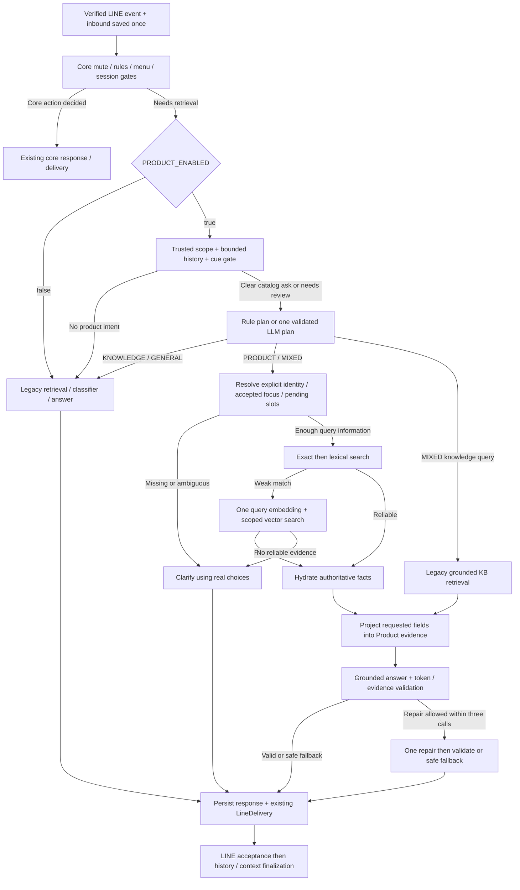

# Product MVP: แผนลดขอบเขตและ flow สำหรับ Product RAG

วันที่วิเคราะห์: 7 ตุลาคม 2026 (Asia/Bangkok)

สถานะ: **เอกสารออกแบบเพื่อ implement ต่อ ยังไม่ใช่พฤติกรรมที่แก้แล้วใน source code** วิเคราะห์จาก working tree ทั้ง tracked diff, staged diff และไฟล์ใหม่ที่ยัง untracked เทียบกับ core เดิมใน Git HEAD ไม่ได้ลบตาราง เปลี่ยน migration หรือแก้ production code ในงานนี้

## 1. ข้อสรุปและขอบเขต MVP

เป้าหมายคือให้ลูกค้าถามสินค้า/บริการทาง LINE แล้วระบบเข้าใจสิ่งที่ถาม ค้นหลักฐานที่ถูก ส่งหลักฐานเท่าที่จำเป็นให้ LLM และตอบตามบริบท รวมถึงการถามต่อและการถามกลับเมื่อระบุสินค้าไม่ชัด

**แนะนำลด commerce foundation และ admin surface ก่อนลดความปลอดภัยของ RAG** โค้ดใหม่ไม่ได้ซับซ้อนเกินจำเป็นทุกส่วน: live price/stock, company scope, variant matching, presented references, billing replay และ delivery acceptance จำเป็น ส่วน catalog CRUD, inventory commands/audit และ cross-channel customer linking เกินขอบเขตการตอบสินค้าในแชตตอนนี้

MVP คงไว้:

1. Gate เปิด/ปิด Product RAG แยกจากการซื้อ
2. การแยก PRODUCT / KNOWLEDGE / MIXED / GENERAL โดยดูเจตนา ไม่ใช้ชื่อสินค้าเป็นคำตัดสิน
3. Search แบบ exact identity → lexical/BM25 → embedding เมื่อจำเป็น
4. อ่านราคา สต็อก และ attributes จากฐานข้อมูลที่เป็นต้นทางหลังเลือก candidates
5. ส่ง `<Product>` แยกจาก knowledge evidence พร้อม requested fields
6. LLM วางแผน + ตอบ โดย validate ทั้ง schema และความสัมพันธ์กับหลักฐาน
7. Context สำหรับสินค้าที่ลูกค้าได้รับคำตอบจริง และ clarification แบบหลาย turn
8. Usage/billing, replay, company ownership และ delivery เดิม

พักไว้:

- Admin product/variant/attribute CRUD และ reindex HTTP endpoints
- Cart, checkout, inventory reservation, order, payment, fulfillment
- Customer sync สำหรับผู้ถามข้อมูลอย่างเดียว
- Account merge/link ข้าม LINE/Facebook/Web
- COUNT ทั้งร้าน, CHEAPEST ทั้งร้าน และ comparison/recommendation engine ที่มี business rules แยก
- Dynamic form builder, business plugins, workflow engine หรือ full SaaS

คำถามรายการ/แนะนำง่าย ๆ ยังตอบจาก bounded candidates ได้ แต่ห้ามอ้างว่าเป็นรายการครบทั้งร้านหรือถูกที่สุดทั้งร้าน หากยังไม่มี aggregate query ที่ตรวจครบจริง

## 2. สิ่งที่มีจริงใน working tree และ design intent ปัจจุบัน

### 2.1 Core เดิมและจุดที่ product เข้าไปแทรก

Core ingress/worker/delivery ยังคงใช้ของเดิม:

```text
LINE raw-body signature → enqueue → durable webhook claim/ordering
→ save incoming/history/unread once → load bounded context
→ ChatbotService → IntentRouterService → retrieval/answer
→ persist LineDelivery → LINE accepts → history/context finalization
```

ใน `ChatbotService.handleTextMessage` admin mute และ validation จบก่อน router ส่วน router เรียง rich menu → cancel → active registration/allowed interruption → inquiry opener/rules → retrieval → safety routing → low-confidence classifier

Product ที่เพิ่มเข้าไป:

| จุดเข้า                              | พฤติกรรมปัจจุบัน                                                                                        | จุดประสงค์                                                |
| ------------------------------------ | ------------------------------------------------------------------------------------------------------- | --------------------------------------------------------- |
| `KnowledgeRetrievalService.retrieve` | เรียก optional ProductRetrievalService; memoize legacy retrieval; ถ้า product ไม่รับ turn จึงใช้ legacy | เป็น entry point เดียวและไม่ bill legacy retrieval ซ้ำ    |
| `IntentRouterService.route`          | เมื่อมี `retrieval.product` คืน ANSWER_KNOWLEDGE ทันที; KNOWLEDGE hint ข้าม classifier รอบสอง           | ใช้ planner เดียวตัดสินและส่ง product workflow ให้ answer |
| `AiChatService.answerKnowledge`      | delegate ProductAnswerService เมื่อมี product workflow                                                  | แยก grounded product generation จาก knowledge เดิม        |
| `ChatbotService.aiResponse`          | ส่ง catalogRefs และแยก GENERAL source                                                                   | เก็บ entity references สำหรับ follow-up                   |
| `LoadContextService`                 | validate/store catalogRefs ใน turn Redis                                                                | จำ IDs โดยไม่ใช้ราคาเก่าเป็นต้นทาง                        |
| `LineDeliveryService.finalize`       | append context หลัง acceptance โดยผ่าน response ที่เก็บใน delivery                                      | refs ที่ใช้ถามต่อมาจากคำตอบที่ส่งสำเร็จ                   |

Active REGISTER ปิด product retrieval อยู่แล้ว (`disableProduct`) และยังไม่ควรเพิ่ม product digression จนกว่าจะมีข้อกำหนดว่าจะรับ input ของ registration หรือคำถามสินค้าอย่างไร โดยไม่ส่ง slots/PII เข้า AI

### 2.2 Product retrieval ปัจจุบัน: intent → condition → action

ดู `src/modules/chatbot/knowledge/product/product-retrieval.service.ts`:

1. ต้องผ่าน `productRagEnabled` และมี userId/turnId/lineMemberId/conversationId
2. Policy question รูปประโยคสั้นที่กำหนดไว้คืน legacy โดยตรง
3. Resolve company ด้วย singleton deployment; ถ้าไม่มี/มากกว่าหนึ่ง company จะ skip product
4. ตัด history เหลือ 6 messages, ไม่ใช้ REGISTRATION และ redact PII
5. ถ้ามี CommerceTurn เดิม ใช้ routing/retrieval snapshot เดิม
6. Turn ใหม่ใช้ keyword/ref/catalog probe เป็นสัญญาณ; ถ้าไม่มีสัญญาณใช้ legacy ก่อน; legacy ที่ยัง LOW_CONFIDENCE อาจเข้า planner แม้เป็น casual chat
7. เปิด CommerceTurn และ lease; probe catalog และอ่าน store field vocabulary
8. Exact SKU บางรูปประโยคสร้าง plan ด้วย rule; กรณีอื่น PLAN LLM คืน PRODUCT/BOTH/KNOWLEDGE/GENERAL
9. Validate IDs, option keys และช่วงราคา; แต่มี rule เปลี่ยน GENERAL เป็น PRODUCT/BOTH เมื่อ probe เจอ catalog
10. PRODUCT/BOTH ค้น DB; semantic เพิ่มเมื่อผลเป็น NO_MATCH/NO_RELIABLE_CANDIDATE หรือ RECOMMEND และไม่มี productIds
11. KNOWLEDGE คืน legacy result พร้อม plannerIntent; BOTH อ่าน policy knowledge แบบ grounded
12. เก็บ retrieval; product evidence ถูกแปลงเป็น KnowledgeItem โดยตั้ง `score: 1` ทุกแถว

Design intent หลักดี: ลด classifier ซ้ำ, ไม่ใช้ vector เป็นราคา/สต็อก, ไม่ให้ LLM แต่ง ID, และ replay turn เดิม แต่ gate/planner/retrieval ใช้หลายเงื่อนไขซ้อนกันจนตรวจ flow ยาก

### 2.3 Search ปัจจุบัน

ดู `src/modules/products/search/product-search.service.ts`:

- Scope มี companyId และ exact tenant partition (`null` ไม่ใช่ omitted filter), ACTIVE/language และ active variants
- Probe ใช้ชื่อ/code/SKU/aliases ในข้อความพร้อม identifier boundaries บางส่วน
- DETAIL หาก exact หลายสินค้า → MISSING_INPUT; ถ้าหนึ่งสินค้า → reliable
- Lexical candidates มี weighted SQL hits แล้ว BM25 + RRF; vector ใช้ cosine floor ค่าเริ่มต้น 0.65
- DETAIL ใช้จำนวน subject hits เลือกผู้ชนะ; เสมอถามกลับ ไม่เงียบเลือกอันดับหนึ่ง
- Filter variant options ทุกข้อบน variant แถวเดียวกัน; ไม่มี variant ที่ถาม → VARIANT_UNAVAILABLE
- ราคาใช้ Decimal และ override/basePrice; stock ใช้ onHand > reserved; ไม่ track stock → NOT_TRACKED
- COUNT/LIST/CHEAPEST scan catalog แบบ keyset ไม่ใช้ vector top-k เป็นยอดรวม
- ProductVector ตรวจ embedding model และ searchRevision; index ไม่ส่งราคา/stock ไป embedding

ข้อแตกต่างจาก flow ที่ผู้ใช้ต้องการ: **embedding fallback ปัจจุบันไม่ได้ทำเมื่อ lexical FOUND แต่คะแนนอ่อน** และผลลัพธ์ภายนอกยังไม่เก็บคะแนนที่แยก exact/lexical/vector อย่างชัดเจน

### 2.4 Answer ปัจจุบัน

ดู `product-answer.service.ts` และ `product-answer.policy.ts`:

- ใช้ PLAN/ANSWER/CRITICAL_REPAIR slots ผ่าน CommerceTurnService; สูงสุด 3 logical generation operations
- Project field ตาม asks/operation และ group variants ต่อสินค้า
- LLM คืน JSON answerTemplate + evidenceIds; renderer แทน tokens จาก evidence ที่ allowlist
- มี coverage checks ราคา/stock/compare/policy และ deterministic safe answer
- Explicit INSUFFICIENT_CONTEXT ไม่เรียก repair และไม่เอา candidates มาแสร้งเป็นคำตอบ
- เก็บ refs เฉพาะที่แสดง หรือ choices ที่ถามกลับ; context commit หลัง delivery acceptance

สิ่งที่ควร reuse คือ projection, tokens/citations, explicit rejection และ refs ไม่ควรรื้อออกทั้งหมดเพื่อให้ LLM ตอบ free text เพราะจะเสียการควบคุม facts ที่มีผลกับลูกค้า

### 2.5 ส่วนที่ขยายเกิน MVP

| กลุ่ม                 | สิ่งที่เพิ่มจริง                                                              | แนวทาง                                                                              |
| --------------------- | ----------------------------------------------------------------------------- | ----------------------------------------------------------------------------------- |
| Admin catalog         | ProductController, ProductService, ProductCommandService, DTOs/version checks | ถอด controller/module dependencies ออกจาก chat; เก็บ import/seed ภายในแบบ validated |
| Inventory mutations   | InventoryService, ProductCatalogCommand, InventoryMovement                    | พัก mutation API; ใช้ read-only inventory adapter สำหรับแชต                         |
| Customer              | CustomerIdentityService, AccountLinkService, CustomersModule, 3 tables        | พักออกจาก RAG; sync เฉพาะ transactional flow ในอนาคต                                |
| Registration coupling | registerForLine สร้าง Member+link customer เมื่อ catalogEnabled               | แยกจากการเปิดอ่านสินค้า ไม่เพิ่ม dependency นี้เมื่อ BUY=false                      |
| Field admin           | attribute controller, preset apply commands, editable form settings           | คง field definitions ที่ search ต้องใช้; พัก form/admin commands                    |
| RAG recovery          | CommerceTurn/CommerceLlmCall และ leases                                       | คง reliability ขณะลด scope; consolidate ได้ภายหลังหากพิสูจน์ replacement แล้ว       |
| Index recovery        | ProductIndexJob, poller, outbox                                               | คง freshness/recovery แต่ไม่ต้องมี admin reindex API                                |

### 2.6 Findings ที่ควรแก้ก่อน implement flow ใหม่

1. **Feature flags ไม่ตรง requirement:** source อ่าน PRODUCT_ENABLED แล้วต้อง PRODUCT_RAG_ENABLED และ PRODUCT_SEMANTIC_ENABLED เพิ่ม ไม่มี PRODUCT_BUY gate
2. **Customer sync ผูกผิด gate:** `RegistrationService.registerForLine` ใช้ catalogEnabled จึงทำให้การเปิดตอบสินค้าเพิ่ม customer transaction dependency ใน registration
3. **พบชื่อสินค้าไม่ได้แปลว่าขอ catalog facts:** productSignal เช่น “เสื้อ/ขนาด/ราคา” และ probe เริ่ม planner ได้กว้าง; rule override GENERAL ไม่ควรบังคับให้คำถาม “Stussy คืออะไร” ต้องเป็นการถามสินค้าของร้าน
4. **KNOWLEDGE ถูกอธิบายเน้น policy:** ขยายความชัดเจนถึงวิธีใช้/ดูแล/troubleshooting ไม่ใช่แค่ส่งฟรี/คืนสินค้า
5. **asks ว่างทำให้ตอบเกิน:** exact SKU path จับ STOCK จากมีของ/สต็อก/พร้อมส่ง ฯลฯ แต่ไม่จับ “มีไหม” ทั่วไป; policy มอง asks ว่างเป็น overview จึงเปิดราคา/stock/description ในคำถามที่อาจต้องการแค่มีสินค้านี้หรือไม่ ต้องแยก EXISTS จาก STOCK และห้าม default overview เมื่อยังไม่รู้สิ่งที่ถาม
6. **score: 1 ทุก product item:** เลขนี้เป็น adapter value ปัจจุบัน ไม่ใช่ความมั่นใจ 100% แยก match kind/ranking ออกจาก intent confidence
7. **Read snapshot ไม่ครบทุก query:** `read(tx)` เรียก `probe()` ผ่าน root prisma แทน tx; อย่าอ้างว่า identity probe อยู่ใน RepeatableRead snapshot เดียวกัน ต้องส่ง db client ผ่าน read helpers
8. **Template validation ซับซ้อนแต่ไม่รับประกัน semantic truth:** token checks ป้องกันการแต่งค่าบางส่วน แต่ข้อความเชื่อมยังอาจตีความผิด เช่นยืนยันมีของจาก UNKNOWN ต้องมี intent/status policy และชุด evaluation
9. **Regex ลบ mutable facts จาก description ไม่พอ:** `stableProductDescription` ตัดทั้งประโยคที่พบคำราคา/stock อาจลบรายละเอียดที่ใช้ได้ และไม่ใช่การรับประกันว่าไม่มี mutable claim ใช้การแยก source fields ตอน import เป็นหลัก
10. **Generic stock ใช้แทนห้องว่างตามวันไม่ได้:** schema รองรับ catalog ของบริการได้ แต่ยังไม่มี authoritative scheduling/availability สำหรับวันเข้าพักหรือรอบบริการ
11. **สถานะ docs/tests drift:** tests หลายไฟล์ยังใช้ PRODUCT_CATALOG_ENABLED แต่ source อ่าน PRODUCT_ENABLED; roadmap บางฉบับยังบอก Product ยังไม่มี ขณะที่ working tree มีแล้ว
12. เอกสาร `docs/mvp-line-rag-billing-flow.md`, `docs/service-flow.md` และ `docs/core-text-reply-refactor.md` ที่ถูกอ้างถึงไม่อยู่ใน tree นี้ จึงใช้ source, tests และ `line-message-e2e-current.md` เป็นหลัก ไม่ถือ roadmap เป็น runtime behavior

## 3. ตัดสินใจเรื่อง config: ใช้สอง feature switches

กำหนดชื่อ canonical เป็น **PRODUCT_ENABLED** และ **PRODUCT_BUY** เพราะ requirement ข้อ 12 เรียกชื่อนี้โดยตรง ส่วน PRODUCT_ACTION ในข้อ 12–13 ให้หมายถึง PRODUCT_BUY ในแผนนี้ ไม่สร้าง flag ที่สาม

```dotenv
PRODUCT_ENABLED=false
PRODUCT_BUY=false
```

| PRODUCT_ENABLED | PRODUCT_BUY | พฤติกรรม                                                                          |
| --------------- | ----------- | --------------------------------------------------------------------------------- |
| false           | false       | Core เดิม; ไม่เปิด product planner/search/index worker/customer sync              |
| true            | false       | Product Q&A/RAG/clarification; ไม่ checkout/payment/customer sync                 |
| true            | true        | Product Q&A และอนุญาตเข้าทางซื้อ **เมื่อ transactional implementation พร้อมจริง** |
| false           | true        | Invalid config: fail startup ด้วยข้อความ config ที่ไม่เปิดเผยค่าอื่น              |

MVP รอบนี้ BUY=false เป็นค่าที่รองรับการใช้งานจริง การตั้ง BUY=true ต้อง fail startup หาก checkout ยังไม่ implement ห้ามให้ flag เป็นหลักฐานว่าซื้อได้แล้ว และห้ามมี placeholder ยืนยันรับ order/payment

หลัก implement:

- Parse bool แบบ strict, trim/case insensitive; ค่าไม่ถูกต้อง fail startup; unset=false
- ยุบ PRODUCT_RAG_ENABLED และ PRODUCT_SEMANTIC_ENABLED ออกจาก feature gating; semantic เป็นขั้นค้นที่จำเป็นภายใต้ PRODUCT_ENABLED
- Threshold/bounds เป็น internal policy constants ก่อน ไม่เพิ่ม env switches ทุกจุด; provider/embedding/deployment config เดิมยังอยู่ได้ ไม่ถือเป็น product feature switches เพิ่ม
- แก้ fixture/tests/docs ชื่อเก่าพร้อมกัน;ไม่ใช้ silent alias ที่ทำให้ config ขัดกันแล้วเดายาก
- อ่าน feature state ผ่าน ProductFeatureService จุดเดียว; ไม่กระจาย `process.env` ใน services
- ปิด flag แล้วต้อง resume delivery ที่สร้างไว้และได้รับ acceptance/recovery ตาม invariant เดิม; ไม่ลบ reservations/context/history หรือยกเลิก finalization เพราะปิด feature
- สำหรับ turn ที่ยังไม่สร้าง outbound เมื่อปิด feature: ถ้ามี operation snapshot ต้อง recover/settle เดิมให้ครบโดยไม่สร้าง product provider operation ใหม่ แล้วจบด้วย safe response ตามนโยบาย ไม่ทิ้ง HELD hold เพื่อย้อนกลับไปทำ flow อื่น

## 4. แยก “สิ่งที่ถาม” ออกจาก “สินค้าที่อ้างถึง”

ใช้สองมิติ ไม่รวมเป็น confidence ค่าเดียว:

1. **Question intent:** ลูกค้าต้องการ catalog facts, ความรู้ของร้าน, knowledge ผสมสินค้า หรือ general
2. **Entity resolution:** รู้แน่นอนว่าเป็นสินค้า/variant ไหน, มี candidates หลายตัว หรือไม่มีหัวข้อพอ

| ข้อความ                         | Intent                                              | ต้องค้นอะไร                                         | คำตอบที่เหมาะ                                     |
| ------------------------------- | --------------------------------------------------- | --------------------------------------------------- | ------------------------------------------------- |
| เสื้อ Stussy มีไหม              | PRODUCT / EXISTS                                    | catalog; stock เพิ่มเฉพาะความหมายพร้อมซื้อ/พร้อมส่ง | มีรุ่นที่ตรง หรือถามรุ่นเพิ่ม ไม่แจกข้อมูลทั้งหมด |
| Stussy รุ่น A ราคาเท่าไร        | PRODUCT / PRICE                                     | exact/lexical → live price                          | ราคา/ช่วงราคาที่ถูกสำหรับ variant                 |
| เสื้อ Stussy ซักยังไง           | KNOWLEDGE / USAGE                                   | KB วิธีดูแลที่เกี่ยวกับรุ่น/วัสดุที่ยืนยันได้       | วิธีซักจากหลักฐาน ไม่ตอบราคาแทน                   |
| ตัวนี้ราคาเท่าไร แล้วซักยังไง   | MIXED                                               | live product price + KB usage                       | ตอบสองประเด็นโดยแยกต้นทาง                         |
| ส่งฟรีไหม                       | KNOWLEDGE / POLICY                                  | legacy KB                                           | ไม่ใส่ product evidence                           |
| ผ้าคอตตอนคืออะไร                | GENERAL หรือ KNOWLEDGE ตามข้อมูลร้านและ policy เดิม | legacy/classifier                                   | ไม่เอาสินค้าที่มีคำว่าคอตตอนมาขายแทน              |
| เสื้อสีดำตัวนั้น                | PRODUCT / unresolved                                | presented refs + options                            | ถามรุ่น/ตัวไหน หากเหลือหลายตัว                    |
| ราคาเท่าไร                      | PRODUCT เมื่อมี active product focus                | rehydrate focus                                     | ราคาใหม่; ถ้าไม่มี focus ถาม “หมายถึงสินค้าอะไร”  |
| สมัครสมาชิก                     | deterministic core                                  | ไม่ค้น product                                      | REGISTER ตามเดิม                                  |
| ห้อง Deluxe ว่าง 12–14 ต.ค. ไหม | PRODUCT / date availability                         | authoritative booking source ถ้ามี                  | ถ้าไม่มี integration ระบุว่าตรวจวันว่างไม่ได้     |

EXISTS หมายถึงมีรายการขายใน catalog; STOCK หมายถึงสถานะมีของพร้อมขาย ณ เวลาตรวจสอบ ทั้งสองไม่เท่ากัน หากคำว่า “มีไหม” ในธุรกิจนั้นหมายถึง stock ให้ planner ระบุทั้งคู่จากบริบท แต่ห้ามอนุมาน “พร้อมส่ง” จากแค่ ACTIVE product

KNOWLEDGE ที่เกี่ยวกับสินค้าอาจต้องใช้ชื่อ/รุ่น/วัสดุเพื่อเลือกบทความ: อ่าน **identity metadata** ได้ ไม่เท่ากับส่งราคา สต็อก หรือ description ทั้งก้อนให้ answer model ส่วน MIXED ต้องมี catalog fact ที่ลูกค้าถามจริงด้วย

## 5. โครงสร้างที่ lean และ NestJS boundaries

```text
src/modules/products/
  products.module.ts                 # Read/search/index providers; ไม่มี admin controllers ใน MVP
  product-feature.service.ts         # 2 gates
  product-scope.service.ts           # Trusted deployment company; preserve tenant partition
  product.types.ts                   # Scope/entity/result/evidence
  search/
    product-search.service.ts        # Exact → lexical → vector; candidate selection
    product-vector.repository.ts     # pgvector read/write
    product-document.ts              # Stable public search document
    product-terms.ts                  # Subject extraction; reuse BM25 primitive เดิม
  attributes/
    attribute-definition.ts          # Validation/canonical keys/value aliases
    product-field.service.ts         # Read field vocabulary; ไม่รวม form commands
  indexing/
    product-index.service.ts          # Import/reindex internal path; durable recovery

src/modules/chatbot/knowledge/
  knowledge-retrieval.service.ts      # Single retrieval entry point
  product-retrieval.service.ts        # Product gate + plan + retrieval composition
  product-intent.policy.ts            # Pure cue/asks policy; แยกเมื่อ complexity จำเป็น
  product-answer.policy.ts            # Projection + factual template validation
  product-answer.service.ts           # Grounded answer, called by AiChatService
```

นี่เป็น target responsibilities; ไม่ต้องสร้างทุกไฟล์ตามรายการหาก provider เดิมรับหน้าที่ได้ และไม่ย้ายไฟล์เพื่อความสวยงามอย่างเดียว

- ChatbotService orchestrates actions; router ตัดสิน action แต่ไม่ทำ product mutations
- RuleIntentService deterministic/no I/O; catalog probe อยู่ product retrieval ไม่ย้ายไป rule service
- ProductsModule ไม่ import Chatbot/Line/Customer/Payments/Commerce mutation modules
- KnowledgeRetrievalService เป็นประตูเดียว; callbacks ของ legacy ต้องไม่เรียก public retrieve วนกลับ product อีก
- AiChatService ใช้ retrieval แล้ว generate; ไม่ตัดสิน BM25/vector score ใหม่
- Provider/embedding ผ่าน abstraction + billing เดิม; ไม่มี SDK call ใหม่ใน ProductService
- `@Optional()` รักษา test/core wiring ชั่วคราวได้ แต่ production module ต้องมี provider ครบ เมื่อ PRODUCT_ENABLED=true อย่าเงียบ fallback เพราะ DI ผิด
- Scope รับจาก server ที่ตรวจแล้ว ห้าม LLM/request text ระบุ companyId/tenantId

## 6. Data model ที่แนะนำ และตารางที่พัก/ลบได้

### 6.1 คง catalog facts ขั้นต่ำ

| Model ปัจจุบัน             | แนะนำ                        | เหตุผล                                                                                                                |
| -------------------------- | ---------------------------- | --------------------------------------------------------------------------------------------------------------------- |
| Product                    | คง                           | companyId, code/name/aliases, category/language/status, stable description, attributes, basePrice Decimal, revisions  |
| ProductVariant             | คง                           | ตัวเลือกสี/ไซส์/ความจุต้องอยู่บนแถวเดียว; SKU/priceOverride/active; สินค้าไม่แตก variant ใช้ default variant หนึ่งแถว |
| InventoryBalance           | คงแบบ read-only              | reuse onHand/reserved ที่มีแล้ว ไม่ต้องเพิ่ม stock field ซ้ำหรือเขียน reservation ใน MVP                              |
| ProductVector              | คง                           | derived index; model/dimension/revision/hash; composite FK รักษา company ownership                                    |
| ProductAttributeDefinition | คงแต่ลด administration       | เป็น dictionary ที่ทำให้ custom fields แปลเป็น search/filter/evidence ได้                                             |
| ProductIndexJob            | คง                           | มี code แล้ว; durable freshness/retry ไม่ใช่ cart/order infrastructure                                                |
| CommerceTurn               | คงชั่วคราวเฉพาะ product turn | immutable input/plan/evidence/response สำหรับ retry ไม่เสียเงินซ้ำจาก prompt ใหม่                                     |
| CommerceLlmCall            | คงชั่วคราวเฉพาะ 3 slots      | request/result/failed state/call cap ที่ใช้พิสูจน์ replay ได้แล้ว                                                     |

เหลือ **8 ตารางที่สนับสนุน chat/read/index/recovery** ในขั้นแรก จาก 13 ตารางใหม่ ไม่เพิ่ม order/payment tables การ lean ที่ปลอดภัยไม่ได้หมายความว่าต้องลบทุกตารางที่ดูเป็น infrastructure

`revision` เป็น source version; `searchRevision` เปลี่ยนเฉพาะ stable searchable content. Price/stock-only changes ไม่บังคับ embedding ใหม่ แต่ hydrate turn ใหม่ต้องอ่านค่าปัจจุบัน

THB/Decimal precision/vector(1536)/CHECKs/FKs ของเดิมคงไว้; ไม่ขยายหลาย currency หรือเปลี่ยน dimension ในรอบลด scope

### 6.2 พัก runtime และเป็น candidates สำหรับลบภายหลัง

| Model                 | งานที่ใช้จริง                  | เหตุผลที่ไม่ต้องใช้ใน read-only MVP         |
| --------------------- | ------------------------------ | ------------------------------------------- |
| ProductCatalogCommand | Idempotent admin mutations     | ไม่มี admin CRUD/stock mutation endpoints   |
| InventoryMovement     | Immutable stock audit          | ไม่มี inventory mutation ใน product chat    |
| Customer              | Buyer/member identity          | ถามข้อมูลสินค้าใช้ verified LINE thread ได้ |
| ChannelIdentity       | Buyer identity namespace       | MVP LINE-only informational flow            |
| AccountLinkChallenge  | Verified cross-channel linking | ยังไม่ทำ account linking/merge              |

**พัก code path ก่อน drop physical tables** ถ้าตารางมี records โดยเฉพาะ inventory audit/command outcomes ต้องเก็บประวัติ ไม่ลบเพียงเพราะ feature ถูกพัก ถ้าพิสูจน์ว่าไม่มีการ deploy/ไม่มีข้อมูลจริงจึงวาง clean schema ลดตารางได้

ทางเลือกอนาคต: รวม CommerceLlmCall 3 slots เป็น bounded JSON state ใน CommerceTurn เพื่อลดหนึ่งตาราง แต่ต้องแทน unique slot/ordinal ด้วย atomic locked updates, persist request ก่อน provider, error/replay semantics และ tests เท่าเดิม การรวมนี้ไม่ใช่งานจำเป็นของ MVP และห้ามแทนด้วย Redis counter/in-memory lock

ไม่แนะนำยุบ ProductVariant เป็น JSON variants เพราะจะเสีย entity ID, SKU uniqueness, same-row filters และการอ่าน price/stock ที่ถูกตัว

## 7. Custom fields: hybrid presets + controlled definitions

เลือก **base schema คงที่ + JSON values + field definitions; business presets เป็น starter dictionary** แทน schema/table ต่อธุรกิจ หรือ JSON อิสระที่ไม่มี metadata

Base fields เช่น name/code/SKU/status/price/stock/companyId คงเป็น typed columns. คุณสมบัติยืดหยุ่นเก็บใน Product.attributes หรือ ProductVariant.attributes ตาม canonical key

Field metadata ที่ search จำเป็น:

```json
{
  "key": "storage",
  "label": "ความจุ",
  "scope": "VARIANT",
  "type": "TEXT",
  "unit": "GB",
  "variantOption": true,
  "searchable": true,
  "aiVisible": true,
  "valueAliases": { "256GB": ["256", "256 GB"] },
  "status": "ACTIVE"
}
```

ใช้ types/options/status/version ที่มีอยู่ได้ ไม่ต้อง rewrite table เพื่อลดจำนวน columns ส่วน required/categories/sortOrder/preset apply/versioning UI ไม่ต้องอยู่ใน chat critical path

### 7.1 เมื่อเพิ่ม field ทีหลัง ระบบ map อย่างไร

1. ผู้ดูแล/import เพิ่ม definition ที่ company scope ถูกต้อง เช่น `service_validity_days` label “อายุบริการ” type NUMBER unit “วัน”
2. Validate และบันทึก values ใน canonical key ของสินค้า; ห้าม string input กลายเป็น SQL field/column name
3. Search document builder อ่านเฉพาะ ACTIVE/searchable definitions แล้ว serialize `label + typed value`; answer projection อ่านเฉพาะ aiVisible
4. เปลี่ยน label/searchable/value aliases/value หรือ searchable values → invalidate/increment searchRevision ของสินค้าที่เกี่ยวข้อง และ enqueue jobs; model/hash/revision เดิมใช้ตอบ candidate ไม่ได้
5. Planner รับ field vocabulary แบบ bounded และเฉพาะ store scope; model คืน canonical key + operator/value จาก allowlist
6. Backend validate type/value/operator และ scope อีกครั้งก่อน filter; valueAliases ช่วย canonicalize “256” เป็น “256GB” โดยไม่เดาความจุอื่น
7. SQL filter สำหรับ JSON ใช้ parameterized key/value และ validate operators; NUMBER เปรียบเทียบเป็น number/Decimal ตามชนิด ห้าม string sorting ทำให้ 100 < 20
8. Field ใหม่ที่ไม่มี value บนสินค้านั้นหมายถึง “ยังไม่มีข้อมูล”; ไม่ default เป็น false/0 และไม่เติมจาก LLM
9. During reindex: exact/lexical และ live attributes ยังทำงาน; stale vector ถูก exclude; query ที่ต้อง semantic จบด้วย clarify/fallback ตาม evidence

ไม่ต้อง hardcode filter ต่อ field ใหม่ แต่ใน MVP รองรับเฉพาะ equality ของ scalar variant options และ requested attribute reads ก่อน range/date/query DSL ให้คืน unsupported/clarify แทน ignore constraint

### 7.2 Presets ตามธุรกิจ

| ธุรกิจ   | Stable fields ที่ค้น/ตอบได้                         | Mutable source ที่ต้องแยก                    |
| -------- | --------------------------------------------------- | -------------------------------------------- |
| เสื้อผ้า | brand/material; variant color/size                  | ราคาและ inventory ต่อ SKU                    |
| อุปกรณ์  | brand/features; storage/memory/color                | ราคา/stock; warranty terms ต้องมีหลักฐาน     |
| โรงแรม   | room_type/bed_type/max_guests/amenities             | ราคาและห้องว่างตามวันจาก booking source      |
| บริการ   | duration_minutes/service_validity_days/service_type | รอบว่าง/ราคา/สิทธิ์คงเหลือจาก service source |

`service_validity_days` เป็นระยะเวลาของแพ็กเกจได้ แต่วันหมดสิทธิ์ของลูกค้าเป็นข้อมูลส่วนตัว/transactional record ไม่ใส่ catalog และไม่ตอบจาก vector

MVP reuse catalog ของหลายธุรกิจได้ ไม่รับประกันจองหรือยืนยันวันว่างได้ทุกธุรกิจ. Date availability ถ้าไม่มี adapter ให้ระบุข้อจำกัดตรงคำถามและส่งเจ้าหน้าที่ ไม่ใช้ `trackStock=false` เป็น “ว่าง/พร้อมให้บริการ”

## 8. Flow ใหม่ step by step



Diagram ย่อ branch errors: query/provider unavailable และ evidence conflict ใช้ safe fallback/handoff ตามรายละเอียดด้านล่าง ไม่จัดเป็น clarification ทุกกรณี

### Step 0 — Preserve transport, auth และ business gates เดิม

Raw-body signature, queued dedup/claim/order, incoming/unread once, bans/spam/rate limits, admin mute, aiEnabled และ budgets อยู่ตำแหน่งเดิม Product feature เริ่มหลัง deterministic core gates เท่านั้น

`waiting_admin` ไม่ mute AI; actual admin reply mute และ expiry/resume-bot ใช้ policy เดิม Product code ไม่อัปเดต registration data เพื่อแทน handoff

### Step 1 — Feature/deployment gate

ถ้า PRODUCT_ENABLED=false ให้ผ่าน legacy code path เดิม ไม่มี product DB probe/planner/query embedding/index worker สำหรับ turn ใหม่

ถ้าเปิด resolve company จาก trusted deployment binding เดิม ถ้าไม่มี binding ใช้ singleton company ที่ตรวจแล้วได้; หากมากกว่าหนึ่ง company และยังไม่มี OA→company mapping ให้ fail closed เฉพาะ product ไม่เลือก company แรกเอง ไม่ทำ SaaS resolver framework ตอนนี้

ทุก query ใช้ `{companyId, tenantId: null}` หรือ verified tenant partition ที่มีจริง; ไม่ลบ tenantId filter ของข้อมูลที่เพิ่มมาแล้วเพื่อความง่าย

### Step 2 — Load bounded context และ cheap semantic cues

ใช้ context เดิม TTL 30 นาทีและ limits เดิม; product planner อ่านเฉพาะ redacted recent messages + presented product refs ไม่อ่าน registration slots/customer PII

Pure cue policy แยก:

- Catalog asks: EXISTS, PRICE, STOCK, OPTIONS, ATTRIBUTE, DETAIL
- Knowledge asks: USAGE, CARE, TROUBLESHOOT, POLICY
- Ref signals: ตัวนี้/ตัวนั้น/อันที่สอง/ราคาเท่าไร พร้อม active focus
- General/social signals: greetings/small talk ที่ไม่ขอข้อมูลร้าน

ใช้ค่าคะแนน gate เล็กน้อยเพื่อ **ตัดสินใจว่าจะเรียก planner** เช่น explicit SKU/name + catalog ask เป็น strong, ref + active focus เป็น strong, product category/ambiguous price เป็น review. คำว่า “เสื้อ/ราคา/ซื้อ” อย่างเดียวไม่ใช่ยืนยัน product intent

หากต้องใช้คะแนน เริ่มด้วย policy เล็ก ๆ ที่ตรวจได้: catalog ask +2, explicit identity +2, reference ที่มี accepted focus +2, catalog category mention +1. Pure usage/care/general intent เป็น routing branch แยก ไม่หักคะแนนแล้วหวังว่าแยกได้ถูกเอง. Gate score ≥2 หมายถึง review/plan ได้เท่านั้น ไม่อนุญาต product search จน plan เป็น PRODUCT/MIXED; identity อย่างเดียวก็ต้องตรวจสิ่งที่ถาม. ค่าเหล่านี้เป็น proposed constants สำหรับ fixtures ไม่ใช่ confidence/probability และต้อง calibrate false-positive/negative ก่อนใช้จริง

Exact knowledge question ที่ไม่มี catalog ask ให้ legacy DIRECT/cache เดิมก่อน และไม่เปิด product search ทั้งหมด กรณีมีทั้งคำถามสินค้าและวิธีใช้ให้ planner แยก MIXED ไม่ให้ strong FAQ answer กลืน product half

สำหรับข้อความไม่มีสัญญาณแน่ชัด ใช้ legacy retrieval/classifier ตามเดิม; เมื่อ classifier พบ BUSINESS ที่อาจเป็นสินค้าที่ไม่มี keyword หรือ catalog miss ให้ reusable planner ตัดสินแทน classifier รอบซ้ำ ไม่ส่งทุก casual message ผ่าน CommerceTurn

คำถาม “ราคาเท่าไร” ไม่มี focus เป็น missing topic → ถามกลับได้โดยไม่ต้อง embedding ทั้ง catalog แต่ต้องไม่แย่งคำถามค่าธรรมเนียม/นโยบายที่มีหัวข้อชัด

### Step 3 — Classify และวางแผนหนึ่งครั้ง

Exact identity + **unambiguous catalog ask** ใช้ deterministic plan ได้; ถ้าประโยคมีวิธีใช้/คำถามผสม/สรรพนามไม่ชัด ใช้ planner หนึ่งครั้งแม้ SKU exact

Target logical contract (ไม่ใช่ DTO ที่ implement แล้ว):

```ts
type ProductQueryPlan = {
  mode: 'PRODUCT' | 'KNOWLEDGE' | 'MIXED' | 'GENERAL';
  productQuery: string | null;
  knowledgeQuery: string | null;
  asks: Array<
    'EXISTS' | 'PRICE' | 'STOCK' | 'OPTIONS' | 'ATTRIBUTE' | 'DETAIL'
  >;
  requestedAttributeKeys: string[];
  optionFilters: Array<{ key: string; value: string }>;
  reference: 'EXPLICIT' | 'FOCUS' | 'PRESENTED_CHOICE' | 'NONE';
  selectedRefIds: string[]; // ใช้เฉพาะ allowed refs ที่ server ให้
  needsClarification: boolean;
};
```

รองรับ existing PRODUCT/BOTH/KNOWLEDGE/GENERAL โดย mapping MIXED↔BOTH ที่ boundary แห่งเดียวระหว่างย้าย; ไม่ rename contracts ทุกไฟล์ใน PR เดียวโดยไม่มี callers/tests ครบ

Rules:

- ตั้ง asks จากสิ่งที่ถาม; asks ว่างไม่แปล DETAIL อัตโนมัติ
- “มีไหม” แยก EXISTS/STOCK ตามบริบท; ถ้าไม่ชัดตอบ catalog existence พร้อมไม่รับประกัน stock
- USAGE/CARE ไม่ขอราคา/stock; mode KNOWLEDGE ไม่ส่ง Product facts block
- Product name/SKU exact ไม่ override knowledge/general intent
- ห้ามคืน invented IDs หรือเลือกจาก catalog rows ที่ไม่ได้ให้; allowlist refs จาก scope เดียว
- หากลูกค้าเปลี่ยนตัวเลือก ปลด selected variant เดิมที่ขัดกัน แต่คง product เดิมได้
- Planner ไม่ตอบ facts ไม่สร้าง SQL ไม่เรียก tools/payment และไม่กำหนด company scope
- Schema parse + semantic validation; invalid/provider failure → safe fallback/clarify, ไม่เดาข้อมูลธุรกิจ

ใช้ provider structured output เดิมและ Zod runtime validation; schema-valid ไม่ได้แปลว่าเลือก intent/entity ถูก ต้องตรวจด้วย fixtures ที่มี gold intent/entity

### Step 4 — Resolve follow-up และ missing slots

Priority:

1. Explicit identity ในข้อความใหม่
2. ตัวเลือก/ordinal ที่ match presented choices อย่างชัดเจน
3. Active focus หนึ่ง product/variant ที่เข้ากับคำถามใหม่
4. ถ้ามีหลาย candidates หรือ refs หมดอายุ → clarify

ห้ามใช้ product ที่ค้นเจอแต่ไม่ได้แสดงเป็น active focus และห้ามอ้างราคา/stock จากข้อความ assistant เก่า

ตัวอย่าง Stussy หลายรุ่นแต่ลูกค้าถามราคา → ถามเลือกรุ่น หรือแสดงราคาแต่ละรุ่นหากลูกค้าถามทุกตัวชัดเจน ไม่ถือว่าอันดับแรกคือ “ตัวนั้น”

### Step 5 — Product search: exact → lexical → semantic

1. **Exact identity:** SKU/code match เป็น complete identifier; normalized name/alias match ต้องตรงทั้ง entity mention ที่ extract แล้วหรือ alias ที่ยืนยัน ไม่ใช่ substring ของชื่ออีกสินค้า
2. หาก exact หนึ่ง product/variant และ constraints สอดคล้อง → identityMatch=EXACT, identityScore=1. ไม่เรียก query embedding
3. Exact collision เช่น alias ซ้ำ/name ซ้ำ → ambiguity ไม่เลือกอันดับแรกแม้ score=1
4. **Lexical:** reusable Thai terms/BM25 จาก code/name/aliases/category/searchable attributes. ใช้ subject terms ไม่ให้คำ “มี/ราคา/ใส่” เป็นเหตุผลจับสินค้า
5. Lexical ที่ reliable จาก identity coverage และไม่มี ambiguity อาจจบได้; weak/partial หรือ gap ไม่พอ → semantic search ด้วย query ที่รักษาหัวข้อจริง
6. **Embedding:** query embedding ครั้งเดียวต่อ normalized query+model ใน turn; vector filter company/tenant/status/language/model/searchRevision
7. รวม lexical/vector ด้วย RRF primitive เดิม แยก score traces; ไม่เพิ่ม reranker model เสมอ ถ้าจำเป็นให้ generation judgment เป็น optional call ที่สาม
8. Entity/option constraints มีอำนาจเหนือ rank เช่นเสื้อดำ M ต้องมีบน variant แถวเดียว; semantic similarity สูงไม่ทำให้รองเท้ากลายเป็นเสื้อ
9. Candidate ต่ำ/เสมอ/ขัด constraints → choices หรือ no evidence ไม่สร้าง business answer จากอันดับแรก

**identityScore=1 ยืนยันการ match identifier เท่านั้น ไม่ใช่รับประกัน intent, factual accuracy หรือ stock.** RRF, BM25 และ cosine เป็นคนละสเกล ไม่เอามาบวกเป็น “confidence 100%”

Target result diagnostics:

```ts
type ProductMatch = {
  productId: string;
  variantId?: string;
  matchedBy: 'EXACT_SKU' | 'EXACT_NAME' | 'EXACT_ALIAS' | 'LEXICAL' | 'HYBRID';
  identityScore?: 1;
  lexicalScore?: number;
  vectorSimilarity?: number;
  rankScore?: number; // diagnostic RRF score
};
```

ไม่กำหนดค่า 0.8/0.9 ว่าเป็น best practice สำหรับ catalog ทุกประเภท ใช้ 0.65 ที่มีอยู่เป็น baseline แล้ว calibrate acceptance/gap กับ Thai fixtures ก่อนเปิดจริง ไม่เปลี่ยน global knowledge thresholds เพื่อช่วย product tests

ราคา budget/simple scalar filters มาจากข้อความจริงและใช้ Decimal; unsupported filter ห้าม ignore แล้วตอบผลที่ไม่ตรง. COUNT/CHEAPEST ถ้ายังพักไว้ให้ถามข้อจำกัด/แสดงบางตัว ไม่คืนคำยืนยัน global

### Step 6 — Read authoritative facts และกำหนด outcome

หลังได้ product/variant IDs ให้อ่าน facts ใหม่ใน company scope เดียว โดย shared DB client/snapshot สำหรับ related reads; ไม่เรียก external provider ใน transaction

Outcomes ที่พอสำหรับ MVP:

| Outcome                 | Action                                                           |
| ----------------------- | ---------------------------------------------------------------- |
| FOUND                   | Project requested evidence → grounded answer                     |
| AMBIGUOUS/MISSING_INPUT | ถามกลับจาก bounded real choices                                  |
| VARIANT_UNAVAILABLE     | บอกตัวเลือกที่ไม่มีพร้อม real alternatives; ไม่ถามชื่อสินค้าใหม่ |
| NO_RELIABLE_MATCH       | “ยังไม่พบข้อมูลที่ตรง”/ถามชื่อรุ่น; ไม่ยืนยันว่าทั้งร้านไม่มี    |
| UNAVAILABLE             | ระบุว่าตรวจข้อมูลไม่ได้/ใช้ safe fallback ตาม core               |

Catalog EXISTS จาก bounded fuzzy search ที่ไม่พบไม่พิสูจน์ nonexistence. จะตอบ “ไม่มีรุ่นนี้ในรายการขาย” แบบชัดเจนได้เมื่อ exact identity/category scope ถูกต้องและ query ครบส่วนที่เกี่ยวข้องจริง

Price: override ?? basePrice, null=ยังไม่ได้ระบุ, 0 เป็นราคาศูนย์ที่ valid; Decimal string ไป prompt. Multiple variant prices ใช้ช่วงราคาที่คำนวณจาก scope ที่ครบจริง หรือขอสี/ไซส์ ไม่เลือกค่าหนึ่งแสร้งว่าเป็นราคาทุกรุ่น

Stock: IN_STOCK/OUT_OF_STOCK/UNKNOWN/NOT_TRACKED; UNKNOWN/NOT_TRACKED ไม่แปลว่า available. ไม่ track stock ไม่ทำให้ purchasable=true ใน MVP; ซื้อขึ้นกับ BUY gate และ future transaction service

ความสดของต้นทางต้องตรวจด้วย: timestamp ของการ SELECT ไม่พิสูจน์ว่าข้อมูล inventory ที่ import มายังสด. ถ้าร้านมี upstream stock/booking ให้กำหนด source freshness จาก integration; หากข้อมูลหมดอายุหรือต้นทาง sync ล้มให้ stock=UNKNOWN และไม่พูดพร้อมส่ง. MVP ที่ดูแล stock ใน DB นี้โดยตรงใช้ committed DB state เป็นต้นทาง ไม่ seed ตัวเลขสมมติเพื่อให้ AI ตอบว่า “มีของ”

### Step 7 — Knowledge-only และ mixed retrieval

- KNOWLEDGE → legacy cache/DB/BM25/vector และ safety policy เดิม ใช้ resolved query เพิ่ม identity context ที่ยืนยันได้เมื่อจำเป็น; Product evidence=[]
- PRODUCT → product search เท่านั้น; ไม่ต้องค้น knowledge เสมอ
- MIXED → แยก productQuery กับ knowledgeQuery แล้วค้นสองต้นทาง โดย memoize legacy reads
- Reuse query embedding เฉพาะข้อความ normalized เดียวกัน, model/dimension/task เดียวกัน ไม่แชร์ vector ของ “ราคาเสื้อ” ให้ query “วิธีซัก”
- Knowledge ของ Product A ห้ามใช้กับ B เพียงเพราะ rank สูง; enforce scoped metadata/explicit applicability ถ้ามี หากไม่มีข้อมูลยืนยันความเกี่ยวข้องให้ fallback
- Knowledge ไม่มี evidence แต่ product half valid → ตอบสินค้าส่วนที่ยืนยันได้ + บอกว่าข้อมูลวิธีใช้/นโยบายยังไม่ยืนยัน
- Product ไม่มี evidence แต่ knowledge valid → ตอบเฉพาะ knowledge ที่ไม่ต้องพึ่ง product identity พร้อมถาม product เพิ่ม
- Evidence conflict/retrieval error ที่กระทบการตีความคำตอบร่วม → core safe handoff ไม่ลด conflict เป็น “ไม่มีข้อมูล” แล้วตอบต่อ

สำหรับ pure KNOWLEDGE/GENERAL อย่าส่งผ่าน ProductAnswerService ทั้งหมด ให้ router/AiChatService ใช้ handler เดิม; planner ที่จำเป็นต้องรันแล้วส่ง classification hint เพื่อไม่เสีย classifier อีกรอบ

### Step 8 — Serve LLM เฉพาะข้อมูลที่ถาม

ใช้ prompt composer เดิมเพิ่ม dataSections ชื่อ `Product` จะได้ `<Product>...</Product>` ที่ escape JSON ถูกต้อง และคง `<ragContext>` สำหรับ KB ไม่สร้าง string concat ของข้อมูล catalog ดิบ

ตัวอย่างคำถาม “Stussy รุ่น A ราคาเท่าไร” หลังเลือกสินค้าแล้ว:

```xml
<Product>
{
  "question": { "asks": ["PRICE"] },
  "status": "FOUND",
  "items": [{
    "ref": "product-ref-1",
    "name": "Stussy รุ่น A",
    "variant": { "color": "ดำ", "size": "M" },
    "price": "1290.00",
    "currency": "THB",
    "fetchedAt": "<server snapshot time>"
  }],
  "partialList": false,
  "buyEnabled": false
}
</Product>
```

ตัวอย่างเป็น logical payload ไม่ใช้ placeholder IDs เป็น UUID จริง ค่าใน production ต้องมาจาก DB/allowlist

| asks            | Facts ที่ให้ model                                                       |
| --------------- | ------------------------------------------------------------------------ |
| EXISTS          | identity + catalog existence; stock เฉพาะถามพร้อมขาย/ส่ง                 |
| PRICE           | identity + variant ที่จำเป็น + price/currency                            |
| STOCK           | identity + requested options + stockStatus/fetchedAt                     |
| OPTIONS         | identity + ค่าตัวเลือกจาก variants ที่ scope ถูกต้อง                     |
| ATTRIBUTE       | identity + requested attributeKeys เท่านั้น                              |
| DETAIL          | stable summary + requested/public attributes; ไม่แถมราคา/stock หากไม่ถาม |
| KNOWLEDGE USAGE | KB usage + identity metadata ที่จำเป็น; ไม่มี Product facts block        |
| MIXED           | แต่ละ facts block ตรงกับ subquestion ที่ต้องตอบ                          |

Projection เป็น code policy ไม่ใช่แค่ prompt ว่า “ตอบสั้น” เพื่อไม่ให้ model เห็น facts ที่ไม่ได้ถามตั้งแต่ต้น ส่วน history ใช้เข้าใจ reference เท่านั้น facts ปัจจุบันต้องใช้ evidence snapshot

Field visibility: MVP searchable content ที่ส่ง embedding ต้อง public/aiVisible ด้วย ถ้ามี field searchable=true แต่ aiVisible=false ห้ามส่ง hidden values ให้ provider ต้องแก้ import/config หรือแยก lexical-only indexing ไม่ใช้ default flags เพื่อให้ข้อมูลภายในรั่ว

### Step 9 — Grounded answer และ validation

Reuse template renderer ที่มีอยู่ โดยลด operation-specific complexity เมื่อพัก COUNT/CHEAPEST/COMPARE

1. LLM คืน decision ANSWER / INSUFFICIENT_CONTEXT พร้อม template/citations จาก requested evidence
2. Backend validate refs/tokens/field allowlist, requested coverage, variant pairing, unknown states และไม่ยืนยันธุรกรรม
3. ราคา/stock/status ที่แสดงแทนจาก backend facts; ไม่ให้ model คิดราคา/ยอดหรือ generate เลขอ้างอิงใหม่
4. KNOWLEDGE facts cite KB; Product facts cite product refs; citation ของ A ไม่อนุญาต facts ของ B
5. INSUFFICIENT_CONTEXT → clarify/fallback จาก outcome; ไม่ repair เพื่อบังคับให้ตอบทั้งที่ไม่พอ
6. Format/coverage error ที่มี evidence เพียงพออาจ repair หนึ่งครั้งภายใน call budget; repair ยังไม่ผ่านใช้ deterministic safe answer ตาม asks
7. Safe answer ห้ามเปลี่ยนจาก EXISTS-only เป็น full overview เพราะ generation ล้ม
8. No evidence/business classifier error/budget exceeded → core safe fallback; ไม่มี general answer สร้าง business facts

Token validation ยังไม่พิสูจน์ทุกข้ออ้างใน natural language ต้องทดสอบ semantics เช่นห้าม “พร้อมส่ง” เมื่อ UNKNOWN, ห้าม “ฟรี” จาก price=null, ห้าม “มีสีครบทุกสี” เมื่อ evidence truncated

### Step 10 — Commit answer และ context หลัง acceptance

Persist response snapshot ก่อน delivery; LINE delivery key/REPLY/PUSH/retries/recovery ใช้ service เดิม ไม่มี ProductDeliveryService ใหม่

หลัง LINE accepts และ finalization จึง append accepted turn พร้อม refs ลง context แบบ idempotent. ไม่ append focus จาก failed/PENDING/UNKNOWN outbound

## 9. Follow-up และ clarification state ที่พอใช้

Reuse `catalogRefs` + context Redis เดิมเป็นฐาน เพิ่ม **bounded product context metadata** เฉพาะที่จำเป็น ไม่สร้าง product session database หรือ cart เพื่อจำ “ตัวนั้น”

Logical shape:

```ts
type ProductContext = {
  companyId: string;
  focus?: { productId: string; variantId?: string };
  presented: Array<{ productId: string; variantId?: string; ordinal: number }>;
  pending?: {
    asks: string[];
    requestedAttributeKeys: string[];
    options: Array<{ key: string; value: string }>;
    missing: 'PRODUCT' | 'VARIANT' | 'OPTION';
  };
  acceptedTurnId: string;
};
```

ให้ metadata อยู่ใน response→LineDelivery.context→accepted Redis turn ที่มี dedup/TTL เดิม จะได้ recover clarification พร้อม answer เดียวกัน ไม่แยกเขียน Redis ก่อนส่งแล้วค่อยพยายาม rollback

- `presented` ต้องรักษาลำดับที่แสดงจริง; “ตัวที่สอง” อ้างตาม display ordinal ไม่ตาม UUID order
- เก็บไม่เกิน 5 products/12 variants และ context bound เดิม; ไม่เก็บ full catalog หรือ PII
- Pending เก็บเรื่องที่ถามเดิม เช่น PRICE แล้วลูกค้าตอบ “สีดำ M” ต้องประกอบคำถามเดิมกลับมา ไม่กลายเป็นถาม details
- Explicit new product แทน focus เดิมและ reset pending ที่ไม่เข้ากัน
- Knowledge digression “ส่งฟรีไหม” ไม่จำเป็นต้องลบ product focus แต่ topic change ไปสินค้าอื่นต้องแทน focus
- General topic change ที่ชัดเจนให้ clear active focus; ประวัติที่ยังอยู่ไม่ใช่อนุญาต infer product ทุก “เท่าไร”
- Cancel/menu/resume-bot/context CLEAR ล้าง product pending/focus ตาม policy เดิม ไม่ปลด admin mute ด้วย product cancel
- Context expired/invalid/cross-company refs → ไม่ use; ถามใหม่และ DB revalidate ownership/active status
- Pending clarification ช่วง registration ไม่แทรกการรับ slots; core session มี priority ตามเดิม

### 9.1 ตัวอย่างครบหลาย turn

```text
ลูกค้า: เสื้อ Stussy มีไหม
planner: PRODUCT, EXISTS; search → พบ Stussy A และ B
ตอบ: มี Stussy รุ่น A และ B ค่ะ สนใจรุ่นไหนคะ
accepted context: presented=[A,B], pending asks=[EXISTS], focus=none

ลูกค้า: ตัวสีดำ
planner: อ้าง presented + color=ดำ; ถ้า A และ B มีดำทั้งคู่ยัง ambiguous
ตอบ: หมายถึง Stussy A หรือ B สีดำคะ
accepted context: pending product selection ไม่เลือก A เอง

ลูกค้า: รุ่น A ไซส์ M
planner: preserve intent + resolve product A/colorดำ/sizeM
hydrate: same variant row; stock/existence ตามคำถามเดิม
ตอบ: รุ่น A สีดำ ไซส์ M มีในรายการค่ะ [ยืนยัน stock เฉพาะมีหลักฐาน]
accepted context: focus=A/ดำ/M

ลูกค้า: ราคาเท่าไร
planner: PRODUCT PRICE focus=A/ดำ/M
hydrate: อ่านราคาปัจจุบันใหม่ ไม่ใช้ข้อความเก่า
ตอบ: Stussy A สีดำ ไซส์ M ราคา 1,290 บาทค่ะ

ลูกค้า: ซักยังไง
planner: KNOWLEDGE CARE resolved identity=A
KB: วิธีดูแลที่ยืนยันว่าใช้กับ A/วัสดุนั้นได้; no price/stock payload
ตอบ: วิธีซักตาม evidence หรือแจ้งว่าข้อมูลยังไม่พอ

ลูกค้า: เอาตัวนี้
BUY=false: รับรู้เจตนาซื้อ แต่บอกว่าสั่งซื้ออัตโนมัติยังไม่เปิด
→ เสนอ/เข้าทางติดต่อเจ้าหน้าที่ตาม policy; ไม่มี customer/order/payment write
```

ถ้า EXISTS มีหลายรุ่น การแสดง choices ให้ลูกค้าเลือกเป็นคำตอบที่พอ ไม่ต้องบังคับให้ระบุไซส์ก่อนตอบว่า catalog มีแบรนด์นั้น

## 10. นโยบาย LLM 1–3 ครั้ง

นับเป็น **logical generation operations ต่อ event** ไม่รวม embedding และไม่ใช่จำนวน network attempts ภายใน provider abstraction เดิม

| ทางเดิน                                           | Generation calls                                                                 |
| ------------------------------------------------- | -------------------------------------------------------------------------------- |
| Core DIRECT FAQ/cancel/menu/registration          | ตาม core เดิม; product เพิ่ม 0                                                   |
| Exact SKU + clear asks                            | answer 1; หรือ deterministic clarification 0                                     |
| Product sentence/follow-up ที่ต้องคิด             | plan 1 + answer 1 = ปกติ 2                                                       |
| Ambiguous หลัง planner/search                     | plan 1 + deterministic clarify; ไม่ต้องจ่าย answer เสมอ                          |
| Mixed/critical formatting coverage error          | plan + answer + repair = สูงสุด 3                                                |
| Semantic candidates ที่ต้อง disambiguate ด้วย LLM | plan + optional candidate judgment + answer = สูงสุด 3; ไม่มี repair slot ที่สี่ |
| Pure legacy GENERAL/KNOWLEDGE                     | policy เดิม; ห้ามเพิ่ม product planner ซ้ำโดยไม่จำเป็น                           |

MVP ให้ call ที่สามเป็น repair แบบปัจจุบันก่อน ไม่เพิ่ม candidate-judge stage ถ้ายังไม่มี evidence ว่าจำเป็น อนาคตถ้าใช้ judgment ต้องเปลี่ยน slot policy/DB constraint ที่ปัจจุบันอนุญาต ordinal=3 เฉพาะ CRITICAL_REPAIR พร้อม migration/tests ห้ามแอบใช้ชื่อ slot ผิดความหมาย

ทุก operation มี stable key ต่อ company/event/stage, persist request และ pin provider/model ก่อน call; billing result replay/provider request ID ใช้ของเดิม. Failed/invalid operations กิน slot แล้ว ไม่ reset เพื่อวนใหม่

ไม่ rerun classifier หลัง planner จัด intent แล้ว; no-evidence ไม่ใช้ call เพิ่มพยายามให้ LLM แต่งคำตอบ และ provider failure ไม่เป็นเหตุเปิด repair

## 11. Replay, concurrency และ indexing ที่ห้ามลดจนเสีย correctness

### 11.1 Turn replay

LineDelivery ป้องกัน outbound ซ้ำ และ CreditReservation.result ป้องกัน charge ซ้ำของ operation เดียว แต่สองอย่างนี้อย่างเดียวไม่ป้องกัน prompt ใหม่ทำ operation ใหม่ใน crash window ก่อนสร้าง delivery

ดังนั้นคง product turn snapshot ขนาด bounded เพื่อ pin input/history/plan/provider/model/query embedding model/evidence/response. **Turn ใหม่อ่าน facts ใหม่; retry event เดิมใช้ snapshot เดิม** ก่อน retry delivery เก่าที่ล่าช้ามากต้องใช้นโยบายอายุข้อความ/delivery เดิม ไม่ silently regenerate แล้วคิดเงินใหม่

- Worker ownership/order ข้าม process เดิมเป็นฐาน; product lease ไม่แทน conversation ordering
- Claim/write results ต้อง fence owner; lease lost ห้าม persist response/finalize เป็นเจ้าของ
- Provider อยู่นอก DB transaction; transaction สั้นสำหรับ claim/write
- Billable result pending ต้อง recovery/review ไม่ออก key ใหม่หลบ reservation
- Call สำเร็จแต่เขียน local slot ล้ม → retry replay billing result เดิม แล้ว persist slot ไม่ call provider/DEBIT ซ้ำ
- Redis context เป็น temporary state เท่านั้น snapshot/replay และ business accounting ไม่ฝากไว้ใน Redis

### 11.2 Index freshness

- Import path บันทึก product/variant/field values ที่ validate แล้วพร้อม revision/outbox job ใน DB transaction เดียว; ไม่ต้องมี HTTP CRUD
- Embedding generation นอก transaction; write vector ตรวจ current model/hash/searchRevision และ lease ownership
- Indexing เป็น derived work: failures ไม่ทำให้ exact price query ใช้งานไม่ได้
- Query ใช้ current compatible vectors เท่านั้น; reindex model/dimension ต้องมีแผนและ migration หาก dimension เปลี่ยน
- Doc embedding กับ query embedding ใช้ scopeKey/operation identity แยกตาม existing billing; ไม่ hardcode prices/rates
- งด regex-only cleansing เป็น source of truth; import ใช้ stable facts ที่แยกจาก live facts
- Metadata visibility/category/definition change ต้อง invalidate เฉพาะสินค้าที่เกี่ยวข้อง; label/value aliases ที่เปลี่ยน planner/filter ต้องมี policy revision ด้วย

## 12. PRODUCT_BUY และ customer sync ในอนาคต

MVP chat ไม่ต้อง Customer และไม่เปลี่ยน completed Member registration contract. การถามสินค้าต้องใช้ได้แม้ยังไม่สมัครสมาชิก

เมื่อเพิ่ม transactional flow จริงและ BUY=true:

1. รับ purchase intent จาก verified LINE queue event/postback
2. Resolve company/connection namespace จาก server; validate product/variant และ authorization
3. เมื่อลูกค้ายืนยันเริ่ม transaction จึง resolve-or-create Customer ผูก lineMember ของคนนั้นแบบ atomic/idempotent
4. Reuse explicit Member FK ถ้ามี; ห้าม merge ด้วยชื่อ/phone/profile ที่เหมือนกัน และไม่ส่งข้อมูลลงทะเบียนให้ AI
5. Identity uniqueness ต้องแยก company + LINE OA connection + external user ID; lineMember global lineUserId ที่มีอยู่ต้องประเมิน migration เมื่อมีหลาย OA จริง
6. Requote authoritative price/availability; deterministic checkout/order service ทำ mutation ไม่ให้ LLM ยืนยันยอด/order/payment เอง
7. Retry/concurrent purchase start ไม่สร้าง customer ซ้ำ; ownership conflicts fail closed
8. BUY=false ไม่เขียน Customer/ChannelIdentity, hold, order, payment แม้ planner ระบุ BUY intent

`ProductEvidence.purchasable` ปัจจุบันไม่ใช่ authorization และไม่ควร serve เป็นคำรับรองซื้อได้เมื่อ BUY=false. แยก catalog facts จาก action capability ให้ชัด

## 13. แผน implementation แบบ PR ที่ทำต่อได้

### PR 1 — ล็อก baseline และ gates

1. เก็บ core regression cases และ expected actions/call counts จาก Git HEAD เทียบ working tree โดย mock boundaries
2. เพิ่ม/ย้าย ProductFeatureService เป็นสอง flags; update fixtures เก่าให้ตรงโดยไม่แก้ business expectations เพื่อให้ผ่านอย่างเดียว
3. Disable customer sync สำหรับ BUY=false; registration standalone behavior/return contract ต้องเดิม
4. Decouple ProductsModule/ProductSearchModule จาก AuthModule/CRUD/Customers/commerce commands ใน chat path; ไม่มี product admin endpoints ใน MVP
5. ปิด index worker เมื่อ PRODUCT_ENABLED=false; preserve existing delivery/accounting recovery
6. อัปเดต current-flow docs ว่า config ใหม่มีผลอย่างไร โดยไม่กล่าวว่า checkout implement แล้ว

Acceptance: off=true path parity, on/read-only ไม่ทำ customer/mutations, malformed flags fail startup, checkout unavailable fail closed

### PR 2 — Lean plan และ intent correctness

1. เพิ่ม EXISTS และ explicit requested fields; remove asks-empty→overview default สำหรับ ambiguous asks
2. Pure cue gate + planner contract/allowlist; usage/care/knowledge classification
3. Remove catalog-name→GENERAL override; exact SKU bypass เฉพาะ clear catalog asks
4. ส่ง KNOWLEDGE/GENERAL classification hint เข้า core handler เดิม ไม่ duplicate classifier
5. Mixed split queries/partial-evidence handling ที่ไม่ทำลาย conflict safety
6. Keep call cap/replay snapshots; update adapter types/callers/tests ก่อนเปลี่ยน shared contracts

Acceptance: negative product questions ไม่ได้ price/stock prompt; mixed ตอบครบหลักฐาน; planner error ไม่มี invented answer

### PR 3 — Search parity + weak-score semantic fallback

1. Reuse BM25/Thai term primitive; รักษา weights/token behavior ของ knowledge เดิม
2. Exact full identifier/name/alias collisions และ follow-up IDs validate scope
3. เก็บ match provenance/raw scores; remove adapter score=1 ของ fuzzy matches
4. Add weak lexical→embedding branch และ thresholds/gap จาก fixture calibration
5. Ensure probe/definitions/hydration อยู่ correct DB client scope; same variant constraints
6. พัก aggregate engine จาก public plan; simple bounded discovery ไม่อ้าง global totals

Acceptance: exact ไม่ embedding; weak lexical ใช้ semantic; cross-company/language/stale vector ไม่หลุด; Thai paraphrases/noisy keywords ผ่าน gold fixtures

### PR 4 — Evidence/answer/context

1. `<Product>` data section กับ projection ตาม asks; no Product block ใน knowledge-only
2. Reuse renderer/citations; safe output สำหรับ EXISTS/PRICE/STOCK/OPTIONS/ATTRIBUTE/DETAIL
3. Add bounded pending asks/options + displayed ordinal/focus ผ่าน delivery metadata
4. Accepted-only context; context CLEAR/expiry/topic switch/company mismatch
5. Freeze/replay request+response และ tests สำหรับ crash windows; guard no fourth generation operation

Acceptance: “ตัวสีดำ → รุ่น A → ราคาเท่าไร” resolve ถูก; unseen/undelivered candidates ไม่กลายเป็น focus; retry ไม่ charge/send ซ้ำ

### PR 5 — Data/index cleanup หลังพิสูจน์ dependency

1. Source/test/seed/fixture dependency inventory ของตารางที่พัก
2. Validate import path/no admin API และ internal reindex recovery
3. ตรวจ migration deployment state ใน environment ที่จะ deployจริง; อย่าอนุมานจาก untracked files ว่าไม่เคย apply
4. ถ้า migrations ไม่เคย deploy/share: จัดชุดใหม่ที่สอดคล้อง schema/clean DB โดย preserve user data และ review diff
5. ถ้าเคย deploy: ห้าม rewrite migration history; ใช้ forward migration และแผน archive/backfill ตามข้อ 14
6. Generate Prisma client ด้วย script ที่มี และทดสอบ clean install/upgrade บน DB disposable

ไม่รวม schema cleanup กับ intent/ranking refactor ใหญ่จนแยก regression ไม่ออก

## 14. Migration/data plan เมื่อลดตาราง

ก่อน DROP ต้องตอบให้ได้ว่ามี deployment/data/reference ที่ใดบ้าง งานวิเคราะห์นี้ **ยังไม่ได้เชื่อม DB หรือรัน migrate status**

ลำดับสำหรับ deployed schema:

1. Deploy code ที่เลิกอ่าน/เขียน tables ที่พักก่อน โดย schema ยัง backward compatible
2. Inventory FKs/records/staged diffs/old deployment versions; ตรวจ wallets/reservations/usage/ledger และยังมี recoverable product operations หรือไม่
3. Customer linking: ย้าย/เก็บ explicit Member mapping ที่จำเป็น; ไม่ลบ lineMember/member/registration data
4. InventoryMovement/ProductCatalogCommand ที่มี historical records เก็บ/archive แบบตรวจย้อนกลับได้ ไม่ DROP immutable accounting/audit trail
5. ถ้าตารางปลอดข้อมูลและไม่มี reader จึง forward migration เอา relations/FKs/indexes ออกตาม dependency order; ไม่ `CASCADE` กวาดข้อมูล
6. ถ้าต้อง archive ให้มี backup/restore rehearsal และ mapping ข้อมูล; application rollback ก่อน DROP ได้ หลัง DROP ต้อง restore/forward recovery ตามแผน ไม่อ้างว่ารัน down migration แล้วข้อมูลกลับเอง
7. คง Decimal precision, vector dimensions และ company composite FKs; validate CHECKs/null partition/uniqueness
8. Regenerate client; ไม่ edit `src/generated` ด้วยมือ; test clean install + upgrade seeded legacy/accepted delivery/replay cases

เริ่มด้วยการพัก runtime tables ที่ไม่ต้องใช้ให้ได้ก่อน การ drop ไม่ใช่เงื่อนไขเปิด MVP และไม่ใช้ `prisma db push` แทน migration

## 15. Test matrix และหลักฐานยอมรับ

### 15.1 Core regression / no side effects

- PRODUCT_ENABLED=false: action, source, contextPolicy, retrieval route และ logical calls เหมือน baseline สำหรับ deterministic core และ mocked AI outputs
- เปิด product: FAQ DIRECT, general, cancel, rich menu, REGISTER/active slots, allowed how-to interruption, waiting_admin และ actual admin mute/resume-bot ยังเหมือน policy เดิม
- ไม่เปลี่ยน LINE signature/claim/retry/history/unread/delivery state machine
- PRODUCT_ENABLED=true/BUY=false: zero writes ไป customer/identity/order/payment/inventory mutations
- Model output nondeterministic จึงตรวจ parity ด้วย fixtures/mock+contracts ไม่กล่าวอ้างว่า live wording เหมือนกันทุกตัวอักษร

### 15.2 Thai retrieval และ intent cases

| Case                                                          | Expected                                                       |
| ------------------------------------------------------------- | -------------------------------------------------------------- |
| เสื้อ Stussy มีไหม                                            | EXISTS-only; ไม่ส่ง description/price โดยอัตโนมัติ             |
| SKU-ST-001 มีไหม / SKU-ST-001 ซักยังไง                        | อันแรก catalog ask; อันหลัง KB care; exact ID ไม่บังคับ intent |
| Stussy คือแบรนด์อะไร                                          | general/knowledge ตาม policy ไม่ forced catalog                |
| เสื้อสีดำตัวนั้น (หลายตัว)                                    | clarify; ไม่เลือกอันดับหนึ่ง                                   |
| มีเสื้อ Stussy รุ่น A → ราคาเท่าไร                            | focus=A; new turn live price                                   |
| A ราคา/stock เปลี่ยนระหว่าง turn                              | turn ใหม่ค่าปัจจุบัน; replay event เดิม snapshot เดิม          |
| รุ่น A สีดำ M มีเฉพาะ ดำ S/ขาว M                              | VARIANT_UNAVAILABLE; ไม่จับคู่ข้าม variant                     |
| มีสีอะไรบ้าง                                                  | ครบใน scope ที่อ้างว่าครบ; partial flag ถ้าตัดรายการ           |
| ราคาและวิธีซัก/ส่งฟรี                                         | MIXED หลักฐานแยก; partial fallback ไม่แต่งส่วนที่หาย           |
| รุ่นสะกดผิด/Thai-English aliases/คำอ้อม                       | lexical→semantic เมื่ออ่อน; no forced match                    |
| ชื่อ/alias ซ้ำ / SKU partial / SKU leading zeros              | ambiguity หรือ exact identifier ถูกต้อง                        |
| สินค้า ARCHIVED/inactive variant/คนละ company/tenant/language | exclude; refs เดิม revalidate                                  |
| สต็อก UNKNOWN/NOT_TRACKED, price=null/0                       | ไม่ยืนยันพร้อมส่ง; ไม่ใช้ null เป็นศูนย์                       |
| ห้องว่างตามวันที่ไม่มี booking adapter                        | ระบุว่าตรวจไม่ได้ ไม่มี fabricated availability                |
| custom memory/service validity เพิ่มทีหลัง                    | field map+typed filters+reindex+visible projection ถูก         |
| user/catalog/history prompt injection                         | ไม่เปลี่ยน company scope/tool/payment policy                   |

### 15.3 Billing/replay/delivery integration

ใช้ PostgreSQL/pgvector disposable + mock LINE/AI boundaries และ reject unexpected outbound calls:

- reserve/settle/release, provider failure, budget/wallet insufficient, effective-date/long-context pricing
- operation retry/replay และ concurrent DB connections: one reservation/usage/DEBIT ต่อ stage ที่ควร bill
- expired holds/pending billable result ตาม recovery policy; reserved totals reconcile และ no double release
- crash หลัง billable response ก่อน local slot write; crash หลัง response snapshot ก่อน LineDelivery persist
- duplicate webhook/message/delivery; provider acceptance กับ finalization แยกกัน; no duplicate LINE send
- accepted-only focus/pending state และ context dedup/TTL/order
- indexing current/stale revision/model, lease expiry/concurrent workers; document/query scopeKeys แยก
- ปิด featureระหว่าง recovery ไม่ทิ้ง usage hold/accepted delivery; no new product calls หลังปิด

อย่าดูแค่ยอดสมดุล ต้องเชื่อม originating event→stage→usage→ledger→delivery outcome และ snapshot ที่ลูกค้าได้รับจริง

### 15.4 Retrieval evaluation ก่อนเปิดจริง

สร้าง gold query set ภาษาไทยจาก catalog หลายแบบ + negative knowledge/general + ambiguous follow-up แยก development/test set และไม่ tune threshold ด้วย test set

รายงาน product intent false-positive/false-negative, entity/variant accuracy, requested-field coverage, clarify correctness, unsupported mutable claims, call count และ latency. Critical fixture ทุกข้อห้ามตอบผิด/หลุด company/ยืนยัน transaction; ค่า precision/recall เป้าหมายเชิง production ต้องกำหนดจากข้อมูลจริง ไม่รับรอง “100% แม่น” เพราะใช้หลาย LLM calls

### 15.5 Commands และผลที่รันในงานวิเคราะห์นี้

Repo มีทั้ง `bun.lock` และ `package-lock.json`; package scripts ใช้ Bun สำหรับ prisma:generate แต่ยังไม่มีข้อสรุป package-manager เดียวใน package.json. งานนี้ไม่ติดตั้ง dependency หรือ rewrite lockfile ใช้ local Node/Jest binary ที่มี

รันจริง:

```bash
node --experimental-vm-modules node_modules/jest/bin/jest.js --runInBand --runTestsByPath \
  src/modules/products/tests/product-rag-routing.spec.ts \
  src/modules/products/tests/product-rag-policy.spec.ts \
  src/modules/commerce/tests/commerce-access.spec.ts
```

ผล: **2 suites ผ่าน, 1 suite ไม่ผ่าน; 57 tests ผ่าน, 4 tests ไม่ผ่าน, รวม 61 tests** ข้อผิดพลาดทั้ง 4 อยู่ commerce-access เพราะ fixture PRODUCT_CATALOG_ENABLED ไม่ตรง source PRODUCT_ENABLED. ผลนี้เป็น baseline drift ไม่ใช่ผลยืนยัน flow ใหม่

Scripts ที่มีสำหรับ implementation ต่อ: `build`, `lint` (มี --fix จึงระวัง user edits), `test`, `test:e2e`, `test:commerce`, `prisma:generate`, `db:deploy`, `db:status`. ไม่มี typecheck script โดยตรง ใช้ local `tsc --noEmit` ตาม tsconfig หลังตรวจ setup

`test:commerce` มี runner สร้าง container PostgreSQL/pgvector disposable ของตัวเองและไม่ใช้ DATABASE_URL เดิม; ต้อง inspect runner อีกครั้งก่อนรัน และแก้ flag fixtures ก่อนคาดหวัง DB suite ผ่าน

ยังไม่ได้รัน build/lint/typecheck/full unit/DB integration/E2E/live-provider evaluation และไม่ได้ตรวจฐานข้อมูลจริง งานนี้เพิ่มเอกสารเท่านั้น ไม่มีเหตุให้รัน live LINE/AI หรือ migration

## 16. Requirement coverage และ deployment risks

| Requirement                          | Design ที่รองรับ                                                                |
| ------------------------------------ | ------------------------------------------------------------------------------- |
| 1: ถามมีไหมตอบเท่าที่ถาม             | EXISTS vs STOCK + requested-fields projection                                   |
| 2: general/knowledge/product ไม่ปน   | Intent/entity แยก + knowledge-only no Product block + MIXED split               |
| 3: exact→embedding + Product payload | Exact identity score=1; weak lexical fallback; `<Product>` escaped data         |
| 4: rules เล็กน้อย + LLM 1–3          | Pure cue gate + planner + answer + optional repair; no duplicate classifier     |
| 5: companyId เผื่อ scale             | Trusted deployment scope + composite FKs + exact tenant partition               |
| 6: ลดตารางเกินจำเป็น                 | พัก 5 tables ที่ไม่ใช้ read-only; phased safe migration                         |
| 7: ไม่ทำ admin CRUD                  | Read/search/index module ไม่ register product controllers                       |
| 8: ถามกลับ/ใช้ history               | Pending asks/options + displayed choices + accepted context                     |
| 9: follow-up ไม่ใส่ชื่อ              | Active focus + rehydrate fresh facts                                            |
| 10: หลายธุรกิจ/custom fields         | Base typed schema + definitions/JSON + presets + authoritative mutable adapters |
| 11: core behavior ไม่เปลี่ยน         | Deterministic priority, legacy handler parity, no customer coupling             |
| 12: เปิดตอบ/เปิดซื้อแยก              | PRODUCT_ENABLED + PRODUCT_BUY canonical; unsupported BUY=true fails closed      |
| 13: sync เฉพาะธุรกรรม                | BUY gate + verified purchase start; informational RAG ไม่สร้าง customer         |

Deploy risks ที่ต้องปิดก่อนใช้งานจริง:

- ยังไม่ทราบว่า migrations ใหม่ apply ไปที่ใดแล้ว: ห้ามเริ่ม DROP/rename ด้วยสมมติฐานว่า untracked=undeployed
- Flag rename ต้อง update deployment env/fixtures/docs พร้อมกัน; เปิด PRODUCT_ENABLED เดี่ยวใน flow ใหม่ต่างจาก source ปัจจุบันที่ต้องสาม flags
- คง snapshot/lease/billing replay ขณะลด modules ไม่เช่นนั้น retry อาจคิดเงินใหม่แม้ outbound ไม่ซ้ำ
- Semantic thresholds ยังต้อง calibrate; ปัจจุบัน unit ที่ใช้ mock ไม่พิสูจน์ intent accuracy ของ live model
- Presets ของโรงแรม/บริการไม่เท่ากับ booking availability integration; ห้ามเปิด BUY ก่อน transaction design/tests พร้อม
- Historical docs จะยังมี scope เก่า ต้อง label เป็น roadmap/history และอัปเดต current-flow docs เมื่อ implement จริง ไม่ทำให้ผู้อ่านเข้าใจว่า target ในเอกสารนี้ deploy แล้ว

## 17. แหล่งอ้างอิงและวิธีใช้

หลักฐาน runtime คือ source/migrations/tests ที่ระบุด้านบน และ [LINE current flow](line-message-e2e-current.md), [ERD](erd-database.md), [Phase 1](product-commerce-phase1.md), [Phase 2–3](product-commerce-phase2-3.md), [attributes](product-attributes.md). [แผน commerce เดิม](impliment-product.md) และ product/order roadmaps ใช้ทำความเข้าใจ intent เดิม ไม่ใช้ตัดสินว่า checkout/payment implement แล้ว

หลักออกแบบที่ตรวจจาก primary references:

- [PostgreSQL 16 JSON types/indexing](https://www.postgresql.org/docs/16/datatype-json.html): JSONB รองรับ containment/expression indexes; ใช้ indexing ตาม query ที่มีจริง ไม่เพิ่ม GIN ทุก field โดยไม่มี workload
- [pgvector official repository](https://github.com/pgvector/pgvector): cosine distance/search/index behavior; ต้องทดสอบ filtered approximate search กับ catalog scope จริง
- [NestJS modules](https://docs.nestjs.com/modules): ใช้ providers/imports/exports เพื่อแยกหน้าที่ feature; structure ในเอกสารนี้เป็นข้อเสนอสำหรับ repo นี้ ไม่ใช่ framework บังคับ

Thresholds, proposed plan/context contracts และการเลือกคง 8 ตารางเป็น **ข้อเสนอจากการวิเคราะห์ repo และ requirement** ไม่ใช่สูตรที่แหล่งอ้างอิงรับประกันความแม่นยำ
