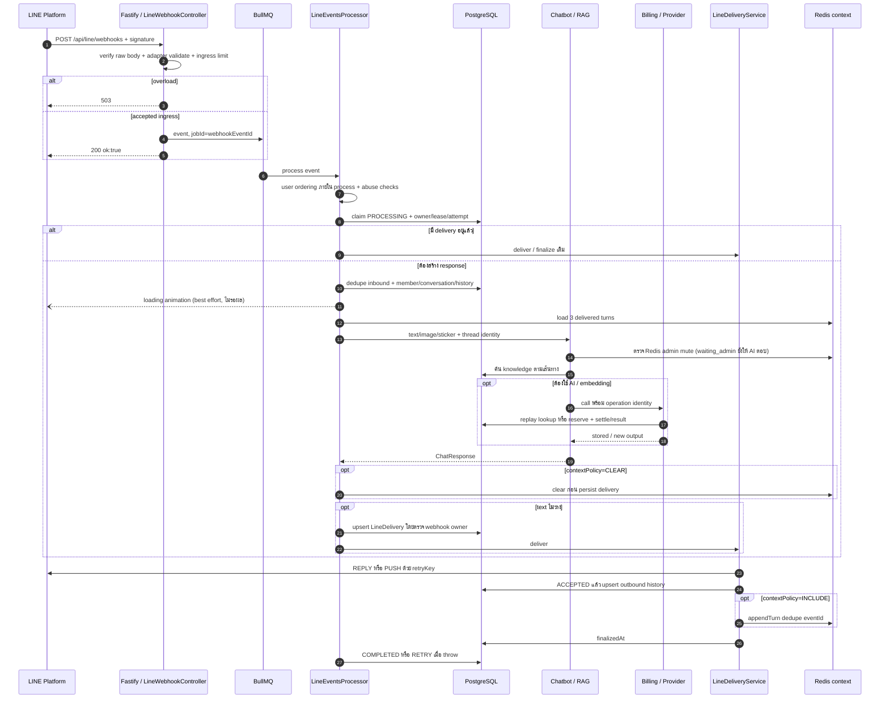
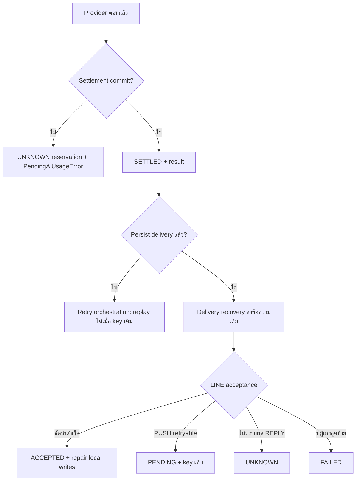

# LINE Message End-to-End — implementation ปัจจุบัน

อัปเดต **8 กันยายน 2026** จาก working tree หลังเพิ่ม durable webhook/delivery, credit reservations และ settled result replay ไฟล์นี้แทน snapshot เดิมเดือนสิงหาคม

อ่าน flow รวม auth/admin/indexing/top-up ที่ [End-to-end ทั้งระบบ](mvp-line-rag-billing-flow.md) และ dependency map ที่ [Service flow](service-flow.md) ไฟล์ architecture.html / line-message-e2e.drawio เป็นภาพประกอบเก่าที่ยังไม่ได้ปรับในงาน Markdown นี้

อัปเดต retrieval follow-up 24 กันยายน 2026: `resolveRetrievalQuery` ใช้ context ที่โหลดไว้สูงสุด 3 turns เพื่อเติมหัวข้อจากข้อความผู้ใช้ล่าสุดให้คำถามอ้างอิง เช่น “โปรโมชั่นส่งฟรีมีไหม” → “อันนี้ใช้ถึงวันไหน” หรือ “สนใจโรงแรมริมทะเล” → “โรงแรมนี้ราคาเท่าไร” หากไม่มีหัวข้อที่ใช้ได้ หรือประวัติคลุมเครือ/มีข้อมูลส่วนตัว จะคืน `MISSING_USER_INFORMATION` ก่อนค้น knowledge แล้ว router ตอบ `CLARIFY` เมื่อผู้ใช้ระบุหัวข้อในข้อความถัดไป ระบบรวมกับคำถามเดิมจาก context เพื่อค้นอีกครั้ง โดยไม่มีการเรียกโมเดลในขั้นวาง query นี้

อัปเดตโครงสร้าง 4 ตุลาคม 2026: worker ยังเรียก `LineWebhookService.processEvent`
แต่ facade ส่งต่อเข้า `MessageProcessorService` ใน `MessagingModule` โดยใช้
`LineChannelAdapter` สำหรับ inbound persistence, แปลง payload/media และ persist/deliver
คำตอบ `ChatbotService`, billing และ delivery state machine เดิมยังใช้งานต่อ
ดู [ขอบเขต adapter และข้อจำกัดปัจจุบัน](messaging-channel-adapters.md)
ภาพด้านล่างแสดง logical flow; ขั้นตอนของ W แบ่งทำงานผ่าน facade/processor/adapter ดังกล่าว

อัปเดต ingress 5 ตุลาคม 2026: `POST /api/line/webhooks` ย้าย handler ไป
`LineWebhookController` และส่งต่อ `LineWebhookAdapter.receive` เพื่อตรวจ payload,
จำกัด ingress และ enqueue ก่อนคืน 200; malformed supported events คืน 400 และ
unsupported types ถูกข้าม `LineController` ดูแล admin routes เดิม worker/claim/
retry/delivery ใช้เส้นทางเดิม ไม่มี external application endpoint ในชุดนี้

อัปเดต catalog foundation 5 ตุลาคม 2026: เพิ่ม [Product/Commerce Phase 1](product-commerce-phase1.md)
แบบ opt-in `PRODUCT_CATALOG_ENABLED` (default false) ตอนนี้มี admin catalog APIs
และ atomic LINE registration identity hook: เมื่อเปิด flag RegistrationFlowService
ใช้ registerForLine เพื่อสร้าง Member และผูก LineMember/Customer/ChannelIdentity
ใน transaction เดียวก่อน clear session; ปิด flag ใช้ register เดิมและไม่อ่าน catalog/customer
สถานะ ณ Phase 1 ยังไม่มี Product RAG; วันที่ 6 ตุลาคม 2026 เพิ่ม [Phase 2–3 Product RAG](product-commerce-phase2-3.md) แบบ opt-in PRODUCT_RAG_ENABLED/PRODUCT_SEMANTIC_ENABLED: single retrieval entry → exact หรือ LLM planner → lexical/vector → live Product/variant/inventory evidence → AiChat fact rendering พร้อม CommerceTurn replay และ LLM สูงสุด 3 calls เฉพาะ critical correction ในครั้งที่ 3 catalogRefs เก็บ IDs ใน context หลัง delivery ACCEPTED ใช้ clear/TTL เดิม ยังไม่มี checkout/payment image intake ข้อความที่ไม่มี product signal และ FAQ ตอบได้มั่นใจจะไม่ผ่าน planner/product search (ดู routing gate ในเอกสาร Phase 2–3)

อัปเดต latency 9 ตุลาคม 2026: หลังบันทึก inbound แล้ว worker เรียก
`LineChannelAdapter.indicateProcessing` แบบไม่รอผล เพื่อเรียก LINE
`POST /v2/bot/chat/loading/start` (แสดงสถานะกำลังพิมพ์) เฉพาะแชต 1:1 ที่เป็น
text/image/sticker/postback และไม่ติด Redis admin mute; LINE ลบ indicator เองเมื่อ
ข้อความถัดไปของบอทมาถึง ไม่นับเป็น message quota ความล้มเหลวถูก log แล้วข้าม
ไม่กระทบ claim/retry/delivery `LINE_LOADING_SECONDS` (5–60 ทีละ 5, default 30,
0 = ปิด) ค่าที่ไม่ถูกต้องทำให้ boot ล้ม พร้อมกันนี้ LLM planner, product answer และ
low-confidence classifier เปลี่ยน `reasoningEffort` จาก `medium` เป็น `low`
(grounded KB answer ยังคง `medium`)

อัปเดตเครดิต 14 ตุลาคม 2026: เมื่อ billing ปฏิเสธการจองเพราะเครดิตไม่พอ
(`InsufficientCreditException` ยอดคงเหลือหลังจองต้องมากกว่า `MIN_AI_BALANCE_CREDIT`
ขั้นต่ำ 20) ทุก AI call ในแชต LINE ได้แก่ embedding ค้น knowledge, classifier,
general/grounded/image answer และ product planner/answer จะไม่ fallback อีก
`ChatbotService` คืนคำตอบว่าง (`SYSTEM`/`EXCLUDE`) จึงไม่มี LineDelivery ไม่ส่งข้อความ
ไม่ `requestAdmin` และไม่เปลี่ยน conversation เป็น `waiting_admin` พร้อม log
`ERROR [ChatbotService] [AiCredit] no reply sent` ระบุ user/conversation/turn และเหตุผล
ข้อความลูกค้ายังบันทึกและเพิ่ม unread ตามปกติ ไม่มี reservation/usage/ledger เกิดขึ้น
และ CommerceLlmCall ไม่ถูกตั้ง `failed` จึงเรียกใหม่ได้เมื่อเติมเครดิต ส่วน error อื่น
(provider, timeout, budget rate limit) คง fallback + handoff เดิม และ log
`… knowledge retrieval failed (<ErrorName>)`

## 1. Request → response sequence



Delivery error ส่วนใหญ่ถูกจัดเป็นสถานะใน delivery service แทน throw กลับ worker ดังนั้น webhook COMPLETED ยังมี delivery PENDING/FAILED/UNKNOWN ได้ Recovery timer ทำงานแยกจาก webhook queue

## 2. Data shapes ที่เชื่อมแต่ละขั้น

| ข้อมูล | Fields สำคัญ | ผู้สร้าง → ผู้ใช้ |
| --- | --- | --- |
| LINE event | webhookEventId, timestamp, source.userId, replyToken, message.id/type/text | LINE → controller/worker |
| processedLineWebhookEvent | event JSON, status, leaseOwner/leaseUntil, attempts, lastError | claim/recovery → worker |
| SavedIncomingEvent | conversationId, lineMemberId | inbound persistence → chatbot/billing |
| LineAiUsageContext | userId, lineMemberId, conversationId, turnId | orchestration → embedding/provider/billing |
| ChatContextMessage | role, text, source, createdAt | Redis load → deterministic query resolution/router/answer |
| KnowledgeRetrievalResult | route, matchType, items, selectedItems, topScores (ranking only), scoreGap, fallbackReason | retrieval → router/answer |
| AiGenerateResponse | text, provider, model, usage, providerRequestId? | provider/billing replay → caller |
| EmbeddingResult | values, model, usage, usageEstimated? | embedding adapter/replay → vector query/write |
| ChatResponse | text, source, contextPolicy | chatbot → durable delivery |
| CreditHold | id, companyId, walletId, budgetId, amountCredit | reserve → settlement |
| CreditReservation.result | kind, value | settlement transaction → replay |
| LineDelivery | key, text, IDs, replyUntil, method, retryKey, status, lease, context, acceptedAt, finalizedAt | webhook/manual API → delivery recovery |
| LineChatHistory | lineMessageId สำหรับ inbound; deliveryId สำหรับ outbound; sender/sentByAdminId/text/sentStatus | inbound/delivery finalization → admin history API |

Token usage มี inputTokens, cachedInputTokens, cacheWriteTokens, outputTokens; AiUsageEvent เก็บ counters เหล่านี้กับ pricingId/costThb/chargedCredit และ actor/thread แต่ยังไม่มี first-class stage/turn linkage ครบทุก call

## 3. Identity และ duplicate protection

```text
LINE event
  webhookEventId ── jobId / processedLineWebhookEvent primary identity
                 └─ LineDelivery.key
                 └─ billing context.turnId
  message.id ─────── LineChatHistory.lineMessageId (unique)

AI generation
  usage:turnId:fingerprint ── CreditReservation.operationKey
                           └─ CreditLedger.idempotencyKey
Embedding
  usage:embed:turnId:hash(task,text) ── reservation / ledger

Outbound
  LineDelivery.id ── LineChatHistory.deliveryId (unique)
  LineDelivery.retryKey ── LINE PUSH retry header
```

AiUsageEvent.id คือหนึ่ง billed call ไม่ใช่หนึ่ง LINE message ลูกค้าอาจได้รับหนึ่งคำตอบที่เสียหลาย calls หรือ exact/template ที่ไม่เสีย AI เลย

Generation hash รวม provider/model/request/context และ responseJsonSchema (เมื่อระบุ) จึงอาจเปลี่ยนเมื่อ retry โหลด history/settings ใหม่ ไม่ใช่ immutable whole-turn plan ส่วน embedding key ไม่รวม model ไม่ควรเปลี่ยน embedding configuration กลางการกู้ turn แล้วคาดว่า replay เป็น vector ของ model ใหม่

OpenRouter generation uses `max_tokens` and retains `response_format: json_schema` with `provider.require_parameters: true` for grounded answers. The adapter omits unsupported `temperature` for OpenAI GPT-5/6 models so strict routing does not exclude all endpoints. SDK retries are disabled; `AiProviderService` owns bounded retries, and permanent 404 failures keep the existing safe fallback.

## 4. Routing และ output policies

Core text flow อัปเดต 13 กันยายน 2026: [implementation และ call-count tests](core-text-reply-refactor.md)

| เงื่อนไข | ผล |
| --- | --- |
| Human-controlled session | ส่ง text ว่าง; inbound ถูกเก็บแต่ไม่สร้าง auto delivery |
| CANCEL ที่รองรับ | clear เฉพาะ registration; ไม่ปลด admin mute หรือ waiting_admin |
| คำถามอ้างอิงที่ไม่มีหัวข้อชัด | retrieval คืน `MISSING_USER_INFORMATION` ก่อนอ่าน knowledge; router เลือก CLARIFY และเก็บ turn ไว้ให้ลูกค้าระบุหัวข้อ |
| Registration ปิด | คืน unavailable; active registration ถูก clear เมื่อพยายามต่อ |
| Exact conflict | handoff ไม่เลือกคำตอบขัดกันแบบสุ่ม |
| Safe approved-question exact, scoped, no conflict | DIRECT stored answer / REWRITE one generation |
| Thai BM25/vector candidates ผ่าน noise floor → RRF ranking | แยก AP/Micro lexical + vector เป็น 3 lists; lexical/hybrid RAG: 1 generation, สูงสุด 3 contexts / 12,000 characters; ไม่เติม unrelated vector-only neighbours |
| Vector-only RAG candidates | classifier ก่อน: GENERAL → general answer, BUSINESS → grounded answer; classifier error/budget → handoff; สูงสุด 2 generation calls |
| คำถามห้องว่าง/สต็อก/ยอดเงิน/สถานะปัจจุบัน | ผ่าน retrieval ตามปกติ; ไม่มี live API หรือ guard ก่อนค้น คำตอบ DIRECT ส่งตามข้อความที่ผู้ดูแลเขียนไว้ ส่วน RAG ถูกกำกับไม่ให้ยืนยันค่าปัจจุบันจาก KB |
| Low confidence | Classifier only; BUSINESS → static handoff (1 call), GENERAL → answerGeneral (2 calls) |
| RAG คืน JSON INSUFFICIENT_CONTEXT หรือ output/หลักฐานอ้างอิงไม่ถูกต้อง | static handoff; ห้ามกลับ classifier |
| ทุก AI fallback รวม provider error, output ผิด, AI rate budget หมด และ image ไม่ปลอดภัย | requestAdmin + waiting_admin + notification เมื่อสถานะเปลี่ยน; SYSTEM/CLEAR; AI/RAG ยังทำงานและ registration คงอยู่ |
| เครดิต wallet ไม่พอ (`InsufficientCreditException`) | ไม่ตอบลูกค้า ไม่ handoff; log `[AiCredit]` พร้อมเหตุผล; ไม่มี provider call หรือ usage |
| Image | โหลด LINE media; billed analysis ตาม image policy; unsafe/invalid → fallback |
| Sticker | semantic intent/template ที่รองรับ; ไม่บังคับ embedding ทุก sticker |
| External image | ข้อความไม่รองรับ; ไม่ส่งภาพนี้ไป AI |

Grounded evidence contract (27 กันยายน 2026): แต่ละ `ragContext` item มี `ref: "SOURCE:ID"` ให้โมเดลคัดลอกไปยัง `evidenceIds`; validator รับ bare ID เพื่อรองรับ output เดิมเฉพาะเมื่อระบุ selected item ได้รายการเดียวเท่านั้น ID นอก selected context, source ผิด, citation ว่าง หรือ bare ID กำกวมยังต้อง fallback/handoff การอ้างอิงที่ถูกต้องไม่ได้รับรองว่าข้อเท็จจริงในคำตอบครบถ้วน ดู [ผลตรวจ audit และ fallback](chatbot-fallback-verification-2026-09-27.md)

Coverage check (30 กันยายน 2026): JSON ของ grounded answer มี `askedAbout` (สิ่งที่ลูกค้าถาม) และ `directlyAnswered` นำหน้า `decision`; ระบบรับ `ANSWER` เฉพาะเมื่อ `directlyAnswered === true` ถ้าหลักฐานพูดถึงเพียงสิ่งทดแทน เช่น ถามร้านอาหารมื้อเย็นแต่มีแค่รูมเซอร์วิส หรือไม่ส่งค่านี้มา จะ fallback + handoff และ log `reason=NOT_DIRECTLY_ANSWERED`

Chatbot ตรวจ human control ใน text/image/sticker แล้ว แต่ LINE image download เกิดใน webhook service ก่อนเข้า chatbot gate จึงอย่าใช้ “หยุด AI” แปลว่าไม่มี HTTP media call เลย

contextPolicy:
- INCLUDE: append หลัง acceptance เก็บ user+assistant เป็นหนึ่ง turn
- EXCLUDE: ส่งคำตอบได้แต่ไม่เพิ่ม AI context
- CLEAR: clear ตอนสร้าง response ก่อน persist delivery ไม่ clear ซ้ำจาก delayed repair

Redis key chat:context:conversationId เก็บ 3 turns, TTL 30 นาที, redaction password/account/phone/email/เลข13หลัก และตัดข้อความสูงสุด 4,000 ตัวอักษร การอ่านไม่ต่อ TTL โหลดล้มคืน []; append ล้มคืน false โดยไม่ throw

## 5. Retry และ recovery ตาม state จริง

| Layer | กลไก | ผลต่อ AI/credit |
| --- | --- | --- |
| Ingress | 503 เมื่อเกิน limit; enqueue ด้วย event ID | ยังไม่มี provider call |
| Main queue | attempts=1, concurrency=10 | retryable error ที่หลุดย้าย retry queue |
| Retry queue | attempts=3, exponential 2s, concurrency=3 | DB claim และ billing identity ยังบังคับ |
| Webhook recovery | scan 15s, lease120s, heartbeat30s, claimสูงสุด5 | มี delivery แล้ว resume ส่ง ไม่ generate |
| Generation provider | default2 attempts, delay300ms, retry budget20s | hold เดียวและ final billed outcome เดียว |
| Billing transaction | P2034 สูงสุด3 attempts | retry SQL ไม่เรียก AI |
| Reservation HELD/UNKNOWN | ไม่ให้ reserve key เดิมอีก | PendingAiUsageError; ต้องรอ/ตรวจ |
| SETTLED มี result | คืน stored value | ไม่มี debit/provider ใหม่ใน billing |
| SETTLED ไม่มี result | block reserve | ไม่ reconstruct output จาก ledger |
| Delivery recovery | scan5s, lease120s | ส่งข้อความเดิม ไม่เรียก AI |
| PUSH | retry keyเดิม, retryable attempts<8, delayสูงสุด60s | ไม่เพิ่ม AI bill |
| REPLY unknown/stale SENDING | UNKNOWN ไม่ push เดาสุ่ม | acceptance ต้องตรวจ |
| ACCEPTED local-write fail | repair history/context | ไม่ resend LINE |

อายุ event >50s ใช้ PUSH; ไม่ใช่ worker drop เงื่อนไขนี้ comment เก่าใน queue constant ไม่ตรงกับการใช้งานปัจจุบัน

## 6. Failure boundaries



ช่องว่างยังมี: provider success ก่อน settlement commit ไม่มี durable recovery payload ครบ, expired reservation ไม่มี auto refund, notification สร้างล้มไม่มี outbox retry, finalize ไม่ตรวจ appendTurn=false, และ ordering ต่อ user ยังอยู่ภายใน process เท่านั้น

## 7. Handoff → admin reply → resume

Customer ขอ staff หรือ business fallback → DB waiting_admin / requireAdmin=true → create adminNotifications → emit ADMIN_NOTIFICATION socket /admin → frontend เปิด conversation จาก metadata.conversationId; ยังไม่ mute และไม่ทับ registration

GET /api/line/conversations และ GET /api/conversations คืนห้อง `waiting_admin` ก่อนห้องสถานะอื่น โดยแต่ละกลุ่มเรียง `lastMessageAt` ล่าสุดก่อน (`updatedAt` และ `id` ใช้ตัดสินเมื่อเวลาเท่ากัน)

Admin ส่งข้อความด้วย clientRequestId → durable PUSH → ก่อนส่งจริงตั้ง Redis chat:control:<lineUserId>=ADMIN, TTL AUTO_MUTE_WHEN_REPLY (default 10m) → เมื่อ LINE accept จะเปลี่ยน waiting_admin เป็น open แบบ atomic กับ delivery ACCEPTED แล้วบันทึก ADMIN history. Push attempt ใหม่ตั้ง TTL ใหม่เต็มระยะ ไม่บวกสะสม; push ที่ยังไม่ accepted จะไม่เปิด waiting_admin. Key หมดอายุจะกลับ AI; POST /api/line/conversations/:conversationId/resume-bot ปลด mute ก่อนเวลา, เปิด conversation และ clear context โดยไม่ลบ registration. Automatic PUSH ไม่ตั้ง mute; queued automatic replies ถูกระงับเมื่อพบ mute.

Notification read state กับ conversation unread/history เป็นคนละข้อมูล อย่าถือว่า mark notification read คือ delivery accepted หรือ customer read receipt

### 7.1 Admin customer-view preview (2026-10-21)

`/api/admin/userview` ให้แอดมินทดสอบแชทในมุมลูกค้าโดยไม่ผ่าน LINE: `POST sessions` → `POST sessions/:sessionId/messages` (`{ clientRequestId, text, postbackData? }`) → `GET`/`DELETE sessions/:sessionId`. แต่ละ turn เรียก `ChatbotService.handleTextMessage` ตัวเดียวกับ LINE และ **ตัดเครดิตจริงจาก company wallet บน scope `*`** เหมือน LINE traffic; ไม่มี webhook, queue, LineDelivery หรือ LineChatHistory

- ลูกค้าจำลองคือ `preview:{adminId}:{sessionId}` (Redis session/context แยกจากลูกค้าจริง, TTL 30 นาที) ไม่ส่ง `conversationId`/`lineMemberId` ดังนั้น usage row ไม่ผูก conversation
- `requestAdmin` ไม่เจอ LineMember จึงไม่เปลี่ยน status และไม่แจ้งเตือนแอดมิน; Product RAG ที่ต้องมี conversation จริงถูก skip และตกไป knowledge path แทน
- `preview: true` ทำให้ ChatbotService ปฏิเสธ registration (ไม่สร้าง member จริง)
- `clientRequestId` replay คำตอบเดิม 10 นาที และเป็นส่วนของ `turnId` ที่ billing ใช้กันตัดซ้ำ; ส่งซ้อนใน session เดียวได้ 409; ต้องมี `AdminMember.aiEnabled`

## 8. หลักฐานและ source

[System E2E](mvp-system-e2e-results-2026-09-07.md): 42/42, PostgreSQL/Redis/BullMQ/Mongo จริง แต่ provider/LINE fixtures ไม่มี live message; unit98/98, audit16/16, build/typecheck ผ่าน ไม่ได้ kill/restart worker จริงเพื่อพิสูจน์ทุก crash window

Source ที่ใช้:
- [LineWebhookService](../src/modules/line/line-webhook.service.ts)
- [LineEventsProcessor](../src/modules/line/line-events.processor.ts)
- [LineDeliveryService](../src/modules/line/line-delivery.service.ts)
- [ChatbotService](../src/modules/chatbot/chatbot.service.ts)
- [UserSessionService](../src/modules/chatbot/user-session.service.ts)
- [LoadContextService](../src/modules/chatbot/context/load-context.service.ts)
- [Schemas](../prisma/schema.prisma)

Routing update 27 กันยายน 2026: เลขเมนู 1/2/3 ใช้ได้เมื่อไม่มี history/active flow หรือหลัง RULE menu แบบเลข; ตัวเลขกลางบทสนทนาเป็นข้อมูลตอบคำถามและ active registration รับเลขตาม flow. Gemini grounded generation เปิด native JSON schema; citation validation ยังบังคับ และ provider อื่นคงใช้ prompt/validator. query และ message/history ถูก redact ก่อนส่ง AI. รายละเอียดและข้อจำกัดอยู่ใน [ผลแก้ fallback](chatbot-fallback-verification-2026-09-27.md).

### Embedding model and pricing (2026-10-02)

The default embedding model is `gemini-embedding-2`; an explicit
`GEMINI_EMBEDDING_MODEL` still takes precedence. Dimensions remain 1536.
Standard text input is USD 0.20 per million tokens, with no output charge,
per [Google's official pricing](https://ai.google.dev/gemini-api/docs/pricing#gemini-embedding-2).
The catalog converts this into THB cost and credits using the configured
exchange rate, active credit exchange rate, and markup. This path does not use
Batch pricing or multimodal input prices. Deleted pricing must be republished;
editing the catalog alone does not restore a database row. Existing active
prices are preserved by default seeding.

When moving from a different embedding model, reindex both answer-pattern and
micro-knowledge vectors before serving retrieval with the new model. Equal
vector dimensions do not make embeddings from different models compatible.

อัปเดต 19 ตุลาคม 2026: `RuleIntentService` ตรวจข้อความเกริ่นสอบถามที่ยังไม่มีหัวข้อด้วย `DETECT_GREET` หลังตัด whitespace เช่น “ขอสอบถามหน่อยครับ” เป็น `GREET` confidence `0.95` รองรับคำทักทายล้วน เช่น “สวัสดี” และ “สวัสดีครับ” ด้วย Router ส่งต่อ `GENERAL_QUESTION` เพื่อเรียก `answerGeneral` ก่อน registration gate โดยไม่ค้น retrieval และไม่ล้าง registration session; ข้อความมีหัวข้อ เช่น “สอบถามห้องว่าง” ไม่เข้า rule นี้

อัปเดต 19 ตุลาคม 2026 (analytics/billing audit): `GET /api/admin/analytics/*` รับ `interval=hour|day|week|month|year`; `week` ตัดเป็นสัปดาห์เริ่มวันจันทร์ตามเวลา Asia/Bangkok (label = วันจันทร์ `YYYY-MM-DD`) ค่าเริ่มต้นคือ 12 สัปดาห์ล่าสุด การสลับโมเดลผ่าน `AiProviderSettingsService.update` (USER/ADMIN) ถูกปฏิเสธด้วย 400 ถ้าโมเดลไม่มี `AiModelPricing` ที่ active และคิดเงินได้ เพราะ billing ปฏิเสธโมเดลที่ไม่มีราคาอยู่แล้ว ธุรกรรม SERIALIZABLE ของ wallet (`CreditService.runSerializable`) retry ได้ 10 ครั้งพร้อม jittered backoff เพื่อรองรับ `LINE_EVENTS_CONCURRENCY` เทิร์นที่จอง/settle บน wallet เดียวพร้อมกัน
